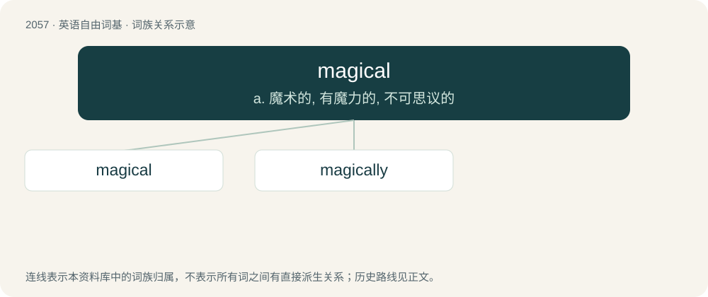

# 2163 · magical — a. 魔术的, 有魔力的, 不可思议的

[总目录](../00_总目录_按常用程度.md)

**类型**：英语自由词基　｜　**来源语言**：见词源记录

## 核心含义与来源

- 核心含义：a. 魔术的, 有魔力的, 不可思议的
- 英文含义：Of, relating to, or by means of magic.
- 词形：magical

**来源记录 1**（形容词；Of, relating to, or by means of magic.）

From magic + -al.

## 词族图

## 单词速览（常用到不常用）

| 单词 | 音标 | 释义 |
|---|---|---|
| [magical](#w-1) | /ˈmæd͡ʒ.ɪ.kəl/ | a. 魔术的, 有魔力的, 不可思议的 |
| [magically](#w-2) | /ˈmæd͡ʒ.ɪ.kli/ | adv. 用魔法地；如魔法般地 |

## 逐词详解

### 1. magical

**词性**：形容词　｜　**音标**：/ˈmæd͡ʒ.ɪ.kəl/

**中文释义**：a. 魔术的, 有魔力的, 不可思议的

**英文义项**：Of, relating to, or by means of magic. / Enchanting.

**构词拆分**：magic + -al

**词源与演化**：

From magic + -al.

**例句**：

> The fireworks created a magical atmosphere in that beautiful summer night.

该用例对应义项：Enchanting.

### 2. magically

**词性**：副词　｜　**音标**：/ˈmæd͡ʒ.ɪ.kli/

**中文释义**：adv. 用魔法地；如魔法般地

**英文义项**：In a magical manner; by magic, or as if by magic.

**构词拆分**：magic + -ally；magical + -ly

**词源与演化**：

From magic + -ally or magical + -ly.

**例句**：

> He wished that a bowl of peanut soup would magically appear before him.
