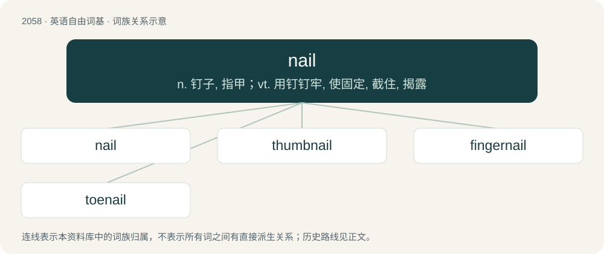

# 2164 · nail — n. 钉子, 指甲；vt. 用钉钉牢, 使固定, 截住, 揭露

[总目录](../00_总目录_按常用程度.md)

**类型**：英语自由词基　｜　**来源语言**：见词源记录

## 核心含义与来源

- 核心含义：n. 钉子, 指甲；vt. 用钉钉牢, 使固定, 截住, 揭露
- 英文含义：The horny plate or appendage at the ends of the digits of various animals, including most reptiles, birds, and mammals (both nonhuman and human).
- 词形：nail

**多个词源／构词路径**：同一拼写可能有不同来源；以下按词性和含义分别列出。

**来源记录 1**（名词；The horny plate or appendage at the ends of the digits of various animals, including most reptiles, birds, and mammals (both nonhuman and human).）

From Middle English nail, nayl, Old English næġl, from Proto-West Germanic \*nagl, from Proto-Germanic \*naglaz, from Proto-Indo-European \*h₃nogʰ- (“nail”). Cognates Compare North Frisian Nail (“nail”), Saterland Frisian Nail (“nail”), West Frisian neil, German and Low German Nagel, Dutch and Swedish nagel, Danish and Norwegian Bokmål negl, Norwegian Nynorsk nagl, Finnish naula (“nail”), Estonian nael (“nail”), (compare Irish ionga, Latin unguis, Albanian nyell (“ankle, hard part of a limb”), Lithuanian nagas, Russian нога́ (nogá, “foot, leg”), но́готь (nógotʹ, “nail”), Ancient Greek ὄνυξ (ónux), Persian ناخن (nâxon), Sanskrit नख (nakhá).

**来源记录 2**（动词；To fix (an object) to another object using a nail.）

From Middle English naylen, from Old English næġlan.

## 词族图

## 单词速览（常用到不常用）

| 单词 | 音标 | 释义 |
|---|---|---|
| [nail](#w-1) | /neɪl/ | n. 钉子, 指甲；vt. 用钉钉牢, 使固定, 截住, 揭露 |
| [thumbnail](#w-2) | /ˈθʌm.neɪl/ | n. 大拇指指甲, 极小之物；a. 极小的, 极短的 |
| [fingernail](#w-3) | 美 /ˈfɪŋɡɚˌneɪl/ | n. 手指甲 |
| [toenail](#w-4) | /ˈtəʊˌneɪl/ | n. 脚趾甲, 斜钉；\[医\] 趾甲 |

## 逐词详解

### 1. nail

**词性**：名词　｜　**音标**：/neɪl/

**中文释义**：n. 钉子, 指甲；vt. 用钉钉牢, 使固定, 截住, 揭露

**英文义项**：The horny plate or appendage at the ends of the digits of various animals, including most reptiles, birds, and mammals (both nonhuman and human). / The thin, flat type of such a plate on the fingers and toes of humans, chimpanzees and some other primates.

**词源与演化**：

From Middle English nail, nayl, Old English næġl, from Proto-West Germanic \*nagl, from Proto-Germanic \*naglaz, from Proto-Indo-European \*h₃nogʰ- (“nail”). Cognates Compare North Frisian Nail (“nail”), Saterland Frisian Nail (“nail”), West Frisian neil, German and Low German Nagel, Dutch and Swedish nagel, Danish and Norwegian Bokmål negl, Norwegian Nynorsk nagl, Finnish naula (“nail”), Estonian nael (“nail”), (compare Irish ionga, Latin unguis, Albanian nyell (“ankle, hard part of a limb”), Lithuanian nagas, Russian нога́ (nogá, “foot, leg”), но́готь (nógotʹ, “nail”), Ancient Greek ὄνυξ (ónux), Persian ناخن (nâxon), Sanskrit नख (nakhá).

**例句**：

> Yesterday my shirt got torn after I caught it on a nail.

该用例对应义项：A spike-shaped metal fastener used for joining wood or similar materials. The nail is generally driven through two or more layers of material by means of impacts from a hammer or other device. It is then held in place by friction.

### 2. thumbnail

**词性**：名词　｜　**音标**：/ˈθʌm.neɪl/

**中文释义**：n. 大拇指指甲, 极小之物；a. 极小的, 极短的

**英文义项**：The fingernail on the thumb. / A rough sketch (e.g., the size of one's thumbnail).

**构词拆分**：thumb + nail

**词源与演化**：

From thumb + nail. Compare West Frisian tommeneil (“thumbnail”), Dutch duimnagel (“thumbnail”), German Daumennagel (“thumbnail”). The phrase thumbnail sketch was first attested 1852. Verb sense attested 1930s.

**例句**：

> Tom clicked on the thumbnail so he could see a larger version of the same image.

### 3. fingernail

**词性**：名词　｜　**音标**：美 /ˈfɪŋɡɚˌneɪl/

**中文释义**：n. 手指甲

**英文义项**：The hard, flat translucent covering near the tip of a human finger, useful for scratching and fine manipulation.

**构词拆分**：finger + nail

**词源与演化**：

From Middle English finger neil(e); equivalent to finger + nail. Compare Middle English nayl of fynger (“fingernail”) and Old English handnæġl (“fingernail”). Compare also Saterland Frisian Fingernail (“fingernail”), West Frisian fingerneil (“fingernail”), Dutch vingernagel (“fingernail”), German Fingernagel (“fingernail”), Danish fingernegl (“fingernail”), Swedish fingernagel (“fingernail”), Norwegian fingernegl (“fingernail”), Icelandic fingurnögl (“fingernail”).

**例句**：

> I always keep a set of fingernail clippers in my guitar case.

### 4. toenail

**词性**：名词　｜　**音标**：/ˈtəʊˌneɪl/

**中文释义**：n. 脚趾甲, 斜钉；\[医\] 趾甲

**英文义项**：The thin, horny, transparent plate covering the upper surface of the end of a toe.

**构词拆分**：toe + nail

**词源与演化**：

From toe + nail.

**用法示例／搭配（非完整句）**：

> toenail clippings

该用例对应义项：The thin, horny, transparent plate covering the upper surface of the end of a toe.
