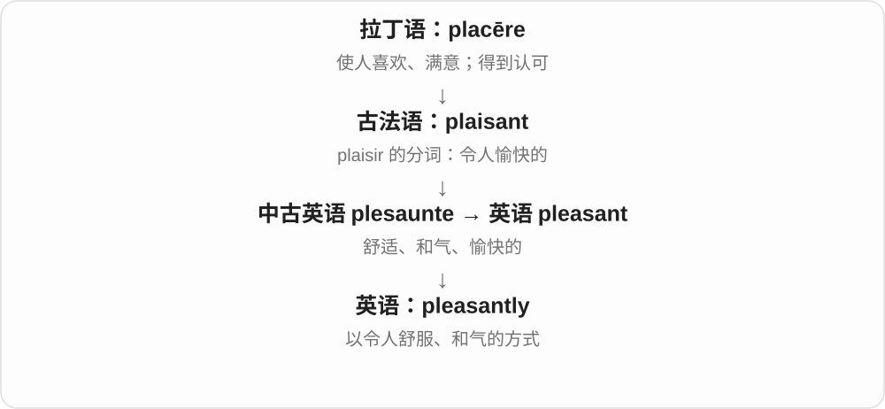
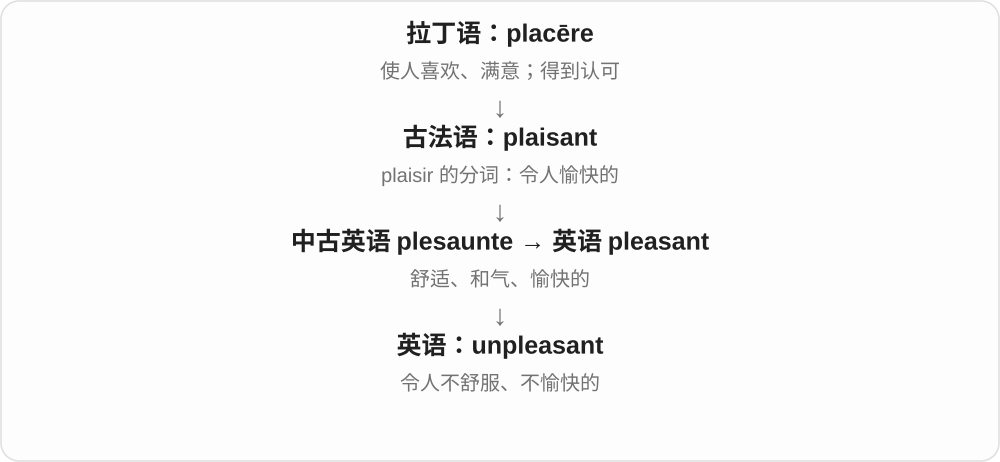

# 2164 · pleasant — 愉快；令人舒适

[逐词精讲目录](../00_逐词精讲目录.md) · [总目录](../00_总目录_按常用程度.md)

## 核心词根与来源

pleasant 经法语愉悦一支传入，联系 please；unpleasant 是否定，pleasantly 是相关副词。各词通过语境描述感受或交往。

**PLEASANT：接触之后让人感觉舒服**

天气不难受，谈话不紧张，声音也悦耳。

- **愉快与否定**：pleasant · unpleasant
- **方式与感受**：pleasantly

## 词形与演化规律

a pleasant person、pleasant weather、pleasantly surprised；un- 否定的是愉快性质。

## 单词速览（按词族由简到繁）

同一基础词的相关扩展放在一起，先读基础形式，再读扩展；各组之间优先读常用的。具体词源关系见各词讲解。

| 单词 | 音标 | 核心意思 |
|---|---|---|
| [pleasant](#w-1) | 英 /ˈplezənt/；美 /ˈplezənt/ | 愉快的；舒适的；和气的 |
| [pleasantly](#w-3) | 英 /ˈplezəntli/；美 /ˈplezəntli/ | 愉快地；和气地；令人舒服地 |
| [unpleasant](#w-2) | 英 /ʌnˈplezənt/；美 /ʌnˈplezənt/ | 令人不快的；难受的；不友善的 |

## 逐词讲解

### 1. pleasant — 愉快的；舒适的；和气的

**音标**：英 /ˈplezənt/；美 /ˈplezənt/

**先抓住这个画面**

天气不折腾人，地方待着舒服，人也好相处，没有让你紧绷的不适。

**怎么拆**

来自古法语 plaisant，是 plaisir 的分词形式；历史上不是先有现代英语 please 再加 -ant。

**怎么变成今天的意思**

a pleasant afternoon 是舒服的一下午；a pleasant person 是和气好相处的人；a pleasant surprise 是令人高兴的意外。

**常见搭配与例句**

pleasant weather；a pleasant surprise；pleasant to talk to。

> We spent a pleasant afternoon by the river.

我们在河边度过了愉快的一下午。

> She was pleasant to everyone, even when the shop was busy.

即使店里很忙，她对每个人也都和和气气。

**别混淆**

pleasant 是让人舒服愉快；pleased 是人已经感到高兴，不能说 I am pleasant 来表示“我很高兴”。

### 2. pleasantly — 愉快地；和气地；令人舒服地

**音标**：英 /ˈplezəntli/；美 /ˈplezəntli/

**先抓住这个画面**

把一种舒服、友善的感觉放进动作或程度里。

**怎么拆**

pleasant + -ly。

**怎么变成今天的意思**

pleasantly surprised 是惊喜；pleasantly warm 是暖得舒服；smile pleasantly 是和气地微笑。

**常见搭配与例句**

pleasantly surprised；pleasantly warm；speak pleasantly。

> We were pleasantly surprised by the quiet garden.

那座安静的花园让我们感到惊喜。

> The room was pleasantly warm when we arrived.

我们到时，房间里暖暖的，很舒服。

**别混淆**

pleasantly warm 不是越热越好，而是热度刚好让人舒服。

### 3. unpleasant — 令人不快的；难受的；不友善的

**音标**：英 /ʌnˈplezənt/；美 /ʌnˈplezənt/

**先抓住这个画面**

让人想躲开、皱眉，或者相处起来感到不舒服。

**怎么拆**

un- 否定 + pleasant。

**怎么变成今天的意思**

可说 unpleasant smell、unpleasant experience、unpleasant person。强度很宽，从不舒服到讨厌都可能。

**常见搭配与例句**

an unpleasant smell；an unpleasant surprise；unpleasant to deal with。

> An unpleasant smell came from the drain.

排水口传来一股难闻的气味。

> The conversation became unpleasant after the accusation.

指责出现后，谈话变得令人不快。

**别混淆**

unpleasant 评价体验让人不舒服；dangerous 说有危险，二者不必同时成立。

## 这一组要分清什么

pleasant 是令人愉快，pleased 是感到满意；pleasant person 不等于此人此刻一定 pleased。

## 串起来练习

We were pleasantly surprised by the pleasant atmosphere.

亲切的气氛让我们感到惊喜。
