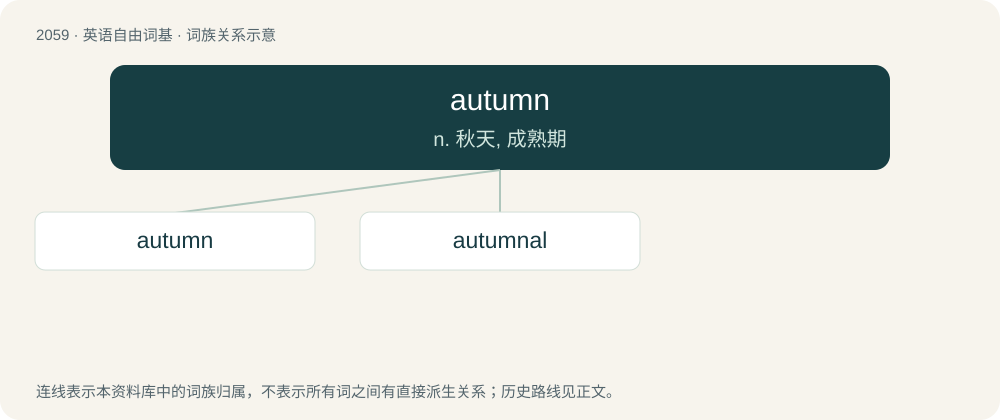

# 2165 · autumn — n. 秋天, 成熟期

[总目录](../00_总目录_按常用程度.md)

**类型**：英语自由词基　｜　**来源语言**：见词源记录

## 核心含义与来源

- 核心含义：n. 秋天, 成熟期
- 英文含义：Traditionally the third of the four seasons, when deciduous trees lose their leaves, and temperatures and daylight hours decrease; typically regarded as spanning the months of September, October, and November in the Northern Hemisphere, and the months of March, April and May in the Southern Hemisphere.
- 词形：autumn

**来源记录 1**（名词；Traditionally the third of the four seasons, when deciduous trees lose their leaves, and temperatures and daylight hours decrease; typically regarded as spanning the months of September, October, and November in the Northern Hemisphere, and the months of March, April and May in the Southern Hemisphere.）

Inherited from Middle English autumpne, from Middle French automne, from Old French automne, autonne, from Latin autumnus. Some of the verbal senses are from Latin autumnāre.

## 词族图

## 单词速览（常用到不常用）

| 单词 | 音标 | 释义 |
|---|---|---|
| [autumn](#w-1) | 英 /ˈɔːtəm/；美 /ˈɔtəm/ | n. 秋天, 成熟期 |
| [autumnal](#w-2) | 英 /ɔːˈtʌm.nəl/；美 /ɑˈtʌm.nəl/ | a. 秋的, 秋天的 |

## 逐词详解

### 1. autumn

**词性**：名词　｜　**音标**：英 /ˈɔːtəm/；美 /ˈɔtəm/

**中文释义**：n. 秋天, 成熟期

**英文义项**：Traditionally the third of the four seasons, when deciduous trees lose their leaves, and temperatures and daylight hours decrease; typically regarded as spanning the months of September, October, and November in the Northern Hemisphere, and the months of March, April and May in the Southern Hemisphere. / The time period when someone or something is past its prime.

**词源与演化**：

Inherited from Middle English autumpne, from Middle French automne, from Old French automne, autonne, from Latin autumnus. Some of the verbal senses are from Latin autumnāre.

**用法示例／搭配（非完整句）**：

> autumn leaves

该用例对应义项：Traditionally the third of the four seasons, when deciduous trees lose their leaves, and temperatures and daylight hours decrease; typically regarded as spanning the months of September, October, and November in the Northern Hemisphere, and the months of March, April and May in the Southern Hemisphere.

### 2. autumnal

**词性**：形容词　｜　**音标**：英 /ɔːˈtʌm.nəl/；美 /ɑˈtʌm.nəl/

**中文释义**：a. 秋的, 秋天的

**英文义项**：Of or relating to autumn. / Past the middle of life; in the third stage.

**构词拆分**：By surface analysis, autumn + -al

**词源与演化**：

Borrowed from Latin autumnāl(is). By surface analysis, autumn + -al.

**例句**：

> In the frigid, autumnal air, icy droplets plummeted to the ground.
