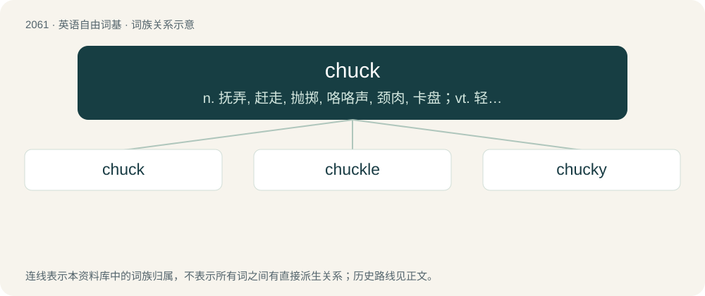

# 2166 · chuck — n. 抚弄, 赶走, 抛掷, 咯咯声, 颈肉, 卡盘；vt. 轻拍, 抛掷, 驱逐, 丢弃, 用卡盘夹住；vi. 咯咯叫

[总目录](../00_总目录_按常用程度.md)

**类型**：英语自由词基　｜　**来源语言**：见词源记录

## 核心含义与来源

- 核心含义：n. 抚弄, 赶走, 抛掷, 咯咯声, 颈肉, 卡盘；vt. 轻拍, 抛掷, 驱逐, 丢弃, 用卡盘夹住；vi. 咯咯叫
- 英文含义：Meat from the shoulder of a cow or other animal.
- 词形：chuck

**多个词源／构词路径**：同一拼写可能有不同来源；以下按词性和含义分别列出。

**来源记录 1**（名词；Meat from the shoulder of a cow or other animal.）

Variant of chock.

**来源记录 2**（名词；A clucking sound.）

From Middle English chuk, of onomatopoeic origin, imitative of a hen's cluck.

**来源记录 3**（动词；To make a clucking sound.）

From Middle English chukken, from the noun (see above).

**来源记录 4**（名词；A gentle touch or tap.）

From earlier chock, likely imitative, but perhaps also from Middle English chokken (“to thrust, pierce, cram”), from Picard Old French chuquier (“to collide, strike”, intransitive verb), from Middle Dutch schocken (“to bump, shake”). Doublet of shock and shuck.

**来源记录 5**（名词；A small pebble.）

From chuck (“to toss”).

**来源记录 6**（名词；A pair of nunchaku, especially when using two.）

Clipping of nunchuck, variant of nunchaku.

## 词族图

## 单词速览（常用到不常用）

| 单词 | 音标 | 释义 |
|---|---|---|
| [chuck](#w-1) | /t͡ʃʌk/ | n. 抚弄, 赶走, 抛掷, 咯咯声, 颈肉, 卡盘；vt. 轻拍, 抛掷, 驱逐, 丢弃, 用卡盘夹住；vi. 咯咯叫 |
| [chuckle](#w-2) | /ˈt͡ʃʌkəl/ | n. 咯咯的笑声, 轻笑；vi. 咯咯的笑, 咕咕叫 |
| [chucky](#w-3) | /ˈt͡ʃʌki/ | \[英方\]小鸡 |

## 逐词详解

### 1. chuck

**词性**：名词　｜　**音标**：/t͡ʃʌk/

**中文释义**：n. 抚弄, 赶走, 抛掷, 咯咯声, 颈肉, 卡盘；vt. 轻拍, 抛掷, 驱逐, 丢弃, 用卡盘夹住；vi. 咯咯叫

**英文义项**：Meat from the shoulder of a cow or other animal. / Food.

**词源与演化**：

Variant of chock.

**例句**：

> Chuck Norris can win a game of Connect Four in three moves.

### 2. chuckle

**词性**：动词　｜　**音标**：/ˈt͡ʃʌkəl/

**中文释义**：n. 咯咯的笑声, 轻笑；vi. 咯咯的笑, 咕咕叫

**英文义项**：To laugh quietly or inwardly. / To communicate through chuckling.

**构词拆分**：From chuck (“laugh”) + -le.

**词源与演化**：

From chuck (“laugh”) + -le.

**例句**：

> I couldn't help but let out a chuckle at Tom's cheesy joke.

### 3. chucky

**词性**：名词　｜　**音标**：/ˈt͡ʃʌki/

**中文释义**：\[英方\]小鸡

**英文义项**：chicken

**构词拆分**：chuck (“chicken”) + -y

**词源与演化**：

From chuck (“chicken”) + -y.

**例句**：

> I'm a boy. My name's Chucky.
