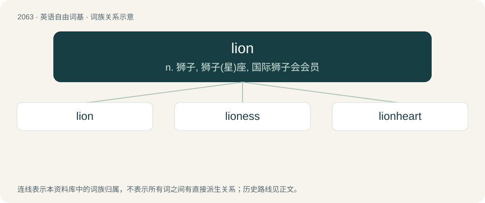

# 2167 · lion — n. 狮子, 狮子(星)座, 国际狮子会会员

[总目录](../00_总目录_按常用程度.md)

**类型**：英语自由词基　｜　**来源语言**：见词源记录

## 核心含义与来源

- 核心含义：n. 狮子, 狮子(星)座, 国际狮子会会员
- 英文含义：A big cat, Panthera leo, native to Africa, India and formerly much of Europe.
- 词形：lion

**来源记录 1**（名词；A big cat, Panthera leo, native to Africa, India and formerly much of Europe.）

From Middle English lyoun, lion, leon, borrowed from Old French lion, from Latin leō, (accusative: leōnem), from Ancient Greek λέων (léōn), of unclear origin. Doublet of Leo, leu, lev, and Lyon. Displaced Old English lēo, from the same Latin source.

## 词族图

## 单词速览（常用到不常用）

| 单词 | 音标 | 释义 |
|---|---|---|
| [lion](#w-1) | /ˈlaɪən/ | n. 狮子, 狮子(星)座, 国际狮子会会员 |
| [lioness](#w-2) | /ˈlaɪ.ə.nɪs/ | n. 雌狮 |
| [lionheart](#w-3) |  | n. 勇士 |

## 逐词详解

### 1. lion

**词性**：名词　｜　**音标**：/ˈlaɪən/

**中文释义**：n. 狮子, 狮子(星)座, 国际狮子会会员

**英文义项**：A big cat, Panthera leo, native to Africa, India and formerly much of Europe. / A male lion, as opposed to a lioness, which is characterized by having a flowing shaggy mane and taking little part in hunting, which can be done cooperatively.

**词源与演化**：

From Middle English lyoun, lion, leon, borrowed from Old French lion, from Latin leō, (accusative: leōnem), from Ancient Greek λέων (léōn), of unclear origin. Doublet of Leo, leu, lev, and Lyon. Displaced Old English lēo, from the same Latin source.

**例句**：

> Tigers and lions share a common ancestor from a few million years ago.

该用例对应义项：A big cat, Panthera leo, native to Africa, India and formerly much of Europe.

### 2. lioness

**词性**：名词　｜　**音标**：/ˈlaɪ.ə.nɪs/

**中文释义**：n. 雌狮

**英文义项**：A female lion (animal). / A female lion (famous person regarded with interest and curiosity).

**构词拆分**：lion + -ess

**词源与演化**：

From Middle English leonesse, lyonesse, from Old French leonesse, lionesse; equivalent to lion + -ess.

**例句**：

> The giraffe spread its legs and swung its neck at the lioness.

### 3. lionheart

**词性**：名词

**中文释义**：n. 勇士

**英文义项**：A brave, heroic person.

**构词拆分**：lion + heart

**词源与演化**：

From lion + heart, perhaps from Richard the Lionheart.

**例句**：

> Fishblood Tom was the son of Lionheart John and Harelip Mary.
