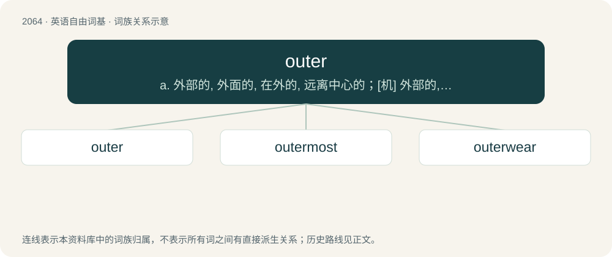

# 2168 · outer — a. 外部的, 外面的, 在外的, 远离中心的；\[机\] 外部的, 外面的, 外侧的

[总目录](../00_总目录_按常用程度.md)

**类型**：英语自由词基　｜　**来源语言**：见词源记录

## 核心含义与来源

- 核心含义：a. 外部的, 外面的, 在外的, 远离中心的；\[机\] 外部的, 外面的, 外侧的
- 英文含义：Outside; external.
- 词形：outer

**多个词源／构词路径**：同一拼写可能有不同来源；以下按词性和含义分别列出。

**来源记录 1**（形容词；Outside; external.）

From Middle English outre, outer, outter, uttre, from Old English ūtre, ūtera, ūterra (“outer”), equivalent to out + -er. Compare German äußere (“outer”), Danish ydre (“outer”), Swedish yttre (“outer”), Icelandic ytri (“outer”). Piecewise doublet of utter.

**来源记录 2**（名词；Someone who admits to something publicly.）

out (verb) + -er (“agent suffix”)

## 词族图

## 单词速览（常用到不常用）

| 单词 | 音标 | 释义 |
|---|---|---|
| [outer](#w-1) | 英 /ˈaʊtə/；美 /ˈaʊtɚ/ | a. 外部的, 外面的, 在外的, 远离中心的；\[机\] 外部的, 外面的, 外侧的 |
| [outermost](#w-2) | 美 /ˈaʊtɚmoʊst/ | a. 最外面的, 最远离中心的 |
| [outerwear](#w-3) | /ˈajtəweə(r)/ | n. 外衣, 外套 |

## 逐词详解

### 1. outer

**词性**：名词　｜　**音标**：英 /ˈaʊtə/；美 /ˈaʊtɚ/

**中文释义**：a. 外部的, 外面的, 在外的, 远离中心的；\[机\] 外部的, 外面的, 外侧的

**英文义项**：An outer part. / An uncovered section of the seating at a stadium or sportsground.

**构词拆分**：out + -er

**词源与演化**：

From Middle English outre, outer, outter, uttre, from Old English ūtre, ūtera, ūterra (“outer”), equivalent to out + -er. Compare German äußere (“outer”), Danish ydre (“outer”), Swedish yttre (“outer”), Icelandic ytri (“outer”). Piecewise doublet of utter.

**例句**：

> We ordered two cartons with twelve outers in each.

该用例对应义项：The smallest single unit sold by wholesalers to retailers, usually one retail display box.

### 2. outermost

**词性**：名词　｜　**音标**：美 /ˈaʊtɚmoʊst/

**中文释义**：a. 最外面的, 最远离中心的

**英文义项**：That which is outermost.

**构词拆分**：outer + -most

**词源与演化**：

From Middle English uttermost, uttirmest, uttermast, outemast, alteration (due to Middle English outre (“outer”)) of Old English ūtemest, ȳtemest (“outermost”), equivalent to outer + -most. Doublet of uttermost.

**例句**：

> The Sun's corona is the outermost part of the Sun's atmosphere.

### 3. outerwear

**词性**：名词　｜　**音标**：/ˈajtəweə(r)/

**中文释义**：n. 外衣, 外套

**英文义项**：Clothing (such as a dress) worn over one's underwear. / Clothing (such as a raincoat) worn over one's clothes when outdoors.

**构词拆分**：outer + -wear

**词源与演化**：

From outer + -wear.

**例句**：

> Please refrain from blocking unoccupied seats with baggage or outerwear, so that passengers boarding may take the seats.
