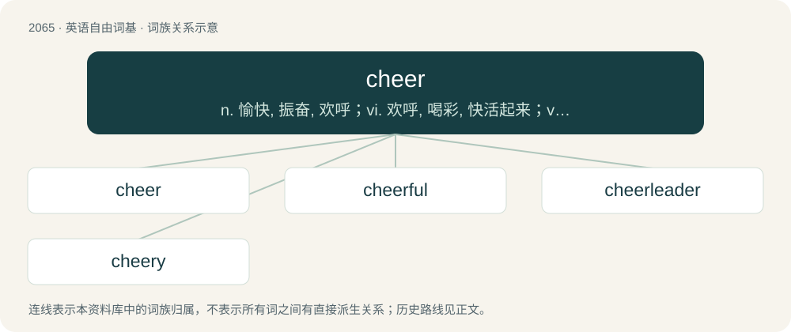

# 2169 · cheer — n. 愉快, 振奋, 欢呼；vi. 欢呼, 喝彩, 快活起来；vt. 使振奋, 欢呼

[总目录](../00_总目录_按常用程度.md)

**类型**：英语自由词基　｜　**来源语言**：见词源记录

## 核心含义与来源

- 核心含义：n. 愉快, 振奋, 欢呼；vi. 欢呼, 喝彩, 快活起来；vt. 使振奋, 欢呼
- 英文含义：A cheerful attitude; happiness; a good, happy, or positive mood.
- 词形：cheer

**多个词源／构词路径**：同一拼写可能有不同来源；以下按词性和含义分别列出。

**来源记录 1**（名词；A cheerful attitude; happiness; a good, happy, or positive mood.）

From Middle English chere, from Anglo-Norman chere, from Old French chiere (“head, face; appearance; reception, hospitality; meal, dinner, food”) (Modern French chère), from Late Latin cara (“head”).

**来源记录 2**（名词；Cheerleading, especially when practiced as a competitive sport.）

Clipping of cheerleading.

## 词族图

## 单词速览（常用到不常用）

| 单词 | 音标 | 释义 |
|---|---|---|
| [cheer](#w-1) | 英 /t͡ʃɪə/；美 /t͡ʃɪɹ/ | n. 愉快, 振奋, 欢呼；vi. 欢呼, 喝彩, 快活起来；vt. 使振奋, 欢呼 |
| [cheerful](#w-2) | 英 /ˈt͡ʃɪəfl̩/；美 /ˈt͡ʃɪɹfl̩/ | a. 快活的, 高兴的, 兴高采烈的 |
| [cheerleader](#w-3) | /ˈtʃɪə(ɹ)ˌliːdə(ɹ)/ | n. 啦啦队长 |
| [cheery](#w-4) | 英 /ˈt͡ʃɪəɹi/；美 /ˈt͡ʃɪɚi/ | a. 愉快的 |

## 逐词详解

### 1. cheer

**词性**：名词　｜　**音标**：英 /t͡ʃɪə/；美 /t͡ʃɪɹ/

**中文释义**：n. 愉快, 振奋, 欢呼；vi. 欢呼, 喝彩, 快活起来；vt. 使振奋, 欢呼

**英文义项**：A cheerful attitude; happiness; a good, happy, or positive mood. / That which promotes good spirits or cheerfulness, especially food and entertainment prepared for a festive occasion.

**词源与演化**：

From Middle English chere, from Anglo-Norman chere, from Old French chiere (“head, face; appearance; reception, hospitality; meal, dinner, food”) (Modern French chère), from Late Latin cara (“head”).

**例句**：

> Three cheers for the birthday boy!

该用例对应义项：A cry expressing joy, approval or support, such as "hurrah".

### 2. cheerful

**词性**：形容词　｜　**音标**：英 /ˈt͡ʃɪəfl̩/；美 /ˈt͡ʃɪɹfl̩/

**中文释义**：a. 快活的, 高兴的, 兴高采烈的

**英文义项**：Noticeably happy and optimistic. / Bright and pleasant.

**构词拆分**：cheer + -ful

**词源与演化**：

From Middle English chereful, cherful, equivalent to cheer + -ful.

**例句**：

> They enjoyed a cheerful room.

该用例对应义项：Bright and pleasant.

### 3. cheerleader

**词性**：名词　｜　**音标**：/ˈtʃɪə(ɹ)ˌliːdə(ɹ)/

**中文释义**：n. 啦啦队长

**英文义项**：A person, usually a young, attractive female, who encourages applause and cheers at a sports event, and wearing a specially-designed uniform in the official colors of the team he/she cheers for. / A person who rallies support for any cause.

**构词拆分**：cheer + leader

**词源与演化**：

From cheer + leader.

**例句**：

> Do you think Mary is too fat to be a cheerleader?

### 4. cheery

**词性**：形容词　｜　**音标**：英 /ˈt͡ʃɪəɹi/；美 /ˈt͡ʃɪɚi/

**中文释义**：a. 愉快的

**英文义项**：In a good mood, happy, cheerful.

**构词拆分**：cheer + -y

**词源与演化**：

From Middle English cheri, equivalent to cheer + -y.

**例句**：

> Mary put on a cheery smile.
