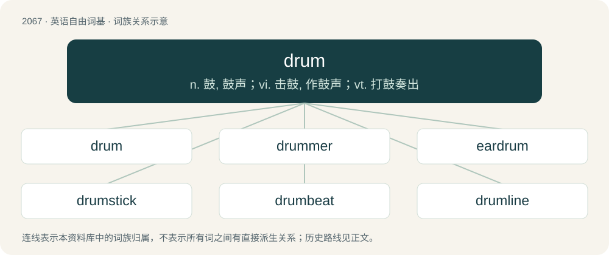

# 2171 · drum — n. 鼓, 鼓声；vi. 击鼓, 作鼓声；vt. 打鼓奏出

[总目录](../00_总目录_按常用程度.md)

**类型**：英语自由词基　｜　**来源语言**：见词源记录

## 核心含义与来源

- 核心含义：n. 鼓, 鼓声；vi. 击鼓, 作鼓声；vt. 打鼓奏出
- 英文含义：A percussive musical instrument spanned with a thin covering on at least one end for striking, forming an acoustic chamber; a membranophone.
- 词形：drum

**多个词源／构词路径**：同一拼写可能有不同来源；以下按词性和含义分别列出。

**来源记录 1**（名词；A percussive musical instrument spanned with a thin covering on at least one end for striking, forming an acoustic chamber; a membranophone.）

Perhaps back-formation from drumslade (“drummer”), from Middle Dutch trommelslach (“drumbeat”), from trommel (“drum”) + slach (“beat”) (Dutch slag). Or perhaps borrowed directly from a continental Germanic language; compare Middle Dutch tromme (“drum”), Middle Low German trumme (“drum”) et al. Compare also Middle High German trumme, trumbe (“drum”), Old High German trumba (“trumpet”). Compare Ancient Greek τῠ́μπᾰνον (tŭ́mpănon, “kettledrum”) whence Modern English timbre.

**来源记录 2**（名词；A person's home; a house or other building, especially when insalubrious; a tavern, a brothel.）

Unknown.

**来源记录 3**（名词；A drumstick (of chicken, turkey, etc).）

Shortening.

## 词族图

## 单词速览（常用到不常用）

| 单词 | 音标 | 释义 |
|---|---|---|
| [drum](#w-1) | /ˈdɹʌm/ | n. 鼓, 鼓声；vi. 击鼓, 作鼓声；vt. 打鼓奏出 |
| [drummer](#w-2) | 英 /ˈdɹʌmə(ɹ)/；美 /ˈdɹʌmɚ/ | n. 鼓手, 旅行推销员；\[经\] 跑街, 旅行商人, 旅行销货人 |
| [eardrum](#w-3) | 英 /ˈɪəˌdɹʌm/；美 /ˈiɚˌdɹʌm/ | n. 中耳, 鼓膜；\[医\] 鼓室 |
| [drumstick](#w-4) | /ˈdɹʌmˌstɪk/ | n. 鼓槌, 鸡腿下段 |
| [drumbeat](#w-5) | /ˈdrʌmbiːt/ | n. 鼓声 |
| [drumline](#w-6) |  | 【英文】A group of percussionists in a marching band, consisting of the battery and front ensemble. |

## 逐词详解

### 1. drum

**词性**：名词　｜　**音标**：/ˈdɹʌm/

**中文释义**：n. 鼓, 鼓声；vi. 击鼓, 作鼓声；vt. 打鼓奏出

**英文义项**：A percussive musical instrument spanned with a thin covering on at least one end for striking, forming an acoustic chamber; a membranophone. / Any similar hollow, cylindrical object.

**词源与演化**：

Perhaps back-formation from drumslade (“drummer”), from Middle Dutch trommelslach (“drumbeat”), from trommel (“drum”) + slach (“beat”) (Dutch slag). Or perhaps borrowed directly from a continental Germanic language; compare Middle Dutch tromme (“drum”), Middle Low German trumme (“drum”) et al. Compare also Middle High German trumme, trumbe (“drum”), Old High German trumba (“trumpet”). Compare Ancient Greek τῠ́μπᾰνον (tŭ́mpănon, “kettledrum”) whence Modern English timbre.

**例句**：

> He's playing the piano and she's playing the drums!

该用例对应义项：A percussive musical instrument spanned with a thin covering on at least one end for striking, forming an acoustic chamber; a membranophone.

### 2. drummer

**词性**：名词　｜　**音标**：英 /ˈdɹʌmə(ɹ)/；美 /ˈdɹʌmɚ/

**中文释义**：n. 鼓手, 旅行推销员；\[经\] 跑街, 旅行商人, 旅行销货人

**英文义项**：One who plays the drums. / A drumstick (the lower part of a chicken or turkey leg).

**构词拆分**：drum + -er (occupational suffix)

**词源与演化**：

From drum + -er (occupational suffix) or + -er (relational noun suffix).

**例句**：

> Kate is the lead guitarist, Luna is the drummer, and Izzy is the bass guitarist.

该用例对应义项：One who plays the drums.

### 3. eardrum

**词性**：名词　｜　**音标**：英 /ˈɪəˌdɹʌm/；美 /ˈiɚˌdɹʌm/

**中文释义**：n. 中耳, 鼓膜；\[医\] 鼓室

**英文义项**：A thin membrane that separates the outer ear from the middle ear and transmits sound from the air to the malleus.

**构词拆分**：ear + drum

**词源与演化**：

From ear + drum.

**例句**：

> Is it safe to fly with a perforated eardrum?

### 4. drumstick

**词性**：名词　｜　**音标**：/ˈdɹʌmˌstɪk/

**中文释义**：n. 鼓槌, 鸡腿下段

**英文义项**：A stick used to play drums. / The second joint of the legbone of a chicken or other fowl, especially as an item of food.

**构词拆分**：drum + stick

**词源与演化**：

From drum + stick.

**例句**：

> Tom put down his fork and picked up the drumstick with his fingers.

### 5. drumbeat

**词性**：名词　｜　**音标**：/ˈdrʌmbiːt/

**中文释义**：n. 鼓声

**英文义项**：The beating of a drum. / The sound of a beating drum.

**构词拆分**：drum + beat

**词源与演化**：

From drum + beat.

**例句**：

> This music has a groovy drumbeat that makes me dance!

该用例对应义项：A repetitive beating sound.

### 6. drumline

**词性**：名词

**英文义项**：A group of percussionists in a marching band, consisting of the battery and front ensemble.

**构词拆分**：drum + line

**词源与演化**：

From drum + line.
