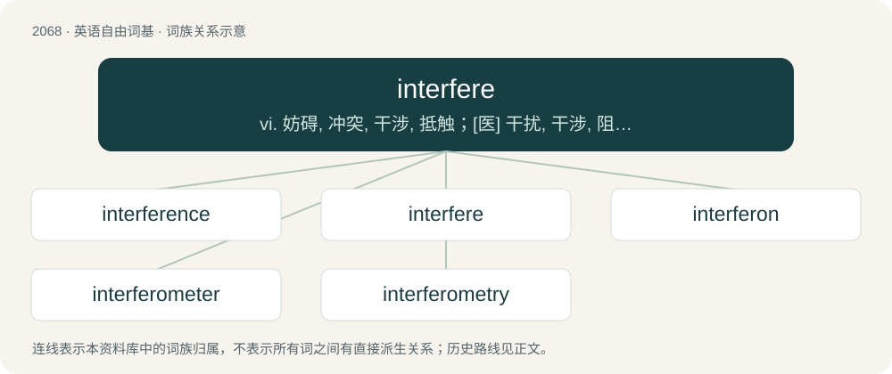

# 2172 · interfere — vi. 妨碍, 冲突, 干涉, 抵触；\[医\] 干扰, 干涉, 阻碍, 碰腿(马)

[总目录](../00_总目录_按常用程度.md)

**类型**：英语自由词基　｜　**来源语言**：见词源记录

## 核心含义与来源

- 核心含义：vi. 妨碍, 冲突, 干涉, 抵触；\[医\] 干扰, 干涉, 阻碍, 碰腿(马)
- 英文含义：To get involved or involve oneself, causing disturbance.
- 词形：interfere

**来源记录 1**（动词；To get involved or involve oneself, causing disturbance.）

From Old French entreferir, from entre- + ferir (“to hit, to strike”), itself from the Latin verb ferio.

## 词族图

## 单词速览（常用到不常用）

| 单词 | 音标 | 释义 |
|---|---|---|
| [interference](#w-1) | 英 /ˌɪntə(ɹ)ˈfɪəɹəns/；美 /ˌɪntəɹˈfɪɹɪns/ | n. 冲突, 干涉；\[计\] 干扰 |
| [interfere](#w-2) | 英 /ˌɪn.təˈfɪə(ɹ)/；美 /ˌɪn.tɚˈfɪɚ/ | vi. 妨碍, 冲突, 干涉, 抵触；\[医\] 干扰, 干涉, 阻碍, 碰腿(马) |
| [interferon](#w-3) | 英 /ˌɪn.təˈfɪːˌɒn/；美 /ˌɪn.təɹˈfɪɹˌɑn/ | n. 干扰素；\[化\] 干扰素 |
| [interferometer](#w-4) | /.intəfəˈrɒmitə/ | n. 干涉仪；\[化\] 干涉仪 |
| [interferometry](#w-5) | 英 /ˌɪn.tə.fəˈɹɒ.mɪ.tɹi/；美 /ˌɪn.(t)ɚ.fəˈɹɑ.mɪ.tɹi/ | n .干涉测量(法) |

## 逐词详解

### 1. interference

**词性**：名词　｜　**音标**：英 /ˌɪntə(ɹ)ˈfɪəɹəns/；美 /ˌɪntəɹˈfɪɹɪns/

**中文释义**：n. 冲突, 干涉；\[计\] 干扰

**英文义项**：The act of interfering with something, or something that interferes. / The illegal obstruction of an opponent in some ball games.

**构词拆分**：interfere + -ence

**词源与演化**：

From interfere + -ence. The sense in physics was likely introduced by English polymath Thomas Young, which he used as early as 1801 in a paper in the Philosophical Transactions of the Royal Society.

**例句**：

> They were glued to the TV, as the referee called out a fifteen yard penalty for interference.

该用例对应义项：The illegal obstruction of an opponent in some ball games.

### 2. interfere

**词性**：动词　｜　**音标**：英 /ˌɪn.təˈfɪə(ɹ)/；美 /ˌɪn.tɚˈfɪɚ/

**中文释义**：vi. 妨碍, 冲突, 干涉, 抵触；\[医\] 干扰, 干涉, 阻碍, 碰腿(马)

**英文义项**：To get involved or involve oneself, causing disturbance. / Of waves, to be correlated with each other when overlapped or superposed.

**词源与演化**：

From Old French entreferir, from entre- + ferir (“to hit, to strike”), itself from the Latin verb ferio.

**例句**：

> Where the radio-wave signals of the two radio stations interfere the listener hears nothing but noise.

该用例对应义项：Of waves, to be correlated with each other when overlapped or superposed.

### 3. interferon

**词性**：名词　｜　**音标**：英 /ˌɪn.təˈfɪːˌɒn/；美 /ˌɪn.təɹˈfɪɹˌɑn/

**中文释义**：n. 干扰素；\[化\] 干扰素

**英文义项**：Any of a group of glycoproteins, produced by the immune system, that prevent viral replication in infected cells.

**构词拆分**：interfere + -on (suffix: chemical compound)

**词源与演化**：

From interfere + -on (suffix: chemical compound), from its role interfering with viral replication.

### 4. interferometer

**词性**：名词　｜　**音标**：/.intəfəˈrɒmitə/

**中文释义**：n. 干涉仪；\[化\] 干涉仪

**英文义项**：Any of several instruments that use the interference of waves to determine wavelengths and wave velocities, determine refractive indices, measure small distances, temperature changes, stresses, and many other useful measurements.

**构词拆分**：interfere + -o- + -meter

**词源与演化**：

From interfer(e) + -o- + -meter.

**例句**：

> The Laser Interferometer Space Antenna (LISA) is a space mission that will be able to detect gravitational waves.

### 5. interferometry

**词性**：名词　｜　**音标**：英 /ˌɪn.tə.fəˈɹɒ.mɪ.tɹi/；美 /ˌɪn.(t)ɚ.fəˈɹɑ.mɪ.tɹi/

**中文释义**：n .干涉测量(法)

**英文义项**：The design and use of optical or radio interferometers.

**构词拆分**：interfere + -o- + -metry

**词源与演化**：

From interfere + -o- + -metry.
