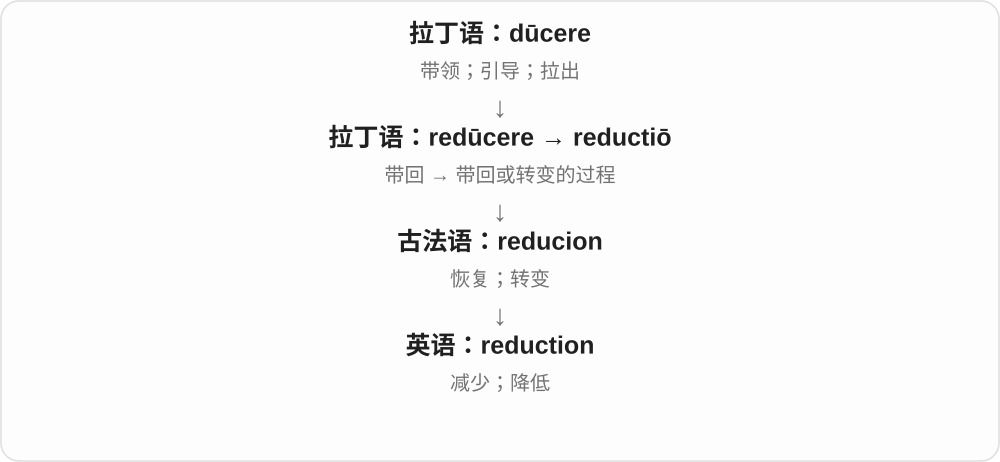

# 2172 · reduction — 归到更基本层次的解释及相应立场

[逐词精讲目录](../00_逐词精讲目录.md) · [总目录](../00_总目录_按常用程度.md)

## 核心词根与来源

一方面是研究部件如何造成整体，另一方面是是否认为这就穷尽整体。两种说法强弱不同，不能一见还原论就只背成错误简化。

**REDUCTION：这里不是只减数量，还可把解释带回基础**

reduction → reductionism 方法或立场 → reductionist 人或相关性质。

- **过程、方法与立场**：reduction · reductionism · reductionist

## 词形与演化规律

redūcere → reductiō → reduction；接 -ism、-ist。

## 单词速览（按词族由简到繁）

同一基础词的相关扩展放在一起，先读基础形式，再读扩展；各组之间优先读常用的。具体词源关系见各词讲解。

| 单词 | 音标 | 核心意思 |
|---|---|---|
| [reduction](#w-1) | /rɪˈdʌkʃən/ | 减少；降低；缩减的量 |
| [reductionism](#w-3) | /rɪˈdʌkʃənɪzəm/ | 还原论、还原主义；把复杂问题归结为简单因素的做法 |
| [reductionist](#w-2) | /rɪˈdʌkʃənɪst/ | 还原论者；还原论的；把解释过度简化的 |

## 逐词讲解

### 1. reduction — 减少；降低；缩减的量

**音标**：/rɪˈdʌkʃən/

**先抓住这个画面**

reduction 是“降下来”这件事或降下来的那部分。原价一百，现在八十，少掉的二十就是价格 reduction 的体现。

**怎么拆**

来自拉丁语 reductiō，经法语传入；与 reduce 同族，使用 reduct- 词干。

**怎么变成今天的意思**

一般语境谈数量变少；化学中的 reduction“还原”是专门术语，不能机械理解为物质数量减少。

**常见搭配与例句**

a reduction in costs（成本下降）；a price reduction（降价）；a reduction of ten percent（降低百分之十）。

> The changes led to a reduction in waste.

这些变化减少了浪费。

> The store announced a ten percent reduction in prices.

商店宣布降价百分之十。

**别混淆**

reduction 表示下降，不说明必然降到零。reduction in 之后常放下降的项目；of 之后常放下降幅度。

### 2. reductionism — 还原论、还原主义；把复杂问题归结为简单因素的做法

**音标**：/rɪˈdʌkʃənɪzəm/

**先抓住这个画面**

想理解一台钟，先研究齿轮怎么运作。这种从较基本部分解释整体的路数能有用；争议在于是否认为只靠这些部分就已经解释完全部。

**怎么拆**

reduction + -ism。这里 reduction 是归到更基本层次的专门义，不只是商店减价；哲学中存在不同强度、类型的还原主张。

**怎么变成今天的意思**

**拉丁 re- + dūcere → redūcere / reductiō**  
带回、归回；相应转变过程

↓

**英语 reduction 的专门扩展**  
把复杂现象归到更基本的组成、原理或解释

↓

**reduction + -ism / -ist**  
相应方法、立场；持这种立场的人或相关性质

scientific reductionism 科学还原论，biological reductionism 生物还原论，criticise reductionism 批评把事情解释得过于单一。

**常见搭配与例句**

scientific reductionism；biological reductionism；criticise reductionism。

> The seminar examined reductionism in the study of complex systems.

研讨课讨论了复杂系统研究中的还原论。

> She criticised the reductionism of explaining every decision in terms of money.

她批评了把每个决定都只归因于金钱的解释方式。

**别混淆**

reductionism 不等于只要分析部件就一定错。日常批评常说解释得太窄，严谨讨论则需问究竟主张哪些东西能还原到什么层次。

### 3. reductionist — 还原论者；还原论的；把解释过度简化的

**音标**：/rɪˈdʌkʃənɪst/

**先抓住这个画面**

说人时是这种解释路线的支持者，说 explanation 时是在评这套解释。可能中性讨论一种方法，也可能批评只抓一个因素就当全部。

**怎么拆**

reduction + -ist，既可作人称名词，也可作相关形容词；与 reductionism 同族，不能只凭 -ist 就要求后面一定站着一个人。

**怎么变成今天的意思**

**拉丁 re- + dūcere → redūcere / reductiō**  
带回、归回；相应转变过程

↓

**英语 reduction 的专门扩展**  
把复杂现象归到更基本的组成、原理或解释

↓

**reduction + -ist → reductionist**  
主张相应还原立场的人；相关解释方法的

a reductionist account 还原式解释，a reductionist approach 还原式方法，a committed reductionist 坚定的还原论支持者。

**常见搭配与例句**

a reductionist account；a reductionist approach；a reductionist。

> The author rejects a purely reductionist account of human behaviour.

作者不接受完全用单一基础层面解释人类行为的做法。

> As a reductionist, he argues that the system can be explained through its components.

作为还原论支持者，他认为可以通过系统的组成部分来解释它。

**别混淆**

reductionist 作批评时常含忽视复杂性的意思，但该贬义不能替代论证。reduce costs 降低成本也不让财务人员自动成为哲学还原论者。

## 这一组要分清什么

普通减价、降低与哲学还原是不同语境；-ist 可兼作形容词。

## 串起来练习

The essay distinguishes useful reduction from an overly reductionist explanation.

文章区分有用的还原分析和过度单一的解释。
