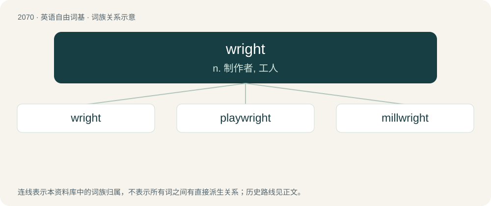

# 2175 · wright — n. 制作者, 工人

[总目录](../00_总目录_按常用程度.md)

**类型**：英语自由词基　｜　**来源语言**：见词源记录

## 核心含义与来源

- 核心含义：n. 制作者, 工人
- 英文含义：A builder or maker of something.
- 词形：wright

**来源记录 1**（名词；A builder or maker of something.）

From Middle English wrighte, wriȝte, wruhte, wurhte, from Old English wyrhta (“worker, maker”), from Proto-West Germanic \*wurhtijō (as in \*wurkijan). Related to wrought and work. Cognate with Dutch wrecht (“worker, builder, wright”, archaic).

## 词族图

## 单词速览（常用到不常用）

| 单词 | 音标 | 释义 |
|---|---|---|
| [wright](#w-1) | /ɹaɪt/ | n. 制作者, 工人 |
| [playwright](#w-2) | /ˈpleɪˌɹaɪt/ | n. 剧作家 |
| [millwright](#w-3) | /ˈmilrait/ | n. 磨粉厂的设计者, 机器安装工；\[化\] 设计师; 磨粉厂设计师; 机器安装工; 工厂的机器安装工 |

## 逐词详解

### 1. wright

**词性**：名词　｜　**音标**：/ɹaɪt/

**中文释义**：n. 制作者, 工人

**英文义项**：A builder or maker of something.

**词源与演化**：

From Middle English wrighte, wriȝte, wruhte, wurhte, from Old English wyrhta (“worker, maker”), from Proto-West Germanic \*wurhtijō (as in \*wurkijan). Related to wrought and work. Cognate with Dutch wrecht (“worker, builder, wright”, archaic).

**例句**：

> The Wright brothers succeeded in flying an airplane driven by an engine.

### 2. playwright

**词性**：名词　｜　**音标**：/ˈpleɪˌɹaɪt/

**中文释义**：n. 剧作家

**英文义项**：A writer and creator of theatrical plays.

**构词拆分**：play + wright (“builder, craftsman”)

**词源与演化**：

From play + wright (“builder, craftsman”).

**例句**：

> I am determined to make a living as a playwright at all costs.

### 3. millwright

**词性**：名词　｜　**音标**：/ˈmilrait/

**中文释义**：n. 磨粉厂的设计者, 机器安装工；\[化\] 设计师; 磨粉厂设计师; 机器安装工; 工厂的机器安装工

**英文义项**：A tradesperson engaged in the erection of machinery.

**构词拆分**：mill + wright

**词源与演化**：

From Middle English mylle wryte; equivalent to mill + wright.
