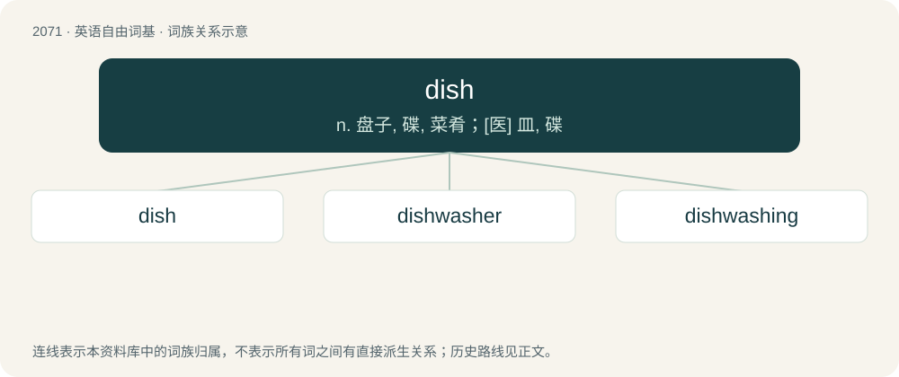

# 2176 · dish — n. 盘子, 碟, 菜肴；\[医\] 皿, 碟

[总目录](../00_总目录_按常用程度.md)

**类型**：英语自由词基　｜　**来源语言**：见词源记录

## 核心含义与来源

- 核心含义：n. 盘子, 碟, 菜肴；\[医\] 皿, 碟
- 英文含义：A vessel such as a plate for holding or serving food, often flat with a depressed region in the middle.
- 词形：dish

**来源记录 1**（名词；A vessel such as a plate for holding or serving food, often flat with a depressed region in the middle.）

From Middle English dissh, disch, from Old English disċ (“plate; bowl; dish”), from Proto-West Germanic \*disk (“table; dish”) (whence also Proto-Slavic \*dъska, whence Bulgarian дъска́ (dăská), Polish deska, Russian доска́ (doská)), Russian чан (čan)) from Latin discus. Doublet of dais, desk, disc, discus, disk, and diskos. Cognates Cognate with Scots disch (“dish; plate”), Dutch dis (“table”), German Low German Disk, Disch (“table”), German Tisch (“table”), Danish, Norwegian Bokmål, Norwegian Nynorsk, and Swedish disk (“dish; counter”), Icelandic diskur (“dish; plate”), Finnish tiski (“desk, counter; dish”). Compare the identical meaning expansion (vessel for food, then also content of such a vessel, then also specific type of food): Bulgarian блю́до (bljúdo), Russian блю́до (bljúdo). For the roundness aspect, compare Polish rondel (“pan, saucepan”) (&lt; Latin rotundus (whence also English round)), Slovene krožnik &lt; krog. Also compare typologically Proto-Slavic \*misъka &lt;&lt; Latin mēnsa; Ancient Greek πίναξ (pínax) (several meanings).

## 词族图

## 单词速览（常用到不常用）

| 单词 | 音标 | 释义 |
|---|---|---|
| [dish](#w-1) | /dɪʃ/ | n. 盘子, 碟, 菜肴；\[医\] 皿, 碟 |
| [dishwasher](#w-2) | 英 /ˈdɪʃˌwɒʃə/；美 /ˈdɪʃˌwɑʃɚ/ | n. 洗碗机, 洗碗工 |
| [dishwashing](#w-3) | /ˈdɪʃwɒʃɪŋ/ | n. 洗碗；v. 洗碗（diahwash的现在分词） |

## 逐词详解

### 1. dish

**词性**：名词　｜　**音标**：/dɪʃ/

**中文释义**：n. 盘子, 碟, 菜肴；\[医\] 皿, 碟

**英文义项**：A vessel such as a plate for holding or serving food, often flat with a depressed region in the middle. / The contents of such a vessel.

**词源与演化**：

From Middle English dissh, disch, from Old English disċ (“plate; bowl; dish”), from Proto-West Germanic \*disk (“table; dish”) (whence also Proto-Slavic \*dъska, whence Bulgarian дъска́ (dăská), Polish deska, Russian доска́ (doská)), Russian чан (čan)) from Latin discus. Doublet of dais, desk, disc, discus, disk, and diskos. Cognates Cognate with Scots disch (“dish; plate”), Dutch dis (“table”), German Low German Disk, Disch (“table”), German Tisch (“table”), Danish, Norwegian Bokmål, Norwegian Nynorsk, and Swedish disk (“dish; counter”), Icelandic diskur (“dish; plate”), Finnish tiski (“desk, counter; dish”). Compare the identical meaning expansion (vessel for food, then also content of such a vessel, then also specific type of food): Bulgarian блю́до (bljúdo), Russian блю́до (bljúdo). For the roundness aspect, compare Polish rondel (“pan, saucepan”) (&lt; Latin rotundus (whence also English round)), Slovene krožnik &lt; krog. Also compare typologically Proto-Slavic \*misъka &lt;&lt; Latin mēnsa; Ancient Greek πίναξ (pínax) (several meanings).

**例句**：

> It's your turn to wash the dishes.

该用例对应义项：Tableware (including cutlery, etc, as well as crockery) that is to be or is being washed after being used to prepare, serve and eat a meal.

### 2. dishwasher

**词性**：名词　｜　**音标**：英 /ˈdɪʃˌwɒʃə/；美 /ˈdɪʃˌwɑʃɚ/

**中文释义**：n. 洗碗机, 洗碗工

**英文义项**：A machine for washing dishes. / Someone who washes dishes, especially one hired to wash dishes in a restaurant.

**构词拆分**：dish + washer

**词源与演化**：

From Middle English dysche wescheare, equivalent to dish + washer.

**用法示例／搭配（非完整句）**：

> load the dishwasher

该用例对应义项：A machine for washing dishes.

### 3. dishwashing

**词性**：名词　｜　**音标**：/ˈdɪʃwɒʃɪŋ/

**中文释义**：n. 洗碗；v. 洗碗（diahwash的现在分词）

**英文义项**：The act of cleaning the dishware.

**构词拆分**：dish + washing

**词源与演化**：

From Middle English dihsse-wehssinge, dischwaschyng, equivalent to dish + washing.

**例句**：

> Let's have the one who loses at rock-paper-scissors do the dishwashing today!
