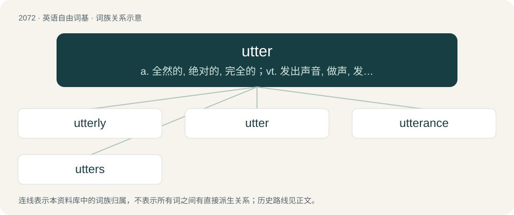

# 2177 · utter — a. 全然的, 绝对的, 完全的；vt. 发出声音, 做声, 发表, 发射, 流通

[总目录](../00_总目录_按常用程度.md)

**类型**：英语自由词基　｜　**来源语言**：见词源记录

## 核心含义与来源

- 核心含义：a. 全然的, 绝对的, 完全的；vt. 发出声音, 做声, 发表, 发射, 流通
- 英文含义：To the furthest or most extreme extent; absolute, complete, total, unconditional.
- 词形：utter

**来源记录 1**（动词；Sometimes preceded by forth, out, etc.: to produce (a cry, speech, or other sounds) with the voice.）

From Middle English outren, utteren (“to display for sale; to market; to sell; to say, speak; to put into words, express, tell; to make known, reveal”), partly: \* from outre, utter (adjective, adverb) (see etymology 1 and etymology 3) + -en (suffix forming the infinitives of verbs); and \* from Middle Dutch uteren (“to announce, make known”) (modern Dutch uiteren); or from Middle Low German üteren, ütern (“to demonstrate, show; to speak; to sell; etc.”) (modern Low German ütern), from Old Dutch or Old Saxon ūtan, probably from Proto-West Germanic \*ūtanā (“from outside or without; outside of”). Compare Middle High German ūzeren, whence German äußern (“to express, say, utter”))

## 词族图

## 单词速览（常用到不常用）

| 单词 | 音标 | 释义 |
|---|---|---|
| [utterly](#w-1) | 英 /ˈʌtəli/；美 /ˈʌtɚli/ | adv. 完全地, 全然, 绝对 |
| [utter](#w-2) | 英 /ˈʌtə/；美 /ˈʌtəɹ/ | a. 全然的, 绝对的, 完全的；vt. 发出声音, 做声, 发表, 发射, 流通 |
| [utterance](#w-3) | /ˈʌtəɹəns/ | n. 发声, 言辞, 表达, 说话的方式, 死；\[医\] 发言, 言语, 语调 |
| [utters](#w-4) | 英 /ˈʌtəz/；美 /ˈʌtəɹz/ | v. 以口发出声音( utter的第三人称单数 ); 说, 讲 |

## 逐词详解

### 1. utterly

**词性**：副词　｜　**音标**：英 /ˈʌtəli/；美 /ˈʌtɚli/

**中文释义**：adv. 完全地, 全然, 绝对

**英文义项**：Completely; entirely; to the fullest extent.

**构词拆分**：utter + -ly

**词源与演化**：

From utter + -ly.

**例句**：

> Well, now we are utterly lost.

该用例对应义项：Completely; entirely; to the fullest extent.

### 2. utter

**词性**：动词　｜　**音标**：英 /ˈʌtə/；美 /ˈʌtəɹ/

**中文释义**：a. 全然的, 绝对的, 完全的；vt. 发出声音, 做声, 发表, 发射, 流通

**英文义项**：Sometimes preceded by forth, out, etc.: to produce (a cry, speech, or other sounds) with the voice. / To verbally express or report (a desire or emotion, an idea or thought, etc.).

**词源与演化**：

From Middle English outren, utteren (“to display for sale; to market; to sell; to say, speak; to put into words, express, tell; to make known, reveal”), partly: \* from outre, utter (adjective, adverb) (see etymology 1 and etymology 3) + -en (suffix forming the infinitives of verbs); and \* from Middle Dutch uteren (“to announce, make known”) (modern Dutch uiteren); or from Middle Low German üteren, ütern (“to demonstrate, show; to speak; to sell; etc.”) (modern Low German ütern), from Old Dutch or Old Saxon ūtan, probably from Proto-West Germanic \*ūtanā (“from outside or without; outside of”). Compare Middle High German ūzeren, whence German äußern (“to express, say, utter”))

**例句**：

> Sally’s car uttered a hideous shriek when she applied the brakes.

该用例对应义项：Of a thing: to produce (a noise or sound); to emit.

### 3. utterance

**词性**：名词　｜　**音标**：/ˈʌtəɹəns/

**中文释义**：n. 发声, 言辞, 表达, 说话的方式, 死；\[医\] 发言, 言语, 语调

**英文义项**：An act of, or the process of, uttering. / An instance of that act or process: especially, something spoken (e.g., syllables, words, phrases); (especially linguistics) any such thing either spoken or written.

**构词拆分**：utter + -ance

**词源与演化**：

From Middle English utteraunce, outeraunce; equivalent to utter + -ance.

**例句**：

> He has a good utterance.

该用例对应义项：A manner of speaking.

### 4. utters

**词性**：名词　｜　**音标**：英 /ˈʌtəz/；美 /ˈʌtəɹz/

**中文释义**：v. 以口发出声音( utter的第三人称单数 ); 说, 讲

**英文义项**：Unwanted depressions or other marks on the surface of an object caused when a tool is pressed too hard or vibrates against the surface.

**构词拆分**：utter + -s (suffix forming pluralia tantum, and third-person singular simple present indicative forms of verbs)

**词源与演化**：

From utter + -s (suffix forming pluralia tantum, and third-person singular simple present indicative forms of verbs). The noun is imitative of the sound of a tool repeatedly striking the surface of an object.

**例句**：

> A utters locution B, meaning illocution C, and resulting in perlocution D.
