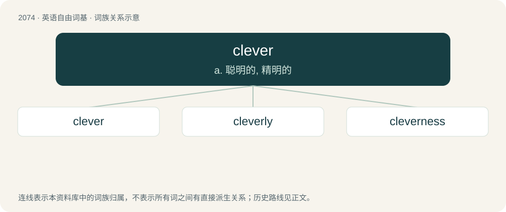

# 2180 · clever — a. 聪明的, 精明的

[总目录](../00_总目录_按常用程度.md)

**类型**：英语自由词基　｜　**来源语言**：见词源记录

## 核心含义与来源

- 核心含义：a. 聪明的, 精明的
- 英文含义：Nimble with hands or body; dexterous; skillful; adept.
- 词形：clever

**来源记录 1**（形容词；Nimble with hands or body; dexterous; skillful; adept.）

From East Anglian dialectal English cliver (“expert at seizing”), from Middle English cliver (“tenacious”). \* perhaps from Old English \*clifer, clibbor (“clinging”); \* or perhaps from Dutch, Low German, or East/Saterland Frisian (compare kluftich (“clever, prudent”), probably derived from Proto-West Germanic \*kleuban (“to cleave, split”)); \* or dialectal Norwegian klover (“ready, skillful”), itself borrowed from Middle Low German klever, related to kleven (“to stick”), from Old Saxon klibōn, from Proto-West Germanic \*klibēn, related to the Old English word above; \* possibly influenced by Old English clifer (“claw, hand”) (compare clawian (“to claw”)). Related to cleave. Perhaps influenced by Welsh celfydd (“talented, dexterous, expert”). Compare typologically Czech chytrý, Russian хи́трый (xítryj) (akin to хвата́ть (xvatátʹ)), also note схва́тывать на лету́ (sxvátyvatʹ na letú).

## 词族图

## 单词速览（常用到不常用）

| 单词 | 音标 | 释义 |
|---|---|---|
| [clever](#w-1) | 英 /ˈklɛv.ə/；美 /ˈklɛv.ɚ/ | a. 聪明的, 精明的 |
| [cleverly](#w-2) | 英 /ˈklɛvəli/；美 /ˈklɛvɚli/ | adv. 聪明地, 全然, 完全, 巧妙地 |
| [cleverness](#w-3) | 英 /ˈklɛvənəs/；美 /ˈklɛvɚnəs/ | n. 机灵；聪明 |

## 逐词详解

### 1. clever

**词性**：形容词　｜　**音标**：英 /ˈklɛv.ə/；美 /ˈklɛv.ɚ/

**中文释义**：a. 聪明的, 精明的

**英文义项**：Nimble with hands or body; dexterous; skillful; adept. / Quick to understand, learn, and devise or apply ideas; intelligent.

**词源与演化**：

From East Anglian dialectal English cliver (“expert at seizing”), from Middle English cliver (“tenacious”). \* perhaps from Old English \*clifer, clibbor (“clinging”); \* or perhaps from Dutch, Low German, or East/Saterland Frisian (compare kluftich (“clever, prudent”), probably derived from Proto-West Germanic \*kleuban (“to cleave, split”)); \* or dialectal Norwegian klover (“ready, skillful”), itself borrowed from Middle Low German klever, related to kleven (“to stick”), from Old Saxon klibōn, from Proto-West Germanic \*klibēn, related to the Old English word above; \* possibly influenced by Old English clifer (“claw, hand”) (compare clawian (“to claw”)). Related to cleave. Perhaps influenced by Welsh celfydd (“talented, dexterous, expert”). Compare typologically Czech chytrý, Russian хи́трый (xítryj) (akin to хвата́ть (xvatátʹ)), also note схва́тывать на лету́ (sxvátyvatʹ na letú).

**例句**：

> This is a simple but clever trick to solve the problem.

该用例对应义项：Showing mental quickness and resourcefulness.

### 2. cleverly

**词性**：副词　｜　**音标**：英 /ˈklɛvəli/；美 /ˈklɛvɚli/

**中文释义**：adv. 聪明地, 全然, 完全, 巧妙地

**英文义项**：Wittily; in a tricky manner. / Intelligently directed to a purpose.

**构词拆分**：clever + -ly

**词源与演化**：

From clever + -ly.

**例句**：

> Cleverly, he found ways of ingratiating himself with all the important guests.

该用例对应义项：Intelligently directed to a purpose.

### 3. cleverness

**词性**：名词　｜　**音标**：英 /ˈklɛvənəs/；美 /ˈklɛvɚnəs/

**中文释义**：n. 机灵；聪明

**英文义项**：The property of being clever. / Something clever, or done cleverly.

**构词拆分**：clever + -ness

**词源与演化**：

From clever + -ness.

**例句**：

> The cleverness of its design.

该用例对应义项：the property of being ingenious
