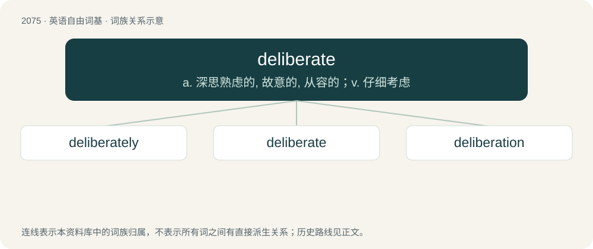

# 2181 · deliberate — a. 深思熟虑的, 故意的, 从容的；v. 仔细考虑

[总目录](../00_总目录_按常用程度.md)

**类型**：英语自由词基　｜　**来源语言**：见词源记录

## 核心含义与来源

- 核心含义：a. 深思熟虑的, 故意的, 从容的；v. 仔细考虑
- 英文含义：Done on purpose; intentional.
- 词形：deliberate

**来源记录 1**（形容词；Done on purpose; intentional.）

Inherited from Middle English deliberat(e), borrowed from Latin dēlīberātus, perfect passive participle of dēlīberō (“to consider, weigh well”) (see -ate (adjective-forming suffix) and -ate (verb-forming suffix)), from dē- + \*līberō / lībrō (“to weigh”)), from \*libera / libra (“a balance”); see librate. Doublet of deliber.

## 词族图

## 单词速览（常用到不常用）

| 单词 | 音标 | 释义 |
|---|---|---|
| [deliberately](#w-1) | /dɪˈlɪb.(ə.)ɹət.li/ | adv. 故意地 |
| [deliberate](#w-2) | 英 /dɪˈlɪb.(ə.)ɹət/；美 /dɪˈlɪb.ɚ.ət/ | a. 深思熟虑的, 故意的, 从容的；v. 仔细考虑 |
| [deliberation](#w-3) | /dɪˌlɪbəˈɹeɪʃən/ | n. 熟虑, 熟思, 审议；\[法\] 慎重考虑, 商讨, 审议 |

## 逐词详解

### 1. deliberately

**词性**：副词　｜　**音标**：/dɪˈlɪb.(ə.)ɹət.li/

**中文释义**：adv. 故意地

**英文义项**：Intentionally, or after deliberation; not accidentally. / Taking one's time, slowly and carefully.

**构词拆分**：deliberate + -ly

**词源与演化**：

From deliberate + -ly.

**例句**：

> After being called upon, he strode deliberately up to the blackboard.

该用例对应义项：Taking one's time, slowly and carefully.

### 2. deliberate

**词性**：形容词　｜　**音标**：英 /dɪˈlɪb.(ə.)ɹət/；美 /dɪˈlɪb.ɚ.ət/

**中文释义**：a. 深思熟虑的, 故意的, 从容的；v. 仔细考虑

**英文义项**：Done on purpose; intentional. / Formed with deliberation; carefully considered; not sudden or rash.

**词源与演化**：

Inherited from Middle English deliberat(e), borrowed from Latin dēlīberātus, perfect passive participle of dēlīberō (“to consider, weigh well”) (see -ate (adjective-forming suffix) and -ate (verb-forming suffix)), from dē- + \*līberō / lībrō (“to weigh”)), from \*libera / libra (“a balance”); see librate. Doublet of deliber.

**例句**：

> The jury took eight hours to come to its deliberate verdict.

该用例对应义项：Of a person, weighing facts and arguments with a view to a choice or decision; carefully considering the probable consequences of a step; slow in determining.

### 3. deliberation

**词性**：名词　｜　**音标**：/dɪˌlɪbəˈɹeɪʃən/

**中文释义**：n. 熟虑, 熟思, 审议；\[法\] 慎重考虑, 商讨, 审议

**英文义项**：The act of deliberating, or of weighing and examining the reasons for and against a choice or measure; careful consideration; mature reflection. / Careful discussion and examination of the reasons for and against a measure.

**构词拆分**：deliberate + -ion

**词源与演化**：

From Middle English deliberacioun, from Old French deliberation, from Latin deliberātiō. Morphologically deliberate + -ion.

**用法示例／搭配（非完整句）**：

> the deliberations of a legislative body or council

该用例对应义项：Careful discussion and examination of the reasons for and against a measure.
