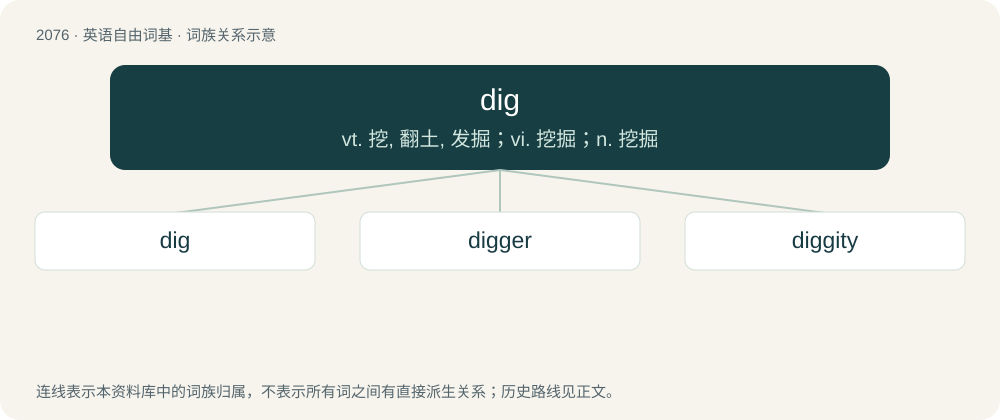

# 2182 · dig — vt. 挖, 翻土, 发掘；vi. 挖掘；n. 挖掘

[总目录](../00_总目录_按常用程度.md)

**类型**：英语自由词基　｜　**来源语言**：见词源记录

## 核心含义与来源

- 核心含义：vt. 挖, 翻土, 发掘；vi. 挖掘；n. 挖掘
- 英文含义：To move hard-packed earth out of the way, especially downward to make a hole with a shovel. Or to drill, or the like, through rocks, roads, or the like. More generally, to make any similar hole by moving material out of the way.
- 词形：dig

**多个词源／构词路径**：同一拼写可能有不同来源；以下按词性和含义分别列出。

**来源记录 1**（动词；To move hard-packed earth out of the way, especially downward to make a hole with a shovel. Or to drill, or the like, through rocks, roads, or the like. More generally, to make any similar hole by moving material out of the way.）

From Middle English diggen (“to dig”, 13th c.), an alteration of dīken, from Old English dīcian (“to dig a ditch, mound up earth”), from Proto-West Germanic \*dīkōn, which see for cognates. This verb is denominal from Proto-Germanic \*dīkaz (“pool, puddle; dyke, ditch”), from Proto-Indo-European \*dʰeygʷ- (“to stab, dig”). The form with g may have been influenced by Old French \*diguer, a variant of dikier, itself from the West Germanic verb above. French forms with g are attested only in the 15th c., thus 200 years later than in English. On the other hand, French has according forms also for the underlying noun (cf. digue) and the phonetic development is more plausible in French than in English.

**来源记录 2**（动词；To understand.）

From African American Vernacular English; due to lack of writing of slave speech, etymology is difficult to trace, but it has been suggested that it is from Wolof dëgg, dëgga (“to understand, to appreciate”). It has also been suggested that it is from Irish dtuig, thus being a doublet of twig. Others do not propose a distinct etymology, instead considering this a semantic shift of the existing English term (compare dig in/dig into).

**来源记录 3**（名词；Digoxin.）

Shortening.

## 词族图

## 单词速览（常用到不常用）

| 单词 | 音标 | 释义 |
|---|---|---|
| [dig](#w-1) | /dɪɡ/ | vt. 挖, 翻土, 发掘；vi. 挖掘；n. 挖掘 |
| [digger](#w-2) | 英 /ˈdɪɡə/；美 /ˈdɪɡɚ/ | n. 挖掘者 |
| [diggity](#w-3) |  | 【英文】An expletive or partially reduplicative form used in word games or idioms. |

## 逐词详解

### 1. dig

**词性**：动词　｜　**音标**：/dɪɡ/

**中文释义**：vt. 挖, 翻土, 发掘；vi. 挖掘；n. 挖掘

**英文义项**：To move hard-packed earth out of the way, especially downward to make a hole with a shovel. Or to drill, or the like, through rocks, roads, or the like. More generally, to make any similar hole by moving material out of the way. / To get by digging; to take from the ground; often with up.

**词源与演化**：

From Middle English diggen (“to dig”, 13th c.), an alteration of dīken, from Old English dīcian (“to dig a ditch, mound up earth”), from Proto-West Germanic \*dīkōn, which see for cognates. This verb is denominal from Proto-Germanic \*dīkaz (“pool, puddle; dyke, ditch”), from Proto-Indo-European \*dʰeygʷ- (“to stab, dig”). The form with g may have been influenced by Old French \*diguer, a variant of dikier, itself from the West Germanic verb above. French forms with g are attested only in the 15th c., thus 200 years later than in English. On the other hand, French has according forms also for the underlying noun (cf. digue) and the phonetic development is more plausible in French than in English.

**例句**：

> If the plane can't pull out of the dive it is in, it'll dig a hole in the ground.

该用例对应义项：To move hard-packed earth out of the way, especially downward to make a hole with a shovel. Or to drill, or the like, through rocks, roads, or the like. More generally, to make any similar hole by moving material out of the way.

### 2. digger

**词性**：名词　｜　**音标**：英 /ˈdɪɡə/；美 /ˈdɪɡɚ/

**中文释义**：n. 挖掘者

**英文义项**：A large piece of machinery that digs holes or trenches. / A tool for digging.

**构词拆分**：dig + -er

**词源与演化**：

From Middle English dyggar, equivalent to dig + -er. In the sense of "Australian soldier", attributed to the considerable time that soldiers spent digging trenches during World War I.

**例句**：

> My parents don't like my girlfriend. They say that she's a gold digger.

### 3. diggity

**词性**：名词

**英文义项**：An expletive or partially reduplicative form used in word games or idioms.

**构词拆分**：dig + -ity

**词源与演化**：

See diggety, analyzable as dig + -ity, a suffix used to extend monosyllabic words.
