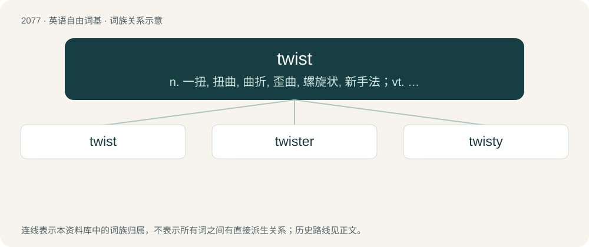

# 2183 · twist — n. 一扭, 扭曲, 曲折, 歪曲, 螺旋状, 新手法；vt. 拧, 扭, 捻, 编织, 使扭转, 缠绕, 盘绕, 歪曲, 使转动, 使苦恼, 使混乱, 使旋转；vi. 转向, 弯曲, 缠绕, 扭动, 呈螺旋形

[总目录](../00_总目录_按常用程度.md)

**类型**：英语自由词基　｜　**来源语言**：见词源记录

## 核心含义与来源

- 核心含义：n. 一扭, 扭曲, 曲折, 歪曲, 螺旋状, 新手法；vt. 拧, 扭, 捻, 编织, 使扭转, 缠绕, 盘绕, 歪曲, 使转动, 使苦恼, 使混乱, 使旋转；vi. 转向, 弯曲, 缠绕, 扭动, 呈螺旋形
- 英文含义：A twisting force.
- 词形：twist

**来源记录 1**（名词；A twisting force.）

From Middle English twist, from Old English \*twist, in compounds (e.g. mæsttwist (“a rope; stay”), candeltwist (“a wick”)), from Proto-Germanic \*twistaz, a derivative of \*twi- (“two-”) (compare also twine, between, betwixt). Related to Saterland Frisian Twist (“discord”), Dutch twist (“twist; strife; discord”), German Low German Twist (“strife; discord”), German Zwist (“turmoil; strife; discord”), Swedish tvist (“quarrel; dispute”), Icelandic tvistur (“deuce”). The verb is from Middle English twisten. Compare Dutch twisten, Danish tviste (“to dispute”), Swedish tvista (“to argue; dispute”).

## 词族图

## 单词速览（常用到不常用）

| 单词 | 音标 | 释义 |
|---|---|---|
| [twist](#w-1) | /twɪst/ | n. 一扭, 扭曲, 曲折, 歪曲, 螺旋状, 新手法；vt. 拧, 扭, 捻, 编织, 使扭转, 缠绕, 盘绕, 歪曲, 使转动, 使苦恼, 使混乱, 使旋转；vi. 转向, 弯曲, 缠绕, 扭动, 呈螺旋形 |
| [twister](#w-2) | 英 /ˈtwɪstə/；美 /ˈtwɪstəɹ/ | n. 缠绕者, 缠绕机, 不老实的人；\[医\] 扭转器 |
| [twisty](#w-3) | /ˈtwɪsti/ | a. 扭曲的, 狡猾的, 不老实的；\[法\] 歪曲事实的, 不正直的 |

## 逐词详解

### 1. twist

**词性**：名词　｜　**音标**：/twɪst/

**中文释义**：n. 一扭, 扭曲, 曲折, 歪曲, 螺旋状, 新手法；vt. 拧, 扭, 捻, 编织, 使扭转, 缠绕, 盘绕, 歪曲, 使转动, 使苦恼, 使混乱, 使旋转；vi. 转向, 弯曲, 缠绕, 扭动, 呈螺旋形

**英文义项**：A twisting force. / Anything twisted, or the act of twisting.

**词源与演化**：

From Middle English twist, from Old English \*twist, in compounds (e.g. mæsttwist (“a rope; stay”), candeltwist (“a wick”)), from Proto-Germanic \*twistaz, a derivative of \*twi- (“two-”) (compare also twine, between, betwixt). Related to Saterland Frisian Twist (“discord”), Dutch twist (“twist; strife; discord”), German Low German Twist (“strife; discord”), German Zwist (“turmoil; strife; discord”), Swedish tvist (“quarrel; dispute”), Icelandic tvistur (“deuce”). The verb is from Middle English twisten. Compare Dutch twisten, Danish tviste (“to dispute”), Swedish tvista (“to argue; dispute”).

**例句**：

> I'm all agog at the new twist to the royal scandal.

该用例对应义项：An unexpected turn in a story, tale, etc.

### 2. twister

**词性**：名词　｜　**音标**：英 /ˈtwɪstə/；美 /ˈtwɪstəɹ/

**中文释义**：n. 缠绕者, 缠绕机, 不老实的人；\[医\] 扭转器

**英文义项**：One who twists. / One whose occupation is to twist or join the threads of one warp to those of another, in weaving.

**构词拆分**：twist + -er

**词源与演化**：

From Middle English twyster, equivalent to twist + -er.

**例句**：

> Ah! Hide yourself at home! This vile tongue twister is hardly useful.

### 3. twisty

**词性**：形容词　｜　**音标**：/ˈtwɪsti/

**中文释义**：a. 扭曲的, 狡猾的, 不老实的；\[法\] 歪曲事实的, 不正直的

**英文义项**：Characterised by a twist or twists; twisting.

**构词拆分**：From twist + -y.

**词源与演化**：

From twist + -y.

**用法示例／搭配（非完整句）**：

> lost in a twisty labyrinth

该用例对应义项：Characterised by a twist or twists; twisting.
