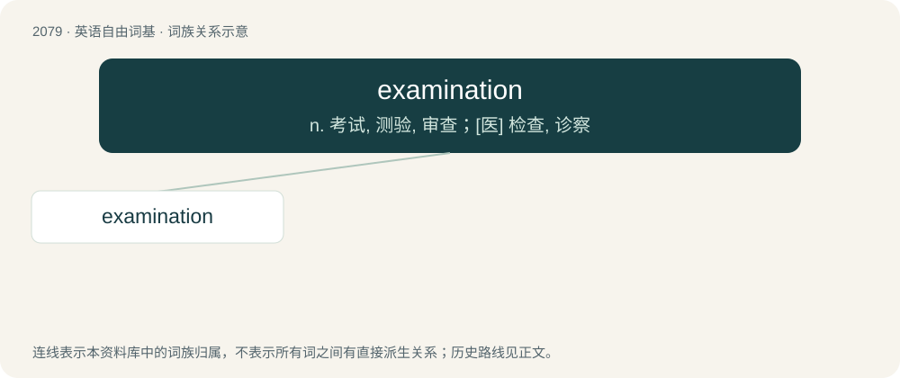

# 2184 · examination — n. 考试, 测验, 审查；\[医\] 检查, 诊察

[总目录](../00_总目录_按常用程度.md)

**类型**：英语自由词基　｜　**来源语言**：见词源记录

## 核心含义与来源

- 核心含义：n. 考试, 测验, 审查；\[医\] 检查, 诊察
- 英文含义：The act of examining.
- 词形：examination

**来源记录 1**（名词；The act of examining.）

From Middle English examinacioun, from Old French examinacion, from Latin exāminātiō. Morphologically examine + -ation.

## 词族图

## 单词速览（常用到不常用）

| 单词 | 音标 | 释义 |
|---|---|---|
| [examination](#w-1) | 英 /ɪɡˌzæm.ɪˈneɪ.ʃən/；美 /ɪɡˌzæm.əˈneɪ.ʃən/ | n. 考试, 测验, 审查；\[医\] 检查, 诊察 |

## 逐词详解

### 1. examination

**词性**：名词　｜　**音标**：英 /ɪɡˌzæm.ɪˈneɪ.ʃən/；美 /ɪɡˌzæm.əˈneɪ.ʃən/

**中文释义**：n. 考试, 测验, 审查；\[医\] 检查, 诊察

**英文义项**：The act of examining. / Particularly, an inspection by a medical professional to establish the extent and nature of any sickness or injury.

**构词拆分**：examine + -ation

**词源与演化**：

From Middle English examinacioun, from Old French examinacion, from Latin exāminātiō. Morphologically examine + -ation.

**例句**：

> Your success depends on whether you pass the STEP examination or not.
