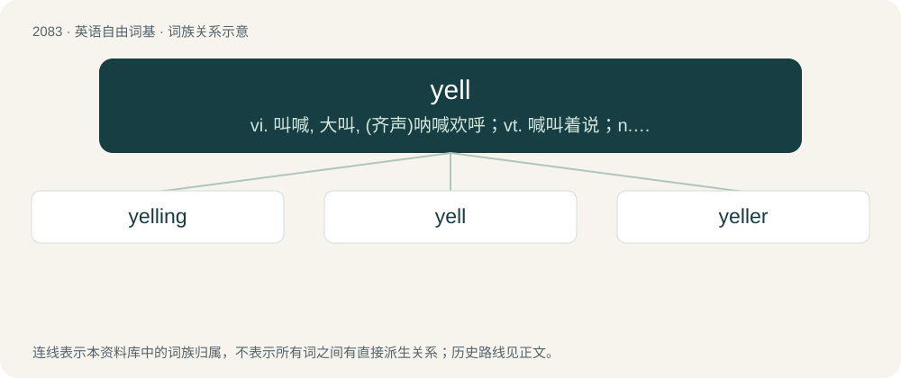

# 2186 · yell — vi. 叫喊, 大叫, (齐声)呐喊欢呼；vt. 喊叫着说；n. 叫声, 喊声, 呐喊

[总目录](../00_总目录_按常用程度.md)

**类型**：英语自由词基　｜　**来源语言**：见词源记录

## 核心含义与来源

- 核心含义：vi. 叫喊, 大叫, (齐声)呐喊欢呼；vt. 喊叫着说；n. 叫声, 喊声, 呐喊
- 英文含义：To shout; holler; make a loud sound with the voice, especially to express intense emotions such as anger or excitement.
- 词形：yell

**多个词源／构词路径**：同一拼写可能有不同来源；以下按词性和含义分别列出。

**来源记录 1**（动词；To shout; holler; make a loud sound with the voice, especially to express intense emotions such as anger or excitement.）

From Middle English ȝellen, yellen, from Old English ġiellan, from Proto-Germanic \*gellaną. Cognate with Saterland Frisian gälje (“to yell”), Dutch gillen (“to yell”), German Low German gellen (“to yell”), German gellen (“to yell”).

**来源记录 2**（形容词；dry (of cow)）

Borrowed from Scots yeld (“ceasing to give milk”).

## 词族图

## 单词速览（常用到不常用）

| 单词 | 音标 | 释义 |
|---|---|---|
| [yelling](#w-1) | /jelɪŋ/ | v. 叫喊, 号叫, 叫着说( yell的现在分词 ) |
| [yell](#w-2) | /jɛl/ | vi. 叫喊, 大叫, (齐声)呐喊欢呼；vt. 喊叫着说；n. 叫声, 喊声, 呐喊 |
| [yeller](#w-3) | 英 /ˈjɛlə/；美 /ˈjɛlɚ/ | n. yell的变形 |

## 逐词详解

### 1. yelling

**词性**：名词　｜　**音标**：/jelɪŋ/

**中文释义**：v. 叫喊, 号叫, 叫着说( yell的现在分词 )

**英文义项**：The act of producing a yell.

**构词拆分**：yell + -ing

**词源与演化**：

From Middle English yellynge, ȝellynge; equivalent to yell + -ing.

**例句**：

> Mennad was yelling at the top of his lungs to that guy.

### 2. yell

**词性**：动词　｜　**音标**：/jɛl/

**中文释义**：vi. 叫喊, 大叫, (齐声)呐喊欢呼；vt. 喊叫着说；n. 叫声, 喊声, 呐喊

**英文义项**：To shout; holler; make a loud sound with the voice, especially to express intense emotions such as anger or excitement. / To convey by shouting.

**词源与演化**：

From Middle English ȝellen, yellen, from Old English ġiellan, from Proto-Germanic \*gellaną. Cognate with Saterland Frisian gälje (“to yell”), Dutch gillen (“to yell”), German Low German gellen (“to yell”), German gellen (“to yell”).

**例句**：

> If I come home late again, my dad is gonna yell at me.

该用例对应义项：To tell someone off, to scold or rebuke, typically in a loud and angry manner.

### 3. yeller

**词性**：名词　｜　**音标**：英 /ˈjɛlə/；美 /ˈjɛlɚ/

**中文释义**：n. yell的变形

**英文义项**：Someone who yells.

**构词拆分**：From yell + -er.

**词源与演化**：

From yell + -er.
