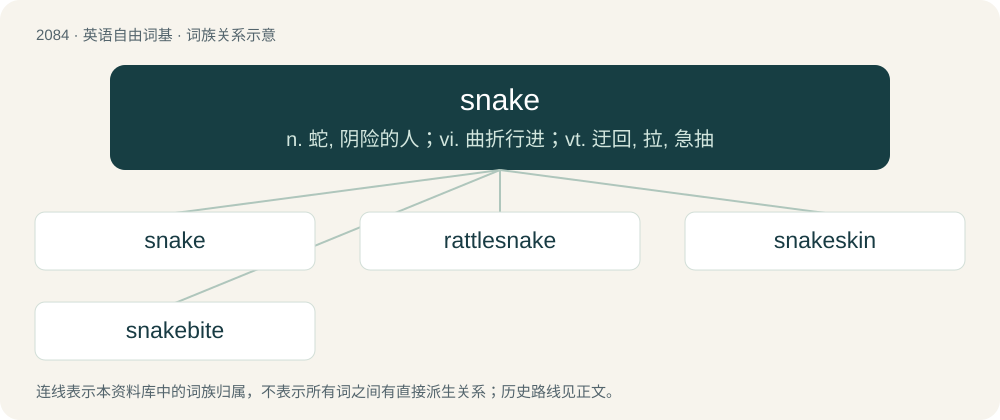

# 2187 · snake — n. 蛇, 阴险的人；vi. 曲折行进；vt. 迂回, 拉, 急抽

[总目录](../00_总目录_按常用程度.md)

**类型**：英语自由词基　｜　**来源语言**：见词源记录

## 核心含义与来源

- 核心含义：n. 蛇, 阴险的人；vi. 曲折行进；vt. 迂回, 拉, 急抽
- 英文含义：Any of the suborder Serpentes of legless reptiles with long, thin bodies and fork-shaped tongues.
- 词形：snake

**来源记录 1**（名词；Any of the suborder Serpentes of legless reptiles with long, thin bodies and fork-shaped tongues.）

From Middle English snake, from Old English snaca (“snake, serpent, reptile”), from Proto-West Germanic \*snakō (“slider, snake”), from \*snakan (“to creep, slide”), related to Old High German snahhan (“to sneak, slide”). Compare also Proto-Germanic \*snēkô (“creeper, crawler”). Cognate with German Low German Snake, Snaak (“snake”), dialectal German Schnake (“adder”), Danish snog (“grass snake”), Swedish snok (“grass snake”), Norwegian Nynorsk snåk (“viper, adder”), Faroese snákur (“grass snake”), Icelandic snákur (“snake”).

## 词族图

## 单词速览（常用到不常用）

| 单词 | 音标 | 释义 |
|---|---|---|
| [snake](#w-1) | 英 /sneɪk/ | n. 蛇, 阴险的人；vi. 曲折行进；vt. 迂回, 拉, 急抽 |
| [rattlesnake](#w-2) | /ˈɹæt.əlˌsneɪk/ | n. 响尾蛇；\[医\] 响尾蛇 |
| [snakeskin](#w-3) | /ˈsneɪkˌskɪn/ | n. 蛇皮, 蛇皮革 |
| [snakebite](#w-4) | /ˈsneikbait/ | n. 蛇咬伤 |

## 逐词详解

### 1. snake

**词性**：名词　｜　**音标**：英 /sneɪk/

**中文释义**：n. 蛇, 阴险的人；vi. 曲折行进；vt. 迂回, 拉, 急抽

**英文义项**：Any of the suborder Serpentes of legless reptiles with long, thin bodies and fork-shaped tongues. / A person who acts deceitfully for personal or social gain; a treacherous person.

**词源与演化**：

From Middle English snake, from Old English snaca (“snake, serpent, reptile”), from Proto-West Germanic \*snakō (“slider, snake”), from \*snakan (“to creep, slide”), related to Old High German snahhan (“to sneak, slide”). Compare also Proto-Germanic \*snēkô (“creeper, crawler”). Cognate with German Low German Snake, Snaak (“snake”), dialectal German Schnake (“adder”), Danish snog (“grass snake”), Swedish snok (“grass snake”), Norwegian Nynorsk snåk (“viper, adder”), Faroese snákur (“grass snake”), Icelandic snákur (“snake”).

**例句**：

> Gem’s a snake for Kamale, man.

该用例对应义项：An informer; a rat.

### 2. rattlesnake

**词性**：名词　｜　**音标**：/ˈɹæt.əlˌsneɪk/

**中文释义**：n. 响尾蛇；\[医\] 响尾蛇

**英文义项**：Any of various venomous American snakes, of genera Crotalus and Sistrurus, having a rattle at the end of its tail.

**构词拆分**：rattle + snake

**词源与演化**：

From rattle + snake.

**例句**：

> Tom found a rattlesnake under the bed and quickly killed it.

### 3. snakeskin

**词性**：名词　｜　**音标**：/ˈsneɪkˌskɪn/

**中文释义**：n. 蛇皮, 蛇皮革

**英文义项**：The hide of a snake, used as leather. / The moult of a snake.

**构词拆分**：snake + skin

**词源与演化**：

From snake + skin.

### 4. snakebite

**词性**：名词　｜　**音标**：/ˈsneikbait/

**中文释义**：n. 蛇咬伤

**英文义项**：The bite of a snake. / A cocktail made with equal parts lager and hard cider.

**构词拆分**：snake + bite

**词源与演化**：

From snake + bite.

**例句**：

> Ellie recently got a navel piercing and snakebites.

该用例对应义项：A pair of lip piercings below the lower lip, resembling the fangs of a snake.
