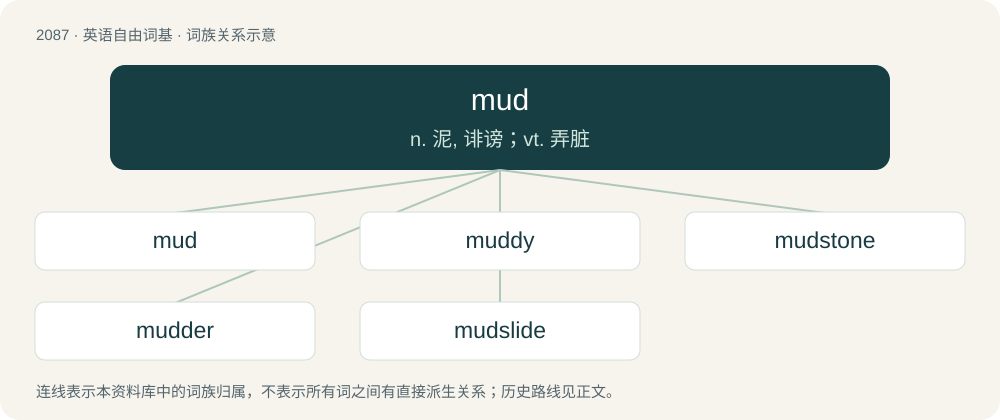

# 2191 · mud — n. 泥, 诽谤；vt. 弄脏

[总目录](../00_总目录_按常用程度.md)

**类型**：英语自由词基　｜　**来源语言**：见词源记录

## 核心含义与来源

- 核心含义：n. 泥, 诽谤；vt. 弄脏
- 英文含义：A mixture of water and soil or fine grained sediment.
- 词形：mud

**多个词源／构词路径**：同一拼写可能有不同来源；以下按词性和含义分别列出。

**来源记录 1**（名词；A mixture of water and soil or fine grained sediment.）

From Middle English mud, mudde, mode, probably a borrowing from Middle Dutch mod, modde or Middle Low German mudde, ultimately from Proto-Germanic \*mud-, \*mudra- (“mud”), perhaps from Proto-Indo-European \*mū-, \*mew- (“moist”). Cognate with Saterland Frisian Mudde (“mud”), Middle High German mot (“mud”), Swedish modd (“slush”). Compare also suffixed variants English mother (“vinegar-forming sediment in alcohol”), West Frisian modder (“mud”), Dutch modder (“mud”), German Low German Mudder (“mud”), German Moder (“moldiness, mildew, decay”), Danish mudder (“mud”). Alternative etymology suggests the Proto-Germanic word is possibly borrowed from a Uralic language (compare e.g. Finnish muta (“mud”), Northern Sami mođđi (“mud”), Erzya мода (moda, “earth, ground”) from Proto-Uralic \*muďa (“earth”)).

**来源记录 2**（动词；To participate in a MUD or multi-user dungeon.）

From MUD.

## 词族图

## 单词速览（常用到不常用）

| 单词 | 音标 | 释义 |
|---|---|---|
| [mud](#w-1) | /mʌd/ | n. 泥, 诽谤；vt. 弄脏 |
| [muddy](#w-2) | 英 /ˈmʌdi/ | a. 泥泞的, 浑浊的, 模糊的；vt. 使污浊, 使沾上泥污 |
| [mudstone](#w-3) | /ˈmʌdstəun/ | n. \[地\]泥岩 |
| [mudder](#w-4) | /ˈmʌdə/ | n. 善于在泥地上跑的马 |
| [mudslide](#w-5) | 美 /ˈmʌdˌslaɪd/ | \[地\](沿缓坡而下的)徐缓黏滞泥流, 泥流 |

## 逐词详解

### 1. mud

**词性**：名词　｜　**音标**：/mʌd/

**中文释义**：n. 泥, 诽谤；vt. 弄脏

**英文义项**：A mixture of water and soil or fine grained sediment. / A plaster-like mixture used to texture or smooth drywall.

**词源与演化**：

From Middle English mud, mudde, mode, probably a borrowing from Middle Dutch mod, modde or Middle Low German mudde, ultimately from Proto-Germanic \*mud-, \*mudra- (“mud”), perhaps from Proto-Indo-European \*mū-, \*mew- (“moist”). Cognate with Saterland Frisian Mudde (“mud”), Middle High German mot (“mud”), Swedish modd (“slush”). Compare also suffixed variants English mother (“vinegar-forming sediment in alcohol”), West Frisian modder (“mud”), Dutch modder (“mud”), German Low German Mudder (“mud”), German Moder (“moldiness, mildew, decay”), Danish mudder (“mud”). Alternative etymology suggests the Proto-Germanic word is possibly borrowed from a Uralic language (compare e.g. Finnish muta (“mud”), Northern Sami mođđi (“mud”), Erzya мода (moda, “earth, ground”) from Proto-Uralic \*muďa (“earth”)).

**例句**：

> The campaign issues got lost in all the mud from both parties.

该用例对应义项：Willfully abusive, even slanderous remarks or claims, notably between political opponents.

### 2. muddy

**词性**：形容词　｜　**音标**：英 /ˈmʌdi/

**中文释义**：a. 泥泞的, 浑浊的, 模糊的；vt. 使污浊, 使沾上泥污

**英文义项**：Covered or splashed with, or full of, mud (“wet soil”). / Of water or some other liquid: containing mud or (by extension) other sediment in suspension; cloudy, turbid.

**构词拆分**：mud + -y (suffix meaning ‘having the quality of’ forming adjectives)

**词源与演化**：

The adjective is derived from Late Middle English muddi, moddy, muddy (“covered with or full of mud, muddy”), from mud, mudde (“mud; turbid water”) + -i (suffix forming adjectives). Mud, mudde is possibly borrowed from Middle Dutch modde, and/or Middle Low German modde, mudde, from Proto-Germanic \*mud-, \*mudra- (“mud”), possibly from Proto-Indo-European \*mū-, \*mew- (“moist”). The English word is analysable as mud + -y (suffix meaning ‘having the quality of’ forming adjectives). Doublet of muddle. The verb is derived from the adjective. cognates \* Middle Low German moddich, muddich (German Low German muddig (“muddy; mouldy”))

**例句**：

> The previously limpid water was now muddy as a result of the struggle between the alligator and the wild boar.

该用例对应义项：Of water or some other liquid: containing mud or (by extension) other sediment in suspension; cloudy, turbid.

### 3. mudstone

**词性**：名词　｜　**音标**：/ˈmʌdstəun/

**中文释义**：n. \[地\]泥岩

**英文义项**：A fine-grained sedimentary rock whose original constituents were clays or muds.

**构词拆分**：mud + stone

**词源与演化**：

From mud + stone.

### 4. mudder

**词性**：名词　｜　**音标**：/ˈmʌdə/

**中文释义**：n. 善于在泥地上跑的马

**英文义项**：A racehorse that performs well on muddy or wet tracks. / A person who handles, works with, digs or is otherwise involved in mud.

**构词拆分**：mud + -er

**词源与演化**：

From mud + -er.

### 5. mudslide

**词性**：名词　｜　**音标**：美 /ˈmʌdˌslaɪd/

**中文释义**：\[地\](沿缓坡而下的)徐缓黏滞泥流, 泥流

**英文义项**：A geological event in which viscous mud flows down an incline. / A mixed drink consisting of vodka, Kahlúa and Baileys.

**构词拆分**：mud + slide

**词源与演化**：

From mud + slide.

**例句**：

> A mudslide swept the truck into a ravine.
