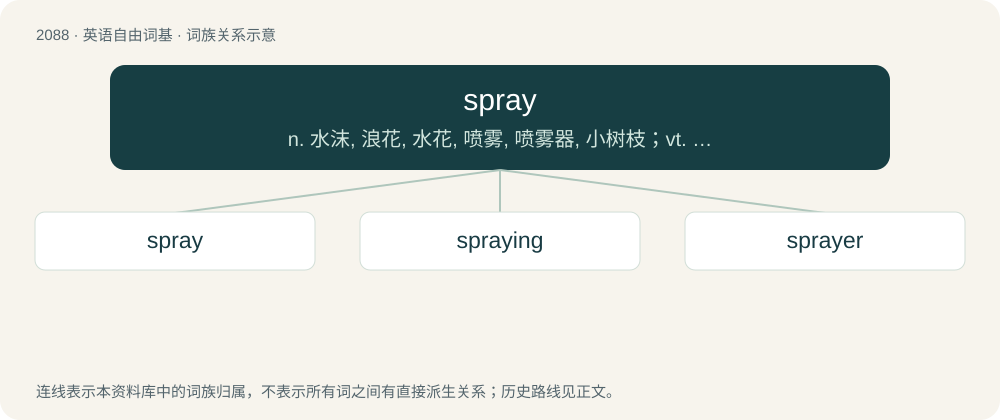

# 2193 · spray — n. 水沫, 浪花, 水花, 喷雾, 喷雾器, 小树枝；vt. 喷雾, 扫射, 喷射；vi. 喷, 溅开

[总目录](../00_总目录_按常用程度.md)

**类型**：英语自由词基　｜　**来源语言**：见词源记录

## 核心含义与来源

- 核心含义：n. 水沫, 浪花, 水花, 喷雾, 喷雾器, 小树枝；vt. 喷雾, 扫射, 喷射；vi. 喷, 溅开
- 英文含义：A fine, gentle, dispersed mist of liquid.
- 词形：spray

**多个词源／构词路径**：同一拼写可能有不同来源；以下按词性和含义分别列出。

**来源记录 1**（名词；A fine, gentle, dispersed mist of liquid.）

From Middle Dutch sprāien, sprayen, spraeyen (“to spray, sprinkle, spread”), ultimately from Proto-Germanic \*sprēwijaną (“to spray, sprinkle”), from Proto-Indo-European \*(s)per- (“to sow, scatter”). Cognate with Middle High German spræjen, spræwen (“to squirt, spray, dust, splash, straw”), Danish dialectal språe (“to open up, burst forth”), Swedish dialectal språ (“to sprout, shoot forth, burst”), Norwegian dialectal spra, spræ (“to splash, splatter, spout, burst forth”), Dutch sproeien (“to spray, sprinkle”), German sprühen (“to spray, sparkle”).

**来源记录 2**（名词；A small branch of flowers or berries.）

From Middle English spray, from Old English \*spræġ, sprei (found in place names such as that of Spreyton, England), of unknown origin. Compare English sprig (“shoot, twig”).

## 词族图

## 单词速览（常用到不常用）

| 单词 | 音标 | 释义 |
|---|---|---|
| [spray](#w-1) | /spɹeɪ/ | n. 水沫, 浪花, 水花, 喷雾, 喷雾器, 小树枝；vt. 喷雾, 扫射, 喷射；vi. 喷, 溅开 |
| [spraying](#w-2) | /ˈspreiiŋ/ | \[化\] 喷镀; 喷涂；\[医\] 喷雾, 喷水 |
| [sprayer](#w-3) | 美 /ˈspɹeɪɚ/ | n. 喷水车, 喷枪, 喷雾器；\[化\] 喷水器; 喷头 |

## 逐词详解

### 1. spray

**词性**：名词　｜　**音标**：/spɹeɪ/

**中文释义**：n. 水沫, 浪花, 水花, 喷雾, 喷雾器, 小树枝；vt. 喷雾, 扫射, 喷射；vi. 喷, 溅开

**英文义项**：A fine, gentle, dispersed mist of liquid. / Something resembling a spray of liquid.

**词源与演化**：

From Middle Dutch sprāien, sprayen, spraeyen (“to spray, sprinkle, spread”), ultimately from Proto-Germanic \*sprēwijaną (“to spray, sprinkle”), from Proto-Indo-European \*(s)per- (“to sow, scatter”). Cognate with Middle High German spræjen, spræwen (“to squirt, spray, dust, splash, straw”), Danish dialectal språe (“to open up, burst forth”), Swedish dialectal språ (“to sprout, shoot forth, burst”), Norwegian dialectal spra, spræ (“to splash, splatter, spout, burst forth”), Dutch sproeien (“to spray, sprinkle”), German sprühen (“to spray, sparkle”).

**例句**：

> The sailor could feel the spray from the waves.

该用例对应义项：A fine, gentle, dispersed mist of liquid.

### 2. spraying

**词性**：名词　｜　**音标**：/ˈspreiiŋ/

**中文释义**：\[化\] 喷镀; 喷涂；\[医\] 喷雾, 喷水

**英文义项**：The act by which something is sprayed.

**构词拆分**：From spray + -ing.

**词源与演化**：

From spray + -ing.

**例句**：

> The parched lawn needed several sprayings before the grass looked green again.

该用例对应义项：The act by which something is sprayed.

### 3. sprayer

**词性**：名词　｜　**音标**：美 /ˈspɹeɪɚ/

**中文释义**：n. 喷水车, 喷枪, 喷雾器；\[化\] 喷水器; 喷头

**英文义项**：Synonym of spray bottle. / A device, machine or vehicle used for large-area spraying, as for irrigation, weed killers, fertilizers, insecticides, or in manufacturing and production line processes.

**构词拆分**：From spray + -er.

**词源与演化**：

From spray + -er.

**例句**：

> Graffiti often includes the sprayer’s name.

该用例对应义项：One who sprays.
