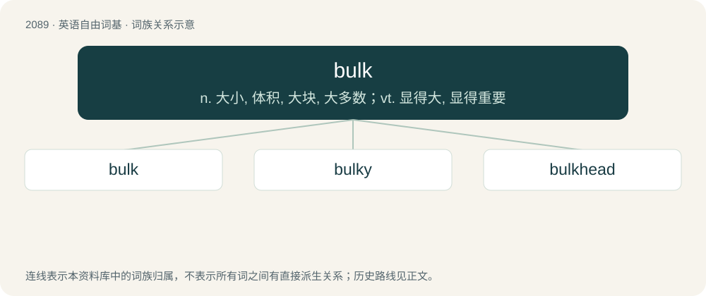

# 2194 · bulk — n. 大小, 体积, 大块, 大多数；vt. 显得大, 显得重要

[总目录](../00_总目录_按常用程度.md)

**类型**：英语自由词基　｜　**来源语言**：见词源记录

## 核心含义与来源

- 核心含义：n. 大小, 体积, 大块, 大多数；vt. 显得大, 显得重要
- 英文含义：Size, specifically, volume.
- 词形：bulk

**来源记录 1**（名词；Size, specifically, volume.）

From Middle English bulk, bolke (“a heap, cargo, hold; heap; bulge”), borrowed from Old Norse búlki (“the freight or the cargo of a ship”), from Proto-Germanic \*bulkô (“beam, pile, heap”), from Proto-Indo-European \*bʰelǵ- (“beam, pile, prop”). Compare Icelandic búlkast (“to be bulky”), Swedish dialectal bulk (“a bunch”), Danish bulk (“bump, knob”). Conflated with Middle English bouk (“belly, trunk”).

## 词族图

## 单词速览（常用到不常用）

| 单词 | 音标 | 释义 |
|---|---|---|
| [bulk](#w-1) | /bʌlk/ | n. 大小, 体积, 大块, 大多数；vt. 显得大, 显得重要 |
| [bulky](#w-2) | /ˈbʌlki/ | a. 庞大的；\[机\] 庞大, 笨重 |
| [bulkhead](#w-3) | /ˈbʌlk.hɛd/ | n. 隔壁, 防水壁 |

## 逐词详解

### 1. bulk

**词性**：名词　｜　**音标**：/bʌlk/

**中文释义**：n. 大小, 体积, 大块, 大多数；vt. 显得大, 显得重要

**英文义项**：Size, specifically, volume. / Any huge body or structure.

**词源与演化**：

From Middle English bulk, bolke (“a heap, cargo, hold; heap; bulge”), borrowed from Old Norse búlki (“the freight or the cargo of a ship”), from Proto-Germanic \*bulkô (“beam, pile, heap”), from Proto-Indo-European \*bʰelǵ- (“beam, pile, prop”). Compare Icelandic búlkast (“to be bulky”), Swedish dialectal bulk (“a bunch”), Danish bulk (“bump, knob”). Conflated with Middle English bouk (“belly, trunk”).

**例句**：

> I understood the bulk of what you were saying, just one of two points I need to hear again.

该用例对应义项：Gist.

### 2. bulky

**词性**：形容词　｜　**音标**：/ˈbʌlki/

**中文释义**：a. 庞大的；\[机\] 庞大, 笨重

**英文义项**：Being large in size, mass, or volume; big, fat or muscular. / Unwieldy.

**构词拆分**：bulk + -y

**词源与演化**：

From Middle English bulki, boulky, equivalent to bulk + -y.

**例句**：

> A boa is very dangerous, and an elephant is very bulky.

### 3. bulkhead

**词性**：名词　｜　**音标**：/ˈbʌlk.hɛd/

**中文释义**：n. 隔壁, 防水壁

**英文义项**：A vertical partition dividing the hull into separate compartments; often made watertight to prevent excessive flooding if the ship's hull is breached. / A similar partition in an aircraft or spacecraft, or some rail vehicles.

**构词拆分**：bulk + head

**词源与演化**：

From Old Norse bálkr (“partition”) + head, anglicised as bulk + head.

**例句**：

> He leaned against the metal bulkhead as the ferry rocked in the waves.
