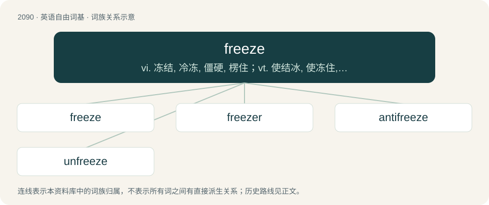

# 2196 · freeze — vi. 冻结, 冷冻, 僵硬, 楞住；vt. 使结冰, 使冻住, 使呆住；n. 结冰, 凝固

[总目录](../00_总目录_按常用程度.md)

**类型**：英语自由词基　｜　**来源语言**：见词源记录

## 核心含义与来源

- 核心含义：vi. 冻结, 冷冻, 僵硬, 楞住；vt. 使结冰, 使冻住, 使呆住；n. 结冰, 凝固
- 英文含义：Especially of a liquid, to become solid due to low temperature.
- 词形：freeze

**来源记录 1**（动词；Especially of a liquid, to become solid due to low temperature.）

From Middle English fresen, from Old English frēosan (“to freeze”), from Proto-West Germanic \*freusan, from Proto-Germanic \*freusaną (“to freeze”), from Proto-Indo-European \*prews- (“to freeze; frost”). Cognates Cognate with North Frisian friis, friise, früüs (“to freeze”), Saterland Frisian fjoose, frjoze (“to freeze”), West Frisian frieze (“to freeze”), Central Franconian freese (“to freeze”), Cimbrian briizan, vriizan (“to be cold”), Dutch vriezen (“to freeze”), Low German freren, fresen (“to freeze”), Luxembourgish fréieren (“to freeze”), German frieren (“to freeze”), Yiddish פֿרירן (frirn, “freeze”), Danish and Norwegian Bokmål fryse (“to freeze”), Icelandic frjósa (“to freeze”), Norwegian Nynorsk frysa, fryse (“to freeze”), Swedish frysa (“to freeze”); also Cornish rew (“frost, ice”), Irish reo (“frost”), reoigh (“to freeze”), Manx rio (“frost, ice”), Scottish Gaelic reòdh, reòth (“freeze”), Welsh rhew (“frost, ice”), Latin pruīna (“hoarfrost, rime”), Albanian prush (“embers”), Lithuanian prausti (“to give showers of rain”), Czech prskat (“to splutter, sputter”), Macedonian прска (prska, “to spray, sprinkle”), Polish pryskać, prysnąć (“to spray, sprinkle”), Russian пры́скать (prýskatʹ), пры́снуть (prýsnutʹ, “to spray, sprinkle”), Serbo-Croatian прскати, prskati (“to spray, sprinkle”), Sanskrit प्रुष्णोति (pruṣṇoti, “to moisten, shower, sprinkle, wet”), प्रुष्वा (pruṣvā, “hoarfrost, ice, rime”), Saraiki پسݨ (pussaṇ, “to become wet”).

## 词族图

## 单词速览（常用到不常用）

| 单词 | 音标 | 释义 |
|---|---|---|
| [freeze](#w-1) | /ˈfɹiːz/ | vi. 冻结, 冷冻, 僵硬, 楞住；vt. 使结冰, 使冻住, 使呆住；n. 结冰, 凝固 |
| [freezer](#w-2) | 英 /ˈfɹiːzə/；美 /ˈfɹizɚ/ | n. 冰库, 冰箱, 冷冻库 |
| [antifreeze](#w-3) | /ˈæntifriːz/ | n. 防冻剂；\[化\] 防冻 |
| [unfreeze](#w-4) | /.ʌnˈfriːz/ | vt. 使解冻, 解除(资金)的冻结 |

## 逐词详解

### 1. freeze

**词性**：动词　｜　**音标**：/ˈfɹiːz/

**中文释义**：vi. 冻结, 冷冻, 僵硬, 楞住；vt. 使结冰, 使冻住, 使呆住；n. 结冰, 凝固

**英文义项**：Especially of a liquid, to become solid due to low temperature. / To lower something's temperature to the point that it freezes or becomes hard.

**词源与演化**：

From Middle English fresen, from Old English frēosan (“to freeze”), from Proto-West Germanic \*freusan, from Proto-Germanic \*freusaną (“to freeze”), from Proto-Indo-European \*prews- (“to freeze; frost”). Cognates Cognate with North Frisian friis, friise, früüs (“to freeze”), Saterland Frisian fjoose, frjoze (“to freeze”), West Frisian frieze (“to freeze”), Central Franconian freese (“to freeze”), Cimbrian briizan, vriizan (“to be cold”), Dutch vriezen (“to freeze”), Low German freren, fresen (“to freeze”), Luxembourgish fréieren (“to freeze”), German frieren (“to freeze”), Yiddish פֿרירן (frirn, “freeze”), Danish and Norwegian Bokmål fryse (“to freeze”), Icelandic frjósa (“to freeze”), Norwegian Nynorsk frysa, fryse (“to freeze”), Swedish frysa (“to freeze”); also Cornish rew (“frost, ice”), Irish reo (“frost”), reoigh (“to freeze”), Manx rio (“frost, ice”), Scottish Gaelic reòdh, reòth (“freeze”), Welsh rhew (“frost, ice”), Latin pruīna (“hoarfrost, rime”), Albanian prush (“embers”), Lithuanian prausti (“to give showers of rain”), Czech prskat (“to splutter, sputter”), Macedonian прска (prska, “to spray, sprinkle”), Polish pryskać, prysnąć (“to spray, sprinkle”), Russian пры́скать (prýskatʹ), пры́снуть (prýsnutʹ, “to spray, sprinkle”), Serbo-Croatian прскати, prskati (“to spray, sprinkle”), Sanskrit प्रुष्णोति (pruṣṇoti, “to moisten, shower, sprinkle, wet”), प्रुष्वा (pruṣvā, “hoarfrost, ice, rime”), Saraiki پسݨ (pussaṇ, “to become wet”).

**例句**：

> Since the last update, the program freezes after a few minutes of use.

该用例对应义项：Of a machine or system, to come to a sudden halt, to stop working (functioning).

### 2. freezer

**词性**：名词　｜　**音标**：英 /ˈfɹiːzə/；美 /ˈfɹizɚ/

**中文释义**：n. 冰库, 冰箱, 冷冻库

**英文义项**：An appliance or room used to store food or other perishable items at temperatures below 0° Celsius (32° Fahrenheit). / The section of a refrigerator used to store food or other perishable items at a temperature below 0° Celsius (32° Fahrenheit).

**构词拆分**：freeze + -er

**词源与演化**：

From freeze + -er.

**例句**：

> Tom finished eating all the ice cream that was in the freezer.

### 3. antifreeze

**词性**：名词　｜　**音标**：/ˈæntifriːz/

**中文释义**：n. 防冻剂；\[化\] 防冻

**英文义项**：A substance, such as glycol, used to lower the freezing point of water. / Automotive antifreeze, a solution of ethylene glycol, used as an additive to water or a replacement for water, in the radiator of a motorcar.

**构词拆分**：anti- + freeze

**词源与演化**：

From anti- + freeze.

**例句**：

> Sami found a container of antifreeze in the kitchen garbage.

### 4. unfreeze

**词性**：动词　｜　**音标**：/.ʌnˈfriːz/

**中文释义**：vt. 使解冻, 解除(资金)的冻结

**英文义项**：To defrost something. / To thaw.

**构词拆分**：From un- + freeze.

**词源与演化**：

From un- + freeze.
