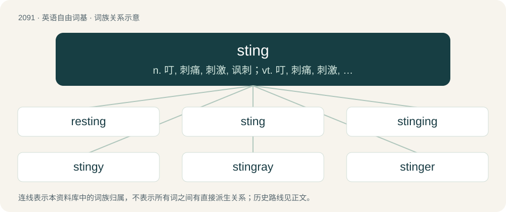

# 2200 · sting — n. 叮, 刺痛, 刺激, 讽刺；vt. 叮, 刺痛, 刺激, 使苦恼；vi. 叮, 刺痛

[总目录](../00_总目录_按常用程度.md)

**类型**：英语自由词基　｜　**来源语言**：见词源记录

## 核心含义与来源

- 核心含义：n. 叮, 刺痛, 刺激, 讽刺；vt. 叮, 刺痛, 刺激, 使苦恼；vi. 叮, 刺痛
- 英文含义：A bump left on the skin after having been stung.
- 词形：sting

**多个词源／构词路径**：同一拼写可能有不同来源；以下按词性和含义分别列出。

**来源记录 1**（名词；A bump left on the skin after having been stung.）

From Middle English styng, sting, stynge, stenge, from Old English sting, stincg (“a sting, stab, thrust made with a pointed instrument; the wound made by a stab or sting”), from Proto-Germanic \*stingaz; possibly also from Old English stynġ, from Proto-Germanic \*stungiz.

**来源记录 2**（动词；To hurt, usually by introducing poison or a sharp point, or both.）

From Middle English stingen, from Old English stingan, from Proto-Germanic \*stinganą. Compare Swedish and Icelandic stinga.

## 词族图

## 单词速览（常用到不常用）

| 单词 | 音标 | 释义 |
|---|---|---|
| [resting](#w-1) | /ɹiːˈstɪŋ/ | a. 静止的；休眠的 |
| [sting](#w-2) | /ˈstɪŋ/ | n. 叮, 刺痛, 刺激, 讽刺；vt. 叮, 刺痛, 刺激, 使苦恼；vi. 叮, 刺痛 |
| [stinging](#w-3) | /ˈstɪŋɪŋ/ | a. 刺人的, 刺一般的, 激烈的 |
| [stingy](#w-4) | /ˈstɪŋi/ | 【英文】Stinging; able or inclined to sting. |
| [stingray](#w-5) | /ˈstɪŋˌɹeɪ/ | n. \[鱼\]黄貂鱼 |
| [stinger](#w-6) | 英 /ˈstɪŋ.ə(ɹ)/；美 /ˈstɪŋ.ɚ/ | n. 刺激者, 讽刺者 |

## 逐词详解

### 1. resting

**词性**：动词　｜　**音标**：/ɹiːˈstɪŋ/

**中文释义**：a. 静止的；休眠的

**英文义项**：To sting again.

**构词拆分**：re- + sting

**词源与演化**：

From re- + sting.

**例句**：

> She fell asleep at her desk, her head resting on the keyboard.

### 2. sting

**词性**：名词　｜　**音标**：/ˈstɪŋ/

**中文释义**：n. 叮, 刺痛, 刺激, 讽刺；vt. 叮, 刺痛, 刺激, 使苦恼；vi. 叮, 刺痛

**英文义项**：A bump left on the skin after having been stung. / A puncture made by an insect or arachnid in an attack, usually including the injection of venom.

**词源与演化**：

From Middle English styng, sting, stynge, stenge, from Old English sting, stincg (“a sting, stab, thrust made with a pointed instrument; the wound made by a stab or sting”), from Proto-Germanic \*stingaz; possibly also from Old English stynġ, from Proto-Germanic \*stungiz.

**例句**：

> The criminal gang was caught after a successful sting.

该用例对应义项：A police operation in which the police pretend to engage in criminal activity in order to catch a criminal.

### 3. stinging

**词性**：形容词　｜　**音标**：/ˈstɪŋɪŋ/

**中文释义**：a. 刺人的, 刺一般的, 激烈的

**英文义项**：Having the capacity to sting. / Precise and hurtful.

**构词拆分**：sting + -ing

**词源与演化**：

From Middle English styngyng; equivalent to sting + -ing.

**用法示例／搭配（非完整句）**：

> a stinging indictment of the American prison system

该用例对应义项：Precise and hurtful.

### 4. stingy

**词性**：形容词　｜　**音标**：/ˈstɪŋi/

**英文义项**：Stinging; able or inclined to sting.

**构词拆分**：From sting + -y.

**词源与演化**：

From sting + -y.

### 5. stingray

**词性**：名词　｜　**音标**：/ˈstɪŋˌɹeɪ/

**中文释义**：n. \[鱼\]黄貂鱼

**英文义项**：Any of various large, venomous rays, of the orders Rajiformes and Myliobatiformes, having a barbed, whiplike tail. / A device that simulates a cell tower, used to intercept cell phone communications.

**构词拆分**：sting + ray

**词源与演化**：

From sting + ray.

**例句**：

> I was surprised to learn that a stingray can actually regenerate its stinger if it gets broken off.

### 6. stinger

**词性**：名词　｜　**音标**：英 /ˈstɪŋ.ə(ɹ)/；美 /ˈstɪŋ.ɚ/

**中文释义**：n. 刺激者, 讽刺者

**英文义项**：A pointed portion of an insect or arachnid used for attack. / Anything that is used to sting, as a means of attack.

**构词拆分**：sting + -er

**词源与演化**：

From sting + -er. Both figurative and literal senses appeared in the 16th century.

**例句**：

> A scorpion has a stinger at the end of its tail.
