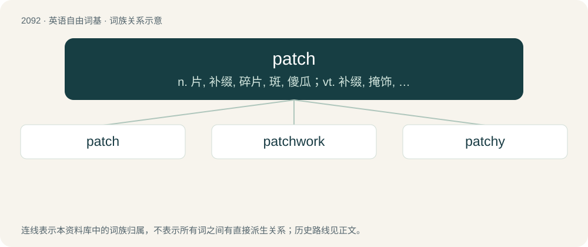

# 2201 · patch — n. 片, 补缀, 碎片, 斑, 傻瓜；vt. 补缀, 掩饰, 拼凑, 平息；\[计\] 修补; 拼凑

[总目录](../00_总目录_按常用程度.md)

**类型**：英语自由词基　｜　**来源语言**：见词源记录

## 核心含义与来源

- 核心含义：n. 片, 补缀, 碎片, 斑, 傻瓜；vt. 补缀, 掩饰, 拼凑, 平息；\[计\] 修补; 拼凑
- 英文含义：A piece of cloth, or other suitable material, sewed or otherwise fixed upon a garment to repair or strengthen it, especially upon an old garment to cover a hole.
- 词形：patch

**来源记录 1**（名词；A piece of cloth, or other suitable material, sewed or otherwise fixed upon a garment to repair or strengthen it, especially upon an old garment to cover a hole.）

From Middle English patche, of uncertain origin. Perhaps an alteration of earlier Middle English placche (“patch, spot, piece of cloth”), from Old English \*plæċċ, \*pleċċ (“a spot, mark, patch”), from Proto-West Germanic \*plakkju, from Proto-Germanic \*plakjō (“spot, stain”). For the loss of l compare pat from Middle English platten. Germanic cognates would then include Middle English plecke, dialectal English pleck (“plot of ground, patch”), West Frisian plak (“place, spot”), Low German Plakk, Plakke (“spot, piece, patch”), Dutch plek (“spot, place, stain, patch”), Dutch plak (“piece, slab”), Swedish plagg (“garment”), Faroese plagg (“cloth, rag”). Or, possibly a variant of Old French pieche, dialectal variant of piece (“piece”). Compare also Old Occitan petaç (“patch”).

## 词族图

## 单词速览（常用到不常用）

| 单词 | 音标 | 释义 |
|---|---|---|
| [patch](#w-1) | /pæt͡ʃ/ | n. 片, 补缀, 碎片, 斑, 傻瓜；vt. 补缀, 掩饰, 拼凑, 平息；\[计\] 修补; 拼凑 |
| [patchwork](#w-2) | /ˈpætʃwəːk/ | n. 拼缝物, 拼凑物 |
| [patchy](#w-3) | /ˈpæt͡ʃi/ | a. 补缀的, 凑合的, 不调和的, 散落的, 斑驳的, 不完全的 |

## 逐词详解

### 1. patch

**词性**：名词　｜　**音标**：/pæt͡ʃ/

**中文释义**：n. 片, 补缀, 碎片, 斑, 傻瓜；vt. 补缀, 掩饰, 拼凑, 平息；\[计\] 修补; 拼凑

**英文义项**：A piece of cloth, or other suitable material, sewed or otherwise fixed upon a garment to repair or strengthen it, especially upon an old garment to cover a hole. / A small piece of anything used to repair damage or a breach; as, a patch on a kettle, a roof, etc.

**词源与演化**：

From Middle English patche, of uncertain origin. Perhaps an alteration of earlier Middle English placche (“patch, spot, piece of cloth”), from Old English \*plæċċ, \*pleċċ (“a spot, mark, patch”), from Proto-West Germanic \*plakkju, from Proto-Germanic \*plakjō (“spot, stain”). For the loss of l compare pat from Middle English platten. Germanic cognates would then include Middle English plecke, dialectal English pleck (“plot of ground, patch”), West Frisian plak (“place, spot”), Low German Plakk, Plakke (“spot, piece, patch”), Dutch plek (“spot, place, stain, patch”), Dutch plak (“piece, slab”), Swedish plagg (“garment”), Faroese plagg (“cloth, rag”). Or, possibly a variant of Old French pieche, dialectal variant of piece (“piece”). Compare also Old Occitan petaç (“patch”).

**例句**：

> Before you can fix a dam, you have to apply a patch to the hole so that everything can dry off.

该用例对应义项：A piece of any size, used to repair something for a temporary period only, or that it is temporary because it is not meant to last long or will be removed as soon as a proper repair can be made, which will happen in the near future.

### 2. patchwork

**词性**：名词　｜　**音标**：/ˈpætʃwəːk/

**中文释义**：n. 拼缝物, 拼凑物

**英文义项**：A work, such as a blanket, composed of many different colors and shapes, sewn together to make an interesting whole. / Any kind of creation that makes use of many different aspects to create one whole piece.

**构词拆分**：patch + work

**词源与演化**：

From patch + work.

**例句**：

> Bill took all of his poetry and put it together in a folder. It made up a patchwork of his life.

该用例对应义项：Any kind of creation that makes use of many different aspects to create one whole piece.

### 3. patchy

**词性**：形容词　｜　**音标**：/ˈpæt͡ʃi/

**中文释义**：a. 补缀的, 凑合的, 不调和的, 散落的, 斑驳的, 不完全的

**英文义项**：Full of, or covered with, patches; abounding in patches. / Not constant or continuous; intermittent or uneven.

**构词拆分**：patch + -y

**词源与演化**：

From patch + -y.

**用法示例／搭配（非完整句）**：

> a patchy performance

该用例对应义项：Not constant or continuous; intermittent or uneven.
