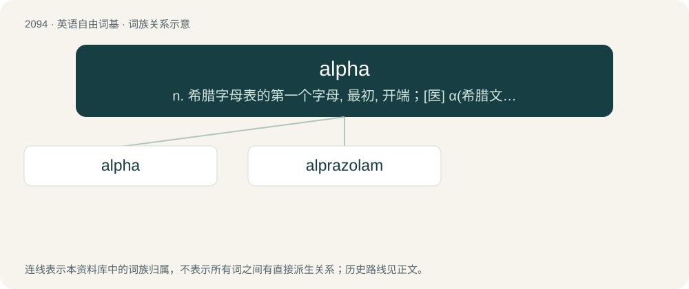

# 2202 · alpha — n. 希腊字母表的第一个字母, 最初, 开端；\[医\] α(希腊文的第一个字母), 甲种

[总目录](../00_总目录_按常用程度.md)

**类型**：英语自由词基　｜　**来源语言**：见词源记录

## 核心含义与来源

- 核心含义：n. 希腊字母表的第一个字母, 最初, 开端；\[医\] α(希腊文的第一个字母), 甲种
- 英文含义：The name of the first letter of the Greek alphabet (Α, α), followed by beta. In the Latin alphabet it is the predecessor to A.
- 词形：alpha

**来源记录 1**（名词；The name of the first letter of the Greek alphabet (Α, α), followed by beta. In the Latin alphabet it is the predecessor to A.）

From the Ancient Greek ἄλφα (álpha), the first letter of the Greek alphabet, from the Phoenician 𐤀 (ʾ, “aleph”). Doublet of alif and aleph.

## 词族图

## 单词速览（常用到不常用）

| 单词 | 音标 | 释义 |
|---|---|---|
| [alpha](#w-1) | 英 /ˈæl.fə/ | n. 希腊字母表的第一个字母, 最初, 开端；\[医\] α(希腊文的第一个字母), 甲种 |
| [alprazolam](#w-2) | 英 /alˈpɹeɪ.zəʊ.lam/；美 /ælˈpɹæz.əˌlæm/ | \[化\] 阿普唑仑 |

## 逐词详解

### 1. alpha

**词性**：名词　｜　**音标**：英 /ˈæl.fə/

**中文释义**：n. 希腊字母表的第一个字母, 最初, 开端；\[医\] α(希腊文的第一个字母), 甲种

**英文义项**：The name of the first letter of the Greek alphabet (Α, α), followed by beta. In the Latin alphabet it is the predecessor to A. / Latin alpha: the Latin letter Ɑ (minuscule: ɑ).

**词源与演化**：

From the Ancient Greek ἄλφα (álpha), the first letter of the Greek alphabet, from the Phoenician 𐤀 (ʾ, “aleph”). Doublet of alif and aleph.

**例句**：

> I will attempt to make an alpha particle ("α-particle") with the Large Hadron Collider.

该用例对应义项：The name of the symbols Α and α used in science and mathematics, often interchangeable with the symbols when used as a prefix.

### 2. alprazolam

**词性**：名词　｜　**音标**：英 /alˈpɹeɪ.zəʊ.lam/；美 /ælˈpɹæz.əˌlæm/

**中文释义**：\[化\] 阿普唑仑

**英文义项**：A drug (trademark Xanax) of the benzodiazepine group (8-chloro-1-methyl-6-phenyl-4H-\[1,2,4\]triazolo\[4,3-a\]\[1,4\]benzodiazepine), used in the treatment of anxiety.

**构词拆分**：alpha + phenyl + triazolo + -azepam

**词源与演化**：

From al(pha) + p(henyl) + (t)r(i)azol(o) + -(azep)am.
