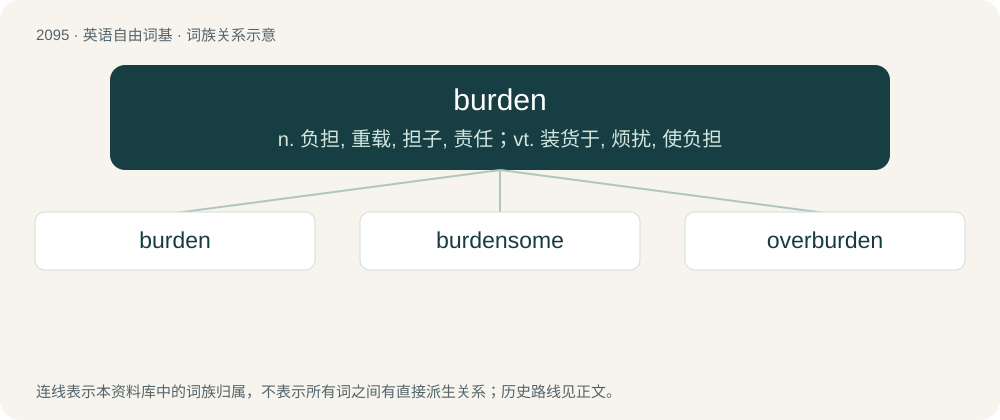

# 2203 · burden — n. 负担, 重载, 担子, 责任；vt. 装货于, 烦扰, 使负担

[总目录](../00_总目录_按常用程度.md)

**类型**：英语自由词基　｜　**来源语言**：见词源记录

## 核心含义与来源

- 核心含义：n. 负担, 重载, 担子, 责任；vt. 装货于, 烦扰, 使负担
- 英文含义：A heavy load.
- 词形：burden

**多个词源／构词路径**：同一拼写可能有不同来源；以下按词性和含义分别列出。

**来源记录 1**（名词；A heavy load.）

Inherited from Middle English birthene, birthen, birden, from Old English byrden, byrþen, from Proto-West Germanic \*burþini, from \*burþī, from Proto-Germanic \*burþį̄, from Proto-Indo-European \*bʰer- (“to carry, bear”).

**来源记录 2**（名词；A phrase or theme that recurs at the end of each verse in a folk song or ballad.）

Inherited from Middle English burdoun (“accompaniment”), from Old French bordon (“drone”), from Medieval Latin burdō. Doublet of bourdon.

## 词族图

## 单词速览（常用到不常用）

| 单词 | 音标 | 释义 |
|---|---|---|
| [burden](#w-1) | 英 /ˈbɜːdn̩/；美 /ˈbɝdn̩/ | n. 负担, 重载, 担子, 责任；vt. 装货于, 烦扰, 使负担 |
| [burdensome](#w-2) | 英 /ˈbɜː.dən.səm/；美 /ˈbɝ.dən.səm/ | a. 累赘的, 恼人的, 繁重的；\[法\] 难于负担的, 压抑的, 累赘的 |
| [overburden](#w-3) | 英 /ˌəʊ̯vəˈbɜːdn̩/；美 /ˌoʊvɚˈbɝdn̩/ | vt. 装载过多, 负担过多, 使过劳；\[经\] 过重的货物, 重担, 过度的负担 |

## 逐词详解

### 1. burden

**词性**：名词　｜　**音标**：英 /ˈbɜːdn̩/；美 /ˈbɝdn̩/

**中文释义**：n. 负担, 重载, 担子, 责任；vt. 装货于, 烦扰, 使负担

**英文义项**：A heavy load. / A responsibility, onus.

**词源与演化**：

Inherited from Middle English birthene, birthen, birden, from Old English byrden, byrþen, from Proto-West Germanic \*burþini, from \*burþī, from Proto-Germanic \*burþį̄, from Proto-Indo-European \*bʰer- (“to carry, bear”).

**例句**：

> A burden of gad steel is 120 pounds.

该用例对应义项：A fixed quantity of certain commodities.

### 2. burdensome

**词性**：形容词　｜　**音标**：英 /ˈbɜː.dən.səm/；美 /ˈbɝ.dən.səm/

**中文释义**：a. 累赘的, 恼人的, 繁重的；\[法\] 难于负担的, 压抑的, 累赘的

**英文义项**：Characteristic of a burden; arduous or demanding

**构词拆分**：burden + -some

**词源与演化**：

From burden + -some.

**例句**：

> When life is so burdensome death has become a sought after refuge.

### 3. overburden

**词性**：动词　｜　**音标**：英 /ˌəʊ̯vəˈbɜːdn̩/；美 /ˌoʊvɚˈbɝdn̩/

**中文释义**：vt. 装载过多, 负担过多, 使过劳；\[经\] 过重的货物, 重担, 过度的负担

**英文义项**：To overload or overtax.

**构词拆分**：over- + burden

**词源与演化**：

From over- + burden.
