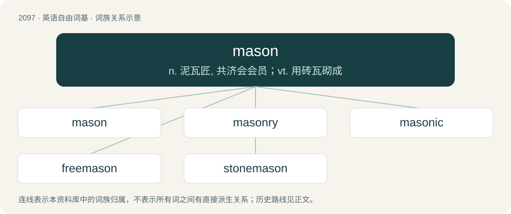

# 2204 · mason — n. 泥瓦匠, 共济会会员；vt. 用砖瓦砌成

[总目录](../00_总目录_按常用程度.md)

**类型**：英语自由词基　｜　**来源语言**：见词源记录

## 核心含义与来源

- 核心含义：n. 泥瓦匠, 共济会会员；vt. 用砖瓦砌成
- 英文含义：A bricklayer, one whose occupation is to build with stone or brick.
- 词形：mason

**来源记录 1**（名词；A bricklayer, one whose occupation is to build with stone or brick.）

From Middle English masoun, machun, from Anglo-Norman machun, masson, Old French maçon, from Late Latin maciō (“carpenter, bricklayer”).

## 词族图

## 单词速览（常用到不常用）

| 单词 | 音标 | 释义 |
|---|---|---|
| [mason](#w-1) | /ˈmeɪsən/ | n. 泥瓦匠, 共济会会员；vt. 用砖瓦砌成 |
| [masonry](#w-2) | /ˈmeɪsənɹi/ | n. (建筑物的)砖石部分 |
| [masonic](#w-3) | 英 /məˈsɒnɪk/；美 /məˈsɑnɪk/ | a. 共济会会员的 |
| [freemason](#w-4) | /ˈfriːmeisn/ | n. 互济会会员；\[法\] 互济会 |
| [stonemason](#w-5) | 美 /ˈstoʊnˌmeɪsən/ | n. 石工, 石匠 |

## 逐词详解

### 1. mason

**词性**：名词　｜　**音标**：/ˈmeɪsən/

**中文释义**：n. 泥瓦匠, 共济会会员；vt. 用砖瓦砌成

**英文义项**：A bricklayer, one whose occupation is to build with stone or brick. / One who prepares stone for building purposes.

**词源与演化**：

From Middle English masoun, machun, from Anglo-Norman machun, masson, Old French maçon, from Late Latin maciō (“carpenter, bricklayer”).

**例句**：

> It is at the foot of the wall that we know the mason.

### 2. masonry

**词性**：名词　｜　**音标**：/ˈmeɪsənɹi/

**中文释义**：n. (建筑物的)砖石部分

**英文义项**：The art or occupation of a mason. / The work or performance of a mason.

**构词拆分**：mason + -ry

**词源与演化**：

From Middle English masonry, masonrie, partly from Old French maçonerie and partly from mason + -ry.

**例句**：

> He studied masonry for five years.

该用例对应义项：The art or occupation of a mason.

### 3. masonic

**词性**：形容词　｜　**音标**：英 /məˈsɒnɪk/；美 /məˈsɑnɪk/

**中文释义**：a. 共济会会员的

**英文义项**：Of or pertaining to stonemasons or masonry. / Of or pertaining to freemasonry.

**构词拆分**：mason + -ic

**词源与演化**：

From mason + -ic.

**例句**：

> A collar may come in many varieties, from button-down to clerical, and Mandarin to Masonic, but it is never a lapel.

### 4. freemason

**词性**：名词　｜　**音标**：/ˈfriːmeisn/

**中文释义**：n. 互济会会员；\[法\] 互济会

**英文义项**：A member of a guild of skilled itinerant masons during the Middle Ages and early modern times.

**构词拆分**：free + mason

**词源与演化**：

From free + mason.

### 5. stonemason

**词性**：名词　｜　**音标**：美 /ˈstoʊnˌmeɪsən/

**中文释义**：n. 石工, 石匠

**英文义项**：One who works in stone.

**构词拆分**：stone + mason

**词源与演化**：

From stone + mason.
