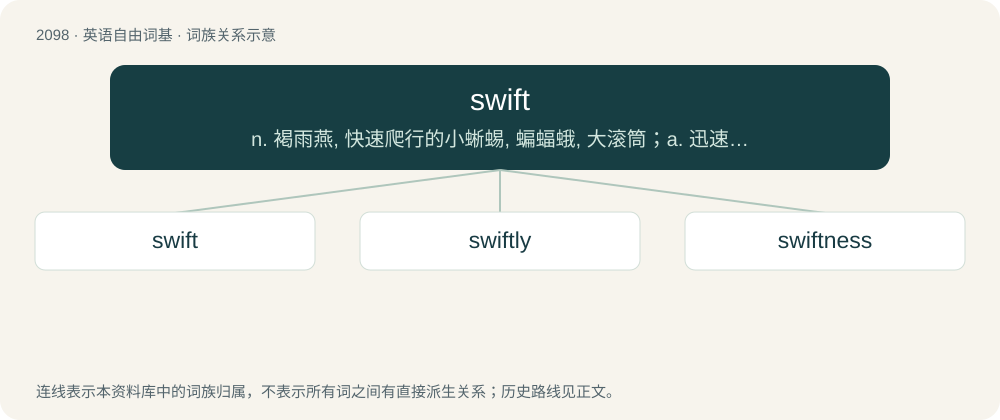

# 2205 · swift — n. 褐雨燕, 快速爬行的小蜥蜴, 蝙蝠蛾, 大滚筒；a. 迅速的, 快的, 敏捷的, 立刻的；adv. 迅速地, 敏捷地

[总目录](../00_总目录_按常用程度.md)

**类型**：英语自由词基　｜　**来源语言**：见词源记录

## 核心含义与来源

- 核心含义：n. 褐雨燕, 快速爬行的小蜥蜴, 蝙蝠蛾, 大滚筒；a. 迅速的, 快的, 敏捷的, 立刻的；adv. 迅速地, 敏捷地
- 英文含义：Fast; quick; rapid.
- 词形：swift

**来源记录 1**（形容词；Fast; quick; rapid.）

From Middle English swift, from Old English swift (“swift; quick”), from Proto-Germanic \*swiftaz (“swift; quick”), from Proto-Indo-European \*(s)weyp- (“to twist; wind around”). Cognate with Icelandic svipta (“to pull quickly”), Old English swīfan (“to revolve, sweep, wend, intervene”). More at swivel.

## 词族图

## 单词速览（常用到不常用）

| 单词 | 音标 | 释义 |
|---|---|---|
| [swift](#w-1) | /swɪft/ | n. 褐雨燕, 快速爬行的小蜥蜴, 蝙蝠蛾, 大滚筒；a. 迅速的, 快的, 敏捷的, 立刻的；adv. 迅速地, 敏捷地 |
| [swiftly](#w-2) | /ˈswɪftli/ | adv. 很快地, 即刻 |
| [swiftness](#w-3) | /ˈswɪftnɪs/ | n. 迅速, 快 |

## 逐词详解

### 1. swift

**词性**：形容词　｜　**音标**：/swɪft/

**中文释义**：n. 褐雨燕, 快速爬行的小蜥蜴, 蝙蝠蛾, 大滚筒；a. 迅速的, 快的, 敏捷的, 立刻的；adv. 迅速地, 敏捷地

**英文义项**：Fast; quick; rapid. / Capable of moving at high speeds.

**词源与演化**：

From Middle English swift, from Old English swift (“swift; quick”), from Proto-Germanic \*swiftaz (“swift; quick”), from Proto-Indo-European \*(s)weyp- (“to twist; wind around”). Cognate with Icelandic svipta (“to pull quickly”), Old English swīfan (“to revolve, sweep, wend, intervene”). More at swivel.

**例句**：

> The river’s swift current carried the boat downstream.

该用例对应义项：Fast; quick; rapid.

### 2. swiftly

**词性**：副词　｜　**音标**：/ˈswɪftli/

**中文释义**：adv. 很快地, 即刻

**英文义项**：In a swift manner; quickly; with quick motion or velocity; fleetly.

**构词拆分**：swift + -ly

**词源与演化**：

From Middle English swiftly, swyftely, swiftliche, from Old English swiftlīċe (“swiftly”), equivalent to swift + -ly.

**例句**：

> If you buy a ticket swiftly, you might still catch the train.

### 3. swiftness

**词性**：名词　｜　**音标**：/ˈswɪftnɪs/

**中文释义**：n. 迅速, 快

**英文义项**：The state of being swift.

**构词拆分**：swift + -ness

**词源与演化**：

From Middle English swiftnesse, swyftnesse, from Old English swiftnes (“swiftness”), equivalent to swift + -ness.

**例句**：

> They admired the swiftness of the river’s current.

该用例对应义项：The state of being swift.
