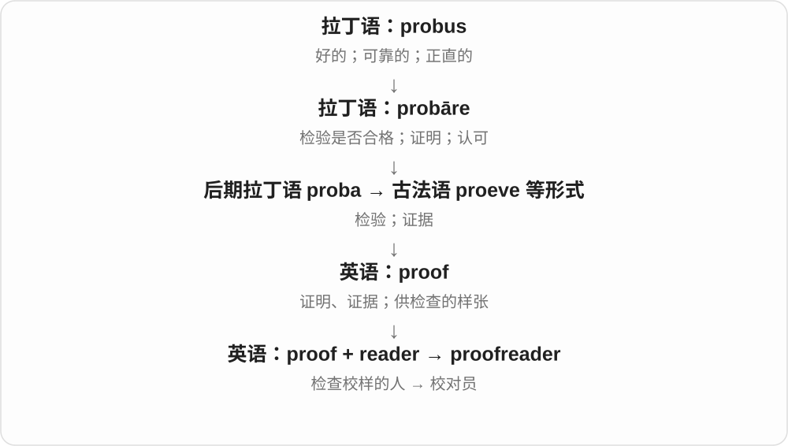

# 2206 · reader — 阅读者、专业读者角色与读者整体

[逐词精讲目录](../00_逐词精讲目录.md) · [总目录](../00_总目录_按常用程度.md)

## 核心词根与来源

词尾改变关注点：从谁在读，到有多少、哪些人在读。新闻播读者和校对者的工作也不能只按会阅读就混成一种职业。

**READER：读的人；READERSHIP：放在一起看的读者群**

reader → readership；newsreader、proofreader 各有固定工作角色。

- **阅读者与集体**：reader · readership
- **工作角色**：newsreader · proofreader

## 词形与演化规律

read + -er → reader；reader + -ship；news/proof + reader。

## 单词速览（按词族由简到繁）

同一基础词的相关扩展放在一起，先读基础形式，再读扩展；各组之间优先读常用的。具体词源关系见各词讲解。

| 单词 | 音标 | 核心意思 |
|---|---|---|
| [reader](#w-1) | 英 /ˈriːdə/；美 /ˈriːdər/ | 读者；阅读器；读本 |
| [readership](#w-2) | 英 /ˈriːdəʃɪp/；美 /ˈriːdərʃɪp/ | 读者群、读者人数；Reader 职位〔特定学术语境〕 |
| [newsreader](#w-3) | 英 /ˈnjuːzriːdə/；美 /ˈnuːzriːdər/ | 新闻播音员；新闻组阅读程序〔技术用法〕 |
| [proofreader](#w-4) | 英 /ˈpruːfriːdə/；美 /ˈpruːfriːdər/ | 校对员 |

## 逐词讲解

### 1. reader — 读者；阅读器；读本

**音标**：英 /ˈriːdə/；美 /ˈriːdər/

**先抓住这个画面**

把文字、编码读进去的，可以是人，也可以是设备；供练习阅读的书也叫 reader。

**怎么拆**

read + -er；接古英语 rǣdere、中古英语 redere 等。-er 常表人或执行某动作的东西，读本义则是供读者阅读的书籍名称。

**怎么变成今天的意思**

**古英语 rǣdan → 中古英语 reden**  
劝告、解释；读懂文字

↓

**古英语 rǣdere → 中古英语 redere → reader**  
读者等角色 → 阅读设备、读本等用法

a regular reader 是常读者，a card reader 是读卡器，a graded reader 是按难度分级的读本。学术职位 Reader 等另按当地体系理解。

**常见搭配与例句**

an avid reader；a card reader；a graded reader；readers of the magazine。

> The magazine invites readers to send in their stories.

杂志邀请读者投稿讲述自己的故事。

> Insert the card into the reader.

把卡插入读卡器。

**别混淆**

reader 不只指电子书设备；a reader of novels 常是读小说的人，a novel reader 又需按语境判断是读者还是软件。

### 2. readership — 读者群、读者人数；Reader 职位〔特定学术语境〕

**音标**：英 /ˈriːdəʃɪp/；美 /ˈriːdərʃɪp/

**先抓住这个画面**

reader 是一个读者，readership 常把一本刊物、一个网站的读者作为一群来看；large readership 就是读的人多。

**怎么拆**

reader + -ship，-ship 在此形成群体、状态等名词，不是轮船。另有 reader 的特定职位名对应的职务用法，须看机构语境。

**怎么变成今天的意思**

**read → reader**  
阅读者、读者；也有特定职位名称

↓

**reader + -ship → readership**  
读者整体、人数；相应职位

a wide readership 广泛读者群，a growing readership 不断扩大的读者群，the readership of a magazine 一本杂志的读者群。

**常见搭配与例句**

a wide readership；a growing readership；magazine readership。

> The magazine has a loyal readership.

这本杂志拥有忠实的读者群。

> The website aims to reach a younger readership.

这个网站希望吸引更年轻的读者群。

**别混淆**

readership 不是阅读技能、读了多少页；reading 阅读活动、readability 可读性和读者群不同。

### 3. newsreader — 新闻播音员；新闻组阅读程序〔技术用法〕

**音标**：英 /ˈnjuːzriːdə/；美 /ˈnuːzriːdər/

**先抓住这个画面**

可以是读新闻给你听的人，也可以是帮你读取旧式网络新闻组的程序。

**怎么拆**

news + reader，reader 是 read + -er；人的播报角色与软件工具都是参与读取的名词用法，不说程序变成了人。

**怎么变成今天的意思**

**news；reader〔read + -er〕**  
并列构词部分

↓

**newsreader**  
新闻播读者；新闻组阅读软件

a BBC newsreader 可指该机构新闻播音员，a Usenet newsreader 是读取、参与新闻组的软件。news 在技术名称中不限时事报道。

**常见搭配与例句**

a television newsreader；a radio newsreader；a Usenet newsreader。

> The newsreader paused before announcing the result.

新闻播音员公布结果前停顿了一下。

> The old guide explains how to configure a newsreader for Usenet.

旧指南讲解怎样为 Usenet 配置新闻组阅读程序。

**别混淆**

newsreader 职业用法与 newscaster 近；普通阅读新闻的任何人通常直接说 a news reader、reader，具体职业称呼看语境。

### 4. proofreader — 校对员

**音标**：英 /ˈpruːfriːdə/；美 /ˈpruːfriːdər/

**先抓住这个画面**

别人负责把内容写出来，这个人专门盯住还没被发现的小错误。

**怎么拆**

proof 印刷校样 + reader 读者；这个人物名历史上早于常用动词 proofread 的记录。

**怎么变成今天的意思**

可以是职业名称，也可以指这次负责校对的人。a proofreader 关注文字准确，并不必然承担事实调查的全部职责。

**常见搭配与例句**

a professional proofreader；hire a proofreader。

> The proofreader caught a repeated word in the title.

校对员发现标题中有一个词重复了。

> A second proofreader checked the revised pages.

另一名校对员检查了修改后的页面。

**别混淆**

proofreader 是校对人；spellchecker 是拼写检查工具，工具不能代替所有语境判断。

## 这一组要分清什么

readership 不是可读性；proofreader 校对文字，newsreader 播读新闻。

## 串起来练习

The reader survey helped the magazine understand its readership.

读者调查帮助杂志了解自己的读者群。
