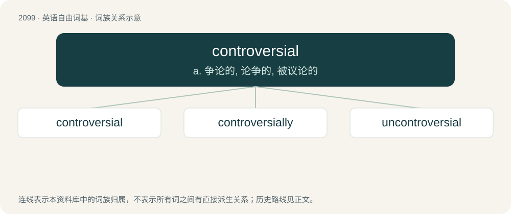

# 2207 · controversial — a. 争论的, 论争的, 被议论的

[总目录](../00_总目录_按常用程度.md)

**类型**：英语自由词基　｜　**来源语言**：见词源记录

## 核心含义与来源

- 核心含义：a. 争论的, 论争的, 被议论的
- 英文含义：Arousing or likely to arouse controversy.
- 词形：controversial

**来源记录 1**（形容词；Arousing or likely to arouse controversy.）

From Latin contrōversiālis, from contrōversia + -ālis. By surface analysis, controversy + -al.

## 词族图

## 单词速览（常用到不常用）

| 单词 | 音标 | 释义 |
|---|---|---|
| [controversial](#w-1) | 英 /ˌkɒn.tɹəˈvɜː.ʃəl/；美 /ˌkɑn.tɹəˈvɝ.ʃəl/ | a. 争论的, 论争的, 被议论的 |
| [controversially](#w-2) | /,kɔntrəˈvəːʃəli/ | adv. 颇有争议地；引起争议地 |
| [uncontroversial](#w-3) |  | a. 非争论性的；不会引起争论的 |

## 逐词详解

### 1. controversial

**词性**：形容词　｜　**音标**：英 /ˌkɒn.tɹəˈvɜː.ʃəl/；美 /ˌkɑn.tɹəˈvɝ.ʃəl/

**中文释义**：a. 争论的, 论争的, 被议论的

**英文义项**：Arousing or likely to arouse controversy. / Engaging in or given to controversy; disputatious, argumentative.

**词源与演化**：

From Latin contrōversiālis, from contrōversia + -ālis. By surface analysis, controversy + -al.

**例句**：

> The issue of the death penalty is highly controversial.

该用例对应义项：marked by or capable of arousing controversy

### 2. controversially

**词性**：副词　｜　**音标**：/,kɔntrəˈvəːʃəli/

**中文释义**：adv. 颇有争议地；引起争议地

**英文义项**：In a controversial manner.

**构词拆分**：controversial + -ly

**词源与演化**：

From controversial + -ly.

**例句**：

> Constantine the Great is discussed controversially in modern historical research.

### 3. uncontroversial

**词性**：形容词

**中文释义**：a. 非争论性的；不会引起争论的

**英文义项**：Not controversial.

**构词拆分**：un- + controversial

**词源与演化**：

From un- + controversial.

**例句**：

> Throwing food at people is a very old, harmless, and uncontroversial form of protest.
