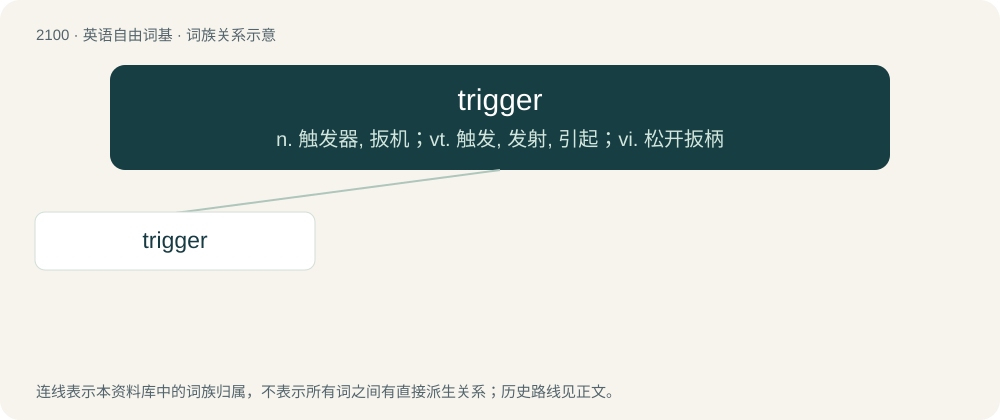

# 2208 · trigger — n. 触发器, 扳机；vt. 触发, 发射, 引起；vi. 松开扳柄

[总目录](../00_总目录_按常用程度.md)

**类型**：英语自由词基　｜　**来源语言**：见词源记录

## 核心含义与来源

- 核心含义：n. 触发器, 扳机；vt. 触发, 发射, 引起；vi. 松开扳柄
- 英文含义：A finger-operated lever used to fire a gun.
- 词形：trigger

**来源记录 1**（名词；A finger-operated lever used to fire a gun.）

Originally tricker, from Dutch trekker (“pull”, noun, as in drawer-pull, bell-pull), from Dutch trekken (“to drag, draw, pull”).

## 词族图

## 单词速览（常用到不常用）

| 单词 | 音标 | 释义 |
|---|---|---|
| [trigger](#w-1) | 英 /ˈtɹɪɡə/；美 /ˈtɹɪɡɚ/ | n. 触发器, 扳机；vt. 触发, 发射, 引起；vi. 松开扳柄 |

## 逐词详解

### 1. trigger

**词性**：名词　｜　**音标**：英 /ˈtɹɪɡə/；美 /ˈtɹɪɡɚ/

**中文释义**：n. 触发器, 扳机；vt. 触发, 发射, 引起；vi. 松开扳柄

**英文义项**：A finger-operated lever used to fire a gun. / A similar device used to activate any mechanism.

**词源与演化**：

Originally tricker, from Dutch trekker (“pull”, noun, as in drawer-pull, bell-pull), from Dutch trekken (“to drag, draw, pull”).

**例句**：

> Sleeping in an unfamiliar room can be a trigger for sleepwalking.

该用例对应义项：An event that initiates others, or incites a response.
