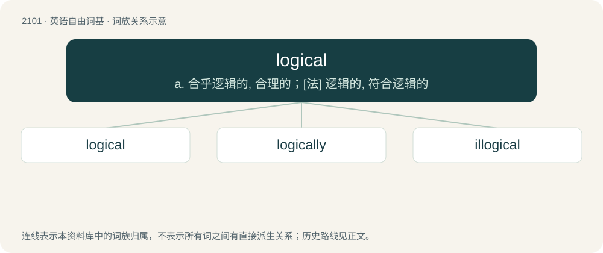

# 2209 · logical — a. 合乎逻辑的, 合理的；\[法\] 逻辑的, 符合逻辑的

[总目录](../00_总目录_按常用程度.md)

**类型**：英语自由词基　｜　**来源语言**：见词源记录

## 核心含义与来源

- 核心含义：a. 合乎逻辑的, 合理的；\[法\] 逻辑的, 符合逻辑的
- 英文含义：In agreement with the principles of logic.
- 词形：logical

**来源记录 1**（形容词；In agreement with the principles of logic.）

From logic + -al. Displaced native Old English flitcræftlīċ.

## 词族图

## 单词速览（常用到不常用）

| 单词 | 音标 | 释义 |
|---|---|---|
| [logical](#w-1) | 英 /ˈlɒd͡ʒɪkəl/；美 /ˈlɑd͡ʒɪkəl/ | a. 合乎逻辑的, 合理的；\[法\] 逻辑的, 符合逻辑的 |
| [logically](#w-2) | 美 /ˈlɑd͡ʒɪˌkli/ | adv. 逻辑, 合乎逻辑, 符合逻辑, 逻辑上, 有逻辑, 有逻辑头脑, 合理, 明智 |
| [illogical](#w-3) | /ɪˈlɒ.dʒɪ.kəl/ | a. 不合逻辑的, 无缘由的；\[法\] 不合逻辑的, 无条理的, 说不通的 |

## 逐词详解

### 1. logical

**词性**：形容词　｜　**音标**：英 /ˈlɒd͡ʒɪkəl/；美 /ˈlɑd͡ʒɪkəl/

**中文释义**：a. 合乎逻辑的, 合理的；\[法\] 逻辑的, 符合逻辑的

**英文义项**：In agreement with the principles of logic. / Reasonable.

**构词拆分**：logic + -al

**词源与演化**：

From logic + -al. Displaced native Old English flitcræftlīċ.

**例句**：

> It's not logical, it's God!

该用例对应义项：Of or pertaining to logic.

### 2. logically

**词性**：副词　｜　**音标**：美 /ˈlɑd͡ʒɪˌkli/

**中文释义**：adv. 逻辑, 合乎逻辑, 符合逻辑, 逻辑上, 有逻辑, 有逻辑头脑, 合理, 明智

**英文义项**：In a logical manner, with logic.

**构词拆分**：logical + -ly

**词源与演化**：

From logical + -ly.

**例句**：

> He acted logically under the circumstances.

该用例对应义项：in a logical manner

### 3. illogical

**词性**：形容词　｜　**音标**：/ɪˈlɒ.dʒɪ.kəl/

**中文释义**：a. 不合逻辑的, 无缘由的；\[法\] 不合逻辑的, 无条理的, 说不通的

**英文义项**：Contrary to logic; lacking sense or sound reasoning.

**构词拆分**：in- + logical

**词源与演化**：

From il- + logical.

**例句**：

> I received an illogical reply and that left me standing there feeling confused.

该用例对应义项：Contrary to logic; lacking sense or sound reasoning.
