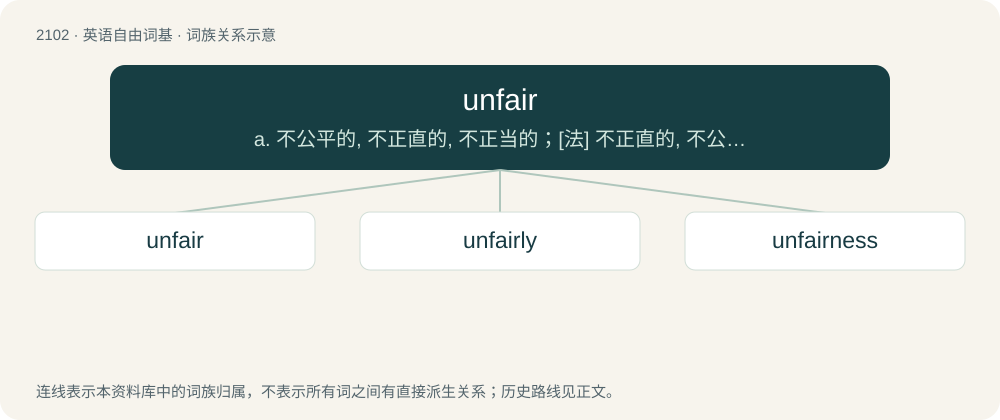

# 2210 · unfair — a. 不公平的, 不正直的, 不正当的；\[法\] 不正直的, 不公平的, 偏颇的

[总目录](../00_总目录_按常用程度.md)

**类型**：英语自由词基　｜　**来源语言**：见词源记录

## 核心含义与来源

- 核心含义：a. 不公平的, 不正直的, 不正当的；\[法\] 不正直的, 不公平的, 偏颇的
- 英文含义：Not just.
- 词形：unfair

**来源记录 1**（形容词；Not just.）

From Middle English unfair (“unattractive, unseemly”), from Old English unfæġer (“ugly”), equivalent to un- + fair.

## 词族图

## 单词速览（常用到不常用）

| 单词 | 音标 | 释义 |
|---|---|---|
| [unfair](#w-1) | 英 /ʌnˈfɛə(ɹ)/；美 /ʌnˈfɛɚ/ | a. 不公平的, 不正直的, 不正当的；\[法\] 不正直的, 不公平的, 偏颇的 |
| [unfairly](#w-2) |  | adv. 不正当地；不公平地 |
| [unfairness](#w-3) | 英 /ʌnˈfɛənəs/；美 /ʌnˈfɛɚnəs/ | \[法\] 不公平, 不公正, 不正当 |

## 逐词详解

### 1. unfair

**词性**：形容词　｜　**音标**：英 /ʌnˈfɛə(ɹ)/；美 /ʌnˈfɛɚ/

**中文释义**：a. 不公平的, 不正直的, 不正当的；\[法\] 不正直的, 不公平的, 偏颇的

**英文义项**：Not just.

**构词拆分**：un- + fair

**词源与演化**：

From Middle English unfair (“unattractive, unseemly”), from Old English unfæġer (“ugly”), equivalent to un- + fair.

**例句**：

> It was unfair for the boss to give larger bonuses to his friends.

该用例对应义项：Not just.

### 2. unfairly

**词性**：副词

**中文释义**：adv. 不正当地；不公平地

**英文义项**：In a manner that is unfair.

**构词拆分**：unfair + -ly；un- + fairly

**词源与演化**：

From unfair + -ly or un- + fairly.

**例句**：

> The carnival games were unfairly difficult, and hardly anybody won a prize.

该用例对应义项：In a manner that is unfair.

### 3. unfairness

**词性**：名词　｜　**音标**：英 /ʌnˈfɛənəs/；美 /ʌnˈfɛɚnəs/

**中文释义**：\[法\] 不公平, 不公正, 不正当

**英文义项**：The state of being unfair; lack of justice. / An unjust act or situation.

**构词拆分**：unfair + -ness

**词源与演化**：

From unfair + -ness.

**例句**：

> We're confronted with unfairness on a daily basis.
