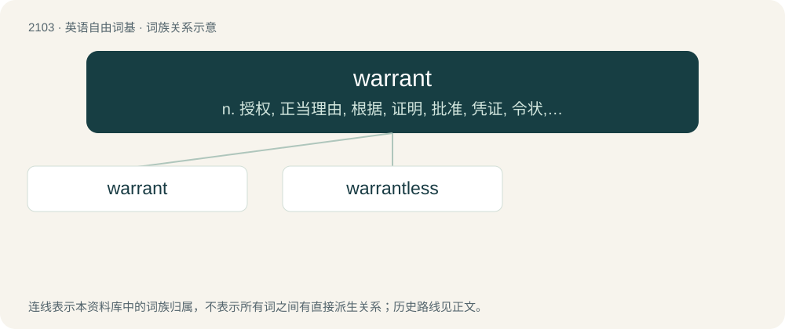

# 2211 · warrant — n. 授权, 正当理由, 根据, 证明, 批准, 凭证, 令状, 委任状；vt. 授权给, 保证, 担保, 批准, 使有正当理由

[总目录](../00_总目录_按常用程度.md)

**类型**：英语自由词基　｜　**来源语言**：见词源记录

## 核心含义与来源

- 核心含义：n. 授权, 正当理由, 根据, 证明, 批准, 凭证, 令状, 委任状；vt. 授权给, 保证, 担保, 批准, 使有正当理由
- 英文含义：Authorization or certification; a sanction, as given by a superior.
- 词形：warrant

**来源记录 1**（名词；Authorization or certification; a sanction, as given by a superior.）

The noun is derived from Middle English warant (“protector; guard, shield, protection”), from Anglo-Norman warrant, Old Northern French warant, warand, a variant of Old French guarant, garant, garand (“assurance, guarantee; authorization, permission; protector; protection, safety”) (modern French garant), from Frankish \*warand, present participle of \*warjan (“to fend off; to stop, thwart”). The word is cognate with Old High German werento (“guarantor”). The verb is derived from Middle English warrant, waranten (“to give protection; to protect, shield; to assure, pledge, promise; to guarantee”), from Anglo-Norman warantir, warandir, warentir, and Old Northern French warandir, warantir, variant forms of Old French guarantir (“to protect”) (modern French garantir), a Romance formation from the noun guarant: see above.

## 词族图

## 单词速览（常用到不常用）

| 单词 | 音标 | 释义 |
|---|---|---|
| [warrant](#w-1) | 英 /ˈwɒɹənt/；美 /ˈwɔɹənt/ | n. 授权, 正当理由, 根据, 证明, 批准, 凭证, 令状, 委任状；vt. 授权给, 保证, 担保, 批准, 使有正当理由 |
| [warrantless](#w-2) | 英 /ˈwɒɹəntləs/ | a. warrant的变形；无保证的；未经授权的；无法辩解的；不正当的 |

## 逐词详解

### 1. warrant

**词性**：名词　｜　**音标**：英 /ˈwɒɹənt/；美 /ˈwɔɹənt/

**中文释义**：n. 授权, 正当理由, 根据, 证明, 批准, 凭证, 令状, 委任状；vt. 授权给, 保证, 担保, 批准, 使有正当理由

**英文义项**：Authorization or certification; a sanction, as given by a superior. / Something that provides assurance or confirmation; a guarantee or proof.

**词源与演化**：

The noun is derived from Middle English warant (“protector; guard, shield, protection”), from Anglo-Norman warrant, Old Northern French warant, warand, a variant of Old French guarant, garant, garand (“assurance, guarantee; authorization, permission; protector; protection, safety”) (modern French garant), from Frankish \*warand, present participle of \*warjan (“to fend off; to stop, thwart”). The word is cognate with Old High German werento (“guarantor”). The verb is derived from Middle English warrant, waranten (“to give protection; to protect, shield; to assure, pledge, promise; to guarantee”), from Anglo-Norman warantir, warandir, warentir, and Old Northern French warandir, warantir, variant forms of Old French guarantir (“to protect”) (modern French garantir), a Romance formation from the noun guarant: see above.

**用法示例／搭配（非完整句）**：

> a warrant of authenticity; a warrant for success

该用例对应义项：Something that provides assurance or confirmation; a guarantee or proof.

### 2. warrantless

**词性**：形容词　｜　**音标**：英 /ˈwɒɹəntləs/

**中文释义**：a. warrant的变形；无保证的；未经授权的；无法辩解的；不正当的

**英文义项**：Of a search, arrest, etc. executed without a warrant. / Synonym of unwarranted.

**构词拆分**：warrant + -less

**词源与演化**：

From warrant + -less.
