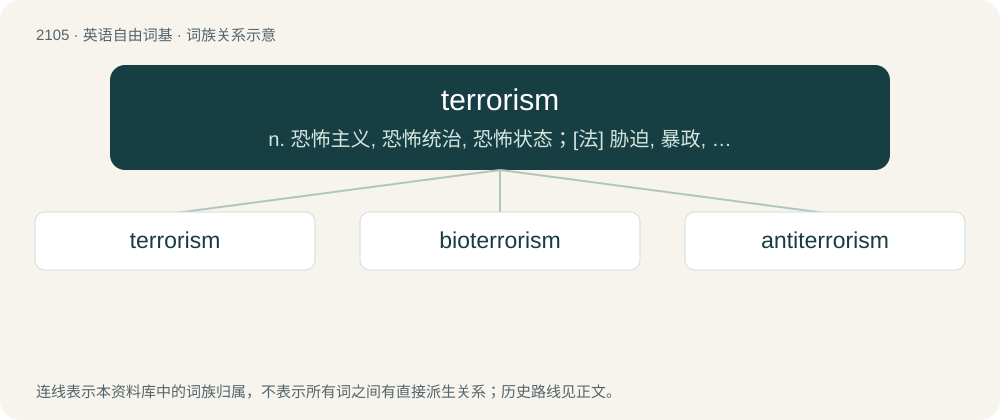

# 2213 · terrorism — n. 恐怖主义, 恐怖统治, 恐怖状态；\[法\] 胁迫, 暴政, 恐怖政治

[总目录](../00_总目录_按常用程度.md)

**类型**：英语自由词基　｜　**来源语言**：见词源记录

## 核心含义与来源

- 核心含义：n. 恐怖主义, 恐怖统治, 恐怖状态；\[法\] 胁迫, 暴政, 恐怖政治
- 英文含义：The use of unlawful violence against people or property to achieve political objectives.
- 词形：terrorism

**来源记录 1**（名词；The use of unlawful violence against people or property to achieve political objectives.）

From French terrorisme, from terreur + -isme. By surface analysis, terror + -ism. The word first appears in English in 1795 in reference to the Jacobin radicals of France, who ruled during the Reign of Terror.

## 词族图

## 单词速览（常用到不常用）

| 单词 | 音标 | 释义 |
|---|---|---|
| [terrorism](#w-1) | /ˈtɛɹəɹɪzəm/ | n. 恐怖主义, 恐怖统治, 恐怖状态；\[法\] 胁迫, 暴政, 恐怖政治 |
| [bioterrorism](#w-2) | /ˌbaɪəʊˈterəˌrɪzəm/ | n. 生物恐怖活动 |
| [antiterrorism](#w-3) | /,æntiˈterərizəm/ | n. 反恐怖主义 |

## 逐词详解

### 1. terrorism

**词性**：名词　｜　**音标**：/ˈtɛɹəɹɪzəm/

**中文释义**：n. 恐怖主义, 恐怖统治, 恐怖状态；\[法\] 胁迫, 暴政, 恐怖政治

**英文义项**：The use of unlawful violence against people or property to achieve political objectives. / The use of intimidation or bullying tactics.

**构词拆分**：By surface analysis, terror + -ism

**词源与演化**：

From French terrorisme, from terreur + -isme. By surface analysis, terror + -ism. The word first appears in English in 1795 in reference to the Jacobin radicals of France, who ruled during the Reign of Terror.

**例句**：

> We consider cyber terrorism to pose a serious threat to international security.

### 2. bioterrorism

**词性**：名词　｜　**音标**：/ˌbaɪəʊˈterəˌrɪzəm/

**中文释义**：n. 生物恐怖活动

**英文义项**：Terrorism that involves biological weapons or other biological agents.

**构词拆分**：bio- + terrorism

**词源与演化**：

From bio- + terrorism.

### 3. antiterrorism

**词性**：名词　｜　**音标**：/,æntiˈterərizəm/

**中文释义**：n. 反恐怖主义

**英文义项**：Activity aiming at opposing or preventing terrorism.

**构词拆分**：anti- + terrorism

**词源与演化**：

From anti- + terrorism.

**例句**：

> Antiterrorism funding was increased after 2001.

该用例对应义项：Activity aiming at opposing or preventing terrorism.
