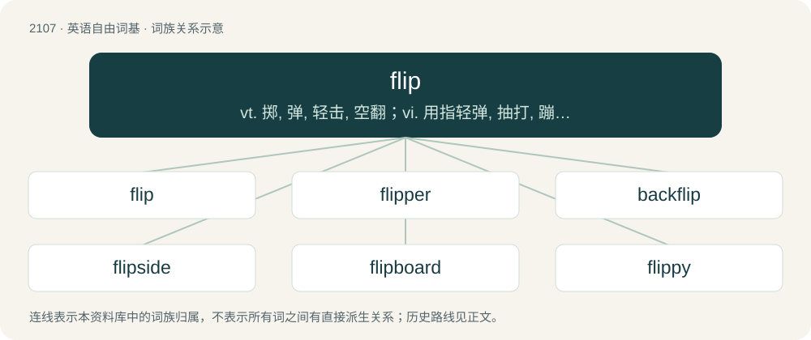

# 2215 · flip — vt. 掷, 弹, 轻击, 空翻；vi. 用指轻弹, 抽打, 蹦跳；n. 抛, 弹, 筋斗

[总目录](../00_总目录_按常用程度.md)

**类型**：英语自由词基　｜　**来源语言**：见词源记录

## 核心含义与来源

- 核心含义：vt. 掷, 弹, 轻击, 空翻；vi. 用指轻弹, 抽打, 蹦跳；n. 抛, 弹, 筋斗
- 英文含义：A maneuver which rotates an object end over end.
- 词形：flip

**多个词源／构词路径**：同一拼写可能有不同来源；以下按词性和含义分别列出。

**来源记录 1**（名词；A maneuver which rotates an object end over end.）

Alteration of earlier fillip, from Middle English filippen (“to make a signal or sound with thumb and right forefinger, snap the fingers”), an attenuated variation of flappen (“to flap, clap, slap, strike”). Cognate with Dutch flappen (“to flap”), German flappen (“to flap”).

**来源记录 2**（感叹词；Used to express annoyance, especially when the speaker has made an error.）

Non-vulgar euphemism for fuck.

**来源记录 3**（形容词；Having the quality of playfulness, or lacking seriousness of purpose.）

Clipping of flippant.

**来源记录 4**（名词；A mixture of beer, spirit, etc., stirred and heated by a hot iron (a “flip dog”).）

Compare English dialect flip (“nimble, flippant, also, a slight blow”).

## 词族图

## 单词速览（常用到不常用）

| 单词 | 音标 | 释义 |
|---|---|---|
| [flip](#w-1) | /flɪp/ | vt. 掷, 弹, 轻击, 空翻；vi. 用指轻弹, 抽打, 蹦跳；n. 抛, 弹, 筋斗 |
| [flipper](#w-2) | 英 /ˈflɪpə/；美 /ˈflɪpɚ/ | n. 鳍状肢, (潜水用)脚蹼；\[化\] 挡泥板 |
| [backflip](#w-3) | /ˈbæk.flɪp/ | n. 后翻式；后滚翻；倒翻筋斗；vi. 后空翻；表演后空翻 |
| [flipside](#w-4) | 英 /ˈflɪpˌsaɪd/ | n. 另一面；反面 |
| [flipboard](#w-5) |  | 【英文】A set of cards hinged together on an easel, used in making presentations. |
| [flippy](#w-6) | /ˈflɪpi/ | a. 宽松式喇叭形的 |

## 逐词详解

### 1. flip

**词性**：名词　｜　**音标**：/flɪp/

**中文释义**：vt. 掷, 弹, 轻击, 空翻；vi. 用指轻弹, 抽打, 蹦跳；n. 抛, 弹, 筋斗

**英文义项**：A maneuver which rotates an object end over end. / A complete change of direction, decision, movement etc.

**词源与演化**：

Alteration of earlier fillip, from Middle English filippen (“to make a signal or sound with thumb and right forefinger, snap the fingers”), an attenuated variation of flappen (“to flap, clap, slap, strike”). Cognate with Dutch flappen (“to flap”), German flappen (“to flap”).

**例句**：

> Justin Bieber and Zac Efron are among the celebrities who wore a flip.

该用例对应义项：A hairstyle popular among boys in the 1960s–70s and 2000s–10s, in which the hair goes halfway down the ears, at which point it sticks out

### 2. flipper

**词性**：名词　｜　**音标**：英 /ˈflɪpə/；美 /ˈflɪpɚ/

**中文释义**：n. 鳍状肢, (潜水用)脚蹼；\[化\] 挡泥板

**英文义项**：In marine mammals such as whales (or other secondarily aquatic animals such as sea turtles), a wide, flat limb adapted for swimming. / A wide, flat, paddle-like rubber covering for the foot, used in swimming.

**构词拆分**：flip + -er

**词源与演化**：

From flip + -er. Compare Saterland Frisian Flappert (“flipper, wing”).

**例句**：

> Those fish keep charging me and snapping at my flipper.

### 3. backflip

**词性**：名词　｜　**音标**：/ˈbæk.flɪp/

**中文释义**：n. 后翻式；后滚翻；倒翻筋斗；vi. 后空翻；表演后空翻

**英文义项**：An act of rotating one's body 360 degrees in the backward direction. / A total reversal in policy or opinion.

**构词拆分**：back- + flip

**词源与演化**：

From back- + flip.

**例句**：

> The gymnast performed a backflip on a trampoline.

该用例对应义项：An act of rotating one's body 360 degrees in the backward direction.

### 4. flipside

**词性**：名词　｜　**音标**：英 /ˈflɪpˌsaɪd/

**中文释义**：n. 另一面；反面

**英文义项**：The reverse, in contrast to the obverse. / The B-side of a phonograph record.

**构词拆分**：flip + side

**词源与演化**：

From flip + side.

**例句**：

> Walking to work is definitely healthier – on the flipside, though, it takes twice as long.

该用例对应义项：A necessary consequence or corollary of something that acts as a negation or counterbalance; especially one seen as opposite, or as pro versus con.

### 5. flipboard

**词性**：名词

**英文义项**：A set of cards hinged together on an easel, used in making presentations.

**构词拆分**：flip + board

**词源与演化**：

From flip + board.

### 6. flippy

**词性**：形容词　｜　**音标**：/ˈflɪpi/

**中文释义**：a. 宽松式喇叭形的

**英文义项**：Having a tendency to flip.

**构词拆分**：flip + -y

**词源与演化**：

From flip + -y.
