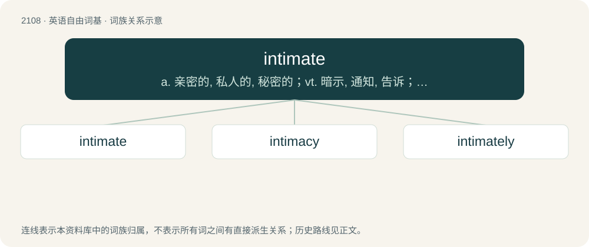

# 2216 · intimate — a. 亲密的, 私人的, 秘密的；vt. 暗示, 通知, 告诉；n. 至交

[总目录](../00_总目录_按常用程度.md)

**类型**：英语自由词基　｜　**来源语言**：见词源记录

## 核心含义与来源

- 核心含义：a. 亲密的, 私人的, 秘密的；vt. 暗示, 通知, 告诉；n. 至交
- 英文含义：Closely acquainted; familiar.
- 词形：intimate

**多个词源／构词路径**：同一拼写可能有不同来源；以下按词性和含义分别列出。

**来源记录 1**（形容词；Closely acquainted; familiar.）

Borrowed from Latin intimātus, the perfect passive participle of intimō (“to put or bring into, to impress, to make familiar”) (see -ate (adjective forming suffix)), from intimus (“inmost, innermost, most intimate”), superlative of intus (“within”), from in (“in”); see interior.

**来源记录 2**（名词；A very close friend.）

From a substantivization of the above adjective, see -ate (noun-forming suffix) and Etymology 1 for more.

**来源记录 3**（动词；To suggest or disclose (something) discreetly.）

From Latin intimātus, see -ate (verb-forming suffix) and Etymology 1 for more. Cognate with French intimer.

## 词族图

## 单词速览（常用到不常用）

| 单词 | 音标 | 释义 |
|---|---|---|
| [intimate](#w-1) | /ˈɪn.tɪ.mət/ | a. 亲密的, 私人的, 秘密的；vt. 暗示, 通知, 告诉；n. 至交 |
| [intimacy](#w-2) | /ˈɪn.tɪ.mə.si/ | n. 亲密, 熟悉, 亲昵行为(言语)；\[法\] 亲近的行为, 亲密, 隐私 |
| [intimately](#w-3) | /ˈɪntɪmətli/ | adv. 亲切地, 亲密地, 个人性地 |

## 逐词详解

### 1. intimate

**词性**：形容词　｜　**音标**：/ˈɪn.tɪ.mət/

**中文释义**：a. 亲密的, 私人的, 秘密的；vt. 暗示, 通知, 告诉；n. 至交

**英文义项**：Closely acquainted; familiar. / Personal; private.

**词源与演化**：

Borrowed from Latin intimātus, the perfect passive participle of intimō (“to put or bring into, to impress, to make familiar”) (see -ate (adjective forming suffix)), from intimus (“inmost, innermost, most intimate”), superlative of intus (“within”), from in (“in”); see interior.

**例句**：

> Black powder consists of an intimate mixture of potassium nitrate, charcoal, and sulfur.

该用例对应义项：Very finely mixed.

### 2. intimacy

**词性**：名词　｜　**音标**：/ˈɪn.tɪ.mə.si/

**中文释义**：n. 亲密, 熟悉, 亲昵行为(言语)；\[法\] 亲近的行为, 亲密, 隐私

**英文义项**：Feeling or atmosphere of closeness and openness towards someone else, often but not necessarily involving sexuality. / Intimate relationship.

**构词拆分**：From intim(ate) + -acy.

**词源与演化**：

From intim(ate) + -acy.

**例句**：

> He often hastens physical intimacy, much to the chagrin of his dates.

### 3. intimately

**词性**：副词　｜　**音标**：/ˈɪntɪmətli/

**中文释义**：adv. 亲切地, 亲密地, 个人性地

**英文义项**：In an intimate manner.

**构词拆分**：intimate + -ly

**词源与演化**：

From intimate + -ly.

**例句**：

> The two phenomena are intimately connected.

该用例对应义项：in a close manner
