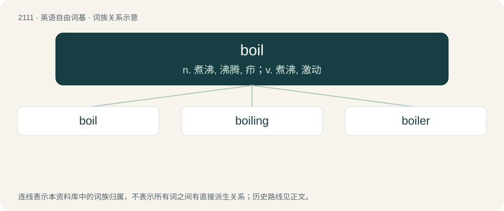

# 2218 · boil — n. 煮沸, 沸腾, 疖；v. 煮沸, 激动

[总目录](../00_总目录_按常用程度.md)

**类型**：英语自由词基　｜　**来源语言**：见词源记录

## 核心含义与来源

- 核心含义：n. 煮沸, 沸腾, 疖；v. 煮沸, 激动
- 英文含义：A localized accumulation of pus in the skin, resulting from infection.
- 词形：boil

**多个词源／构词路径**：同一拼写可能有不同来源；以下按词性和含义分别列出。

**来源记录 1**（名词；A localized accumulation of pus in the skin, resulting from infection.）

From Middle English bile, büle (“boil, tumor”), from Old English bȳl, bȳle (“boil, swelling”), from Proto-Germanic \*būlijō, \*būlō (“boil”). Akin to Dutch buil (“boil, swelling”), German Beule (“boil, hump”), Icelandic beyla (“swelling, hump”). The expected form is bile; the rounding of the diphthong could be caused by the initial b- and/or by association with etymology 2.

**来源记录 2**（名词；The point at which fluid begins to change to a vapour; the boiling point.）

From Middle English boillen, from Old French boillir (see French bouillir) from Latin bullīre (“to bubble, boil”), from bulla (“bubble”). Displaced native Old English weallan (intransitive) and wiellan (transitive). More at wall, well.

## 词族图

## 单词速览（常用到不常用）

| 单词 | 音标 | 释义 |
|---|---|---|
| [boil](#w-1) | 英 /bɔɪ(ə)l/ | n. 煮沸, 沸腾, 疖；v. 煮沸, 激动 |
| [boiling](#w-2) | 英 /ˈbɔɪlɪŋ/ | a. 沸腾的, 激昂的；adv. 沸腾 |
| [boiler](#w-3) | 英 /ˈbɔɪlə/；美 /ˈbɔɪlɚ/ | n. 煮器, 汽锅, 锅炉；\[化\] 锅炉 |

## 逐词详解

### 1. boil

**词性**：名词　｜　**音标**：英 /bɔɪ(ə)l/

**中文释义**：n. 煮沸, 沸腾, 疖；v. 煮沸, 激动

**英文义项**：A localized accumulation of pus in the skin, resulting from infection.

**词源与演化**：

From Middle English bile, büle (“boil, tumor”), from Old English bȳl, bȳle (“boil, swelling”), from Proto-Germanic \*būlijō, \*būlō (“boil”). Akin to Dutch buil (“boil, swelling”), German Beule (“boil, hump”), Icelandic beyla (“swelling, hump”). The expected form is bile; the rounding of the diphthong could be caused by the initial b- and/or by association with etymology 2.

**例句**：

> The water will come to a boil in 5 minutes or so.

### 2. boiling

**词性**：形容词　｜　**音标**：英 /ˈbɔɪlɪŋ/

**中文释义**：a. 沸腾的, 激昂的；adv. 沸腾

**英文义项**：That boils or boil. / Of a thing: extremely hot or active.

**构词拆分**：boil + -ing

**词源与演化**：

From boil + -ing.

**例句**：

> The radiator is boiling – I’m going to turn it down a bit.

该用例对应义项：Of a thing: extremely hot or active.

### 3. boiler

**词性**：名词　｜　**音标**：英 /ˈbɔɪlə/；美 /ˈbɔɪlɚ/

**中文释义**：n. 煮器, 汽锅, 锅炉；\[化\] 锅炉

**英文义项**：A person who boils something. / A steam boiler.

**构词拆分**：boil + -er

**词源与演化**：

From boil + -er.

**例句**：

> I'm afraid I got too carried away throwing passengers into the boiler.
