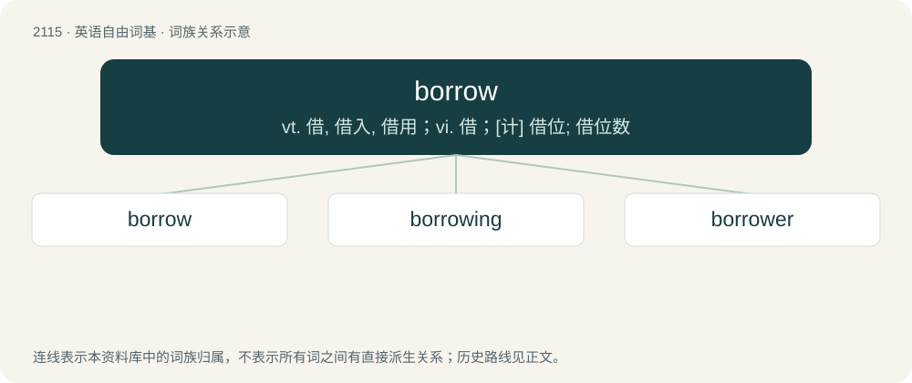

# 2220 · borrow — vt. 借, 借入, 借用；vi. 借；\[计\] 借位; 借位数

[总目录](../00_总目录_按常用程度.md)

**类型**：英语自由词基　｜　**来源语言**：见词源记录

## 核心含义与来源

- 核心含义：vt. 借, 借入, 借用；vi. 借；\[计\] 借位; 借位数
- 英文含义：To receive (something) from somebody temporarily, expecting to return it.
- 词形：borrow

**来源记录 1**（动词；To receive (something) from somebody temporarily, expecting to return it.）

From Middle English borwen, from Old English borgian (“to borrow, lend, pledge surety for”), from Proto-West Germanic \*borgōn, from Proto-Germanic \*burgōną (“to pledge, take care of”), from Proto-Indo-European \*bʰergʰ- (“to take care”). Cognate with Dutch borgen (“to borrow, trust”), German borgen (“to borrow, lend”), Danish borge (“to vouch”). Related to Old English beorgan (“to save, preserve”). More at bury.

## 词族图

## 单词速览（常用到不常用）

| 单词 | 音标 | 释义 |
|---|---|---|
| [borrow](#w-1) | 英 /ˈbɒɹəʊ/；美 /ˈbɑɹ.oʊ/ | vt. 借, 借入, 借用；vi. 借；\[计\] 借位; 借位数 |
| [borrowing](#w-2) | /ˈbɔrəwɪŋ/ | \[经\] 借款, 贷款 |
| [borrower](#w-3) | 英 /ˈbɔɹəʊə/；美 /ˈbɑɹoʊɚ/ | n. 借用人, 剽窃者；\[经\] 借款人, 借用人 |

## 逐词详解

### 1. borrow

**词性**：动词　｜　**音标**：英 /ˈbɒɹəʊ/；美 /ˈbɑɹ.oʊ/

**中文释义**：vt. 借, 借入, 借用；vi. 借；\[计\] 借位; 借位数

**英文义项**：To receive (something) from somebody temporarily, expecting to return it. / To receive money from a bank or other lender under the agreement that the lender will be paid back over time.

**词源与演化**：

From Middle English borwen, from Old English borgian (“to borrow, lend, pledge surety for”), from Proto-West Germanic \*borgōn, from Proto-Germanic \*burgōną (“to pledge, take care of”), from Proto-Indo-European \*bʰergʰ- (“to take care”). Cognate with Dutch borgen (“to borrow, trust”), German borgen (“to borrow, lend”), Danish borge (“to vouch”). Related to Old English beorgan (“to save, preserve”). More at bury.

**例句**：

> John, can I borrow you for a second? I need your help with the copier.

该用例对应义项：To interrupt the current activity of (a person) and lead them away in order to speak with them, get their help, etc.

### 2. borrowing

**词性**：动词　｜　**音标**：/ˈbɔrəwɪŋ/

**中文释义**：\[经\] 借款, 贷款

**英文义项**：Shoplifting.

**构词拆分**：borrow + -ing

**词源与演化**：

From borrow + -ing.

**例句**：

> Corporate borrowing from financial institutions is rising due to the low interest rate.

### 3. borrower

**词性**：名词　｜　**音标**：英 /ˈbɔɹəʊə/；美 /ˈbɑɹoʊɚ/

**中文释义**：n. 借用人, 剽窃者；\[经\] 借款人, 借用人

**英文义项**：One who borrows.

**构词拆分**：borrow + -er (agent suffix)

**词源与演化**：

From Middle English borower, borewer, borwere, equivalent to borrow + -er (agent suffix).

**用法示例／搭配（非完整句）**：

> a library borrower’s card

该用例对应义项：One who borrows.
