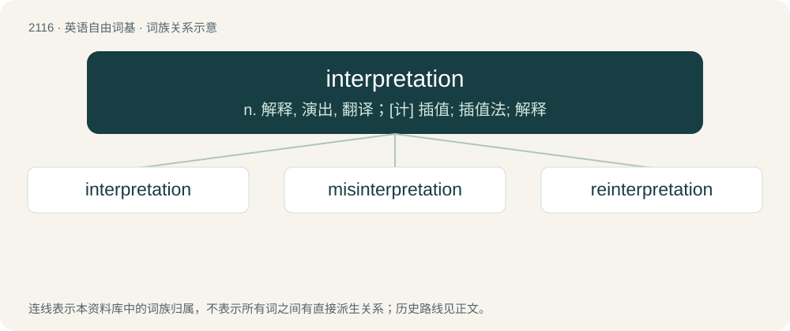

# 2221 · interpretation — n. 解释, 演出, 翻译；\[计\] 插值; 插值法; 解释

[总目录](../00_总目录_按常用程度.md)

**类型**：英语自由词基　｜　**来源语言**：见词源记录

## 核心含义与来源

- 核心含义：n. 解释, 演出, 翻译；\[计\] 插值; 插值法; 解释
- 英文含义：An act of interpreting or explaining something unclear; a translation; a version.
- 词形：interpretation

**来源记录 1**（名词；An act of interpreting or explaining something unclear; a translation; a version.）

From Middle English interpretacioun, from the Anglo-Norman form of Old French interpretacion, from Latin interpretātiō, noun of action from interpretor (“to explain, expound, interpret, understand, conclude, infer, comprehend”). Morphologically interpret + -ation.

## 词族图

## 单词速览（常用到不常用）

| 单词 | 音标 | 释义 |
|---|---|---|
| [interpretation](#w-1) | 英 /ɪnˌtɜːpɹəˈteɪʃən/；美 /ɪnˌtɝpɹəˈteɪʃən/ | n. 解释, 演出, 翻译；\[计\] 插值; 插值法; 解释 |
| [misinterpretation](#w-2) | /ˈmisin,təːpriˈteiʃən/ | \[计\] 错误判断 |
| [reinterpretation](#w-3) | /ˌriːɪnˌtɜːprɪˈteɪʃn/ | 重新解释, 纠正性说明 |

## 逐词详解

### 1. interpretation

**词性**：名词　｜　**音标**：英 /ɪnˌtɜːpɹəˈteɪʃən/；美 /ɪnˌtɝpɹəˈteɪʃən/

**中文释义**：n. 解释, 演出, 翻译；\[计\] 插值; 插值法; 解释

**英文义项**：An act of interpreting or explaining something unclear; a translation; a version. / A sense given by an interpreter; an exposition or explanation given; meaning.

**构词拆分**：interpret + -ation

**词源与演化**：

From Middle English interpretacioun, from the Anglo-Norman form of Old French interpretacion, from Latin interpretātiō, noun of action from interpretor (“to explain, expound, interpret, understand, conclude, infer, comprehend”). Morphologically interpret + -ation.

**例句**：

> Commentators give various interpretations of the same passage of Scripture.

该用例对应义项：A sense given by an interpreter; an exposition or explanation given; meaning.

### 2. misinterpretation

**词性**：名词　｜　**音标**：/ˈmisin,təːpriˈteiʃən/

**中文释义**：\[计\] 错误判断

**英文义项**：An instance of misinterpreting.

**构词拆分**：mis- + interpretation；misinterpret + -ation

**词源与演化**：

From mis- + interpretation or misinterpret + -ation.

**例句**：

> It appears there was a misinterpretation on your part.

### 3. reinterpretation

**词性**：名词　｜　**音标**：/ˌriːɪnˌtɜːprɪˈteɪʃn/

**中文释义**：重新解释, 纠正性说明

**英文义项**：the condition of being reinterpreted / a new interpretation

**构词拆分**：re- + interpretation

**词源与演化**：

From re- + interpretation.
