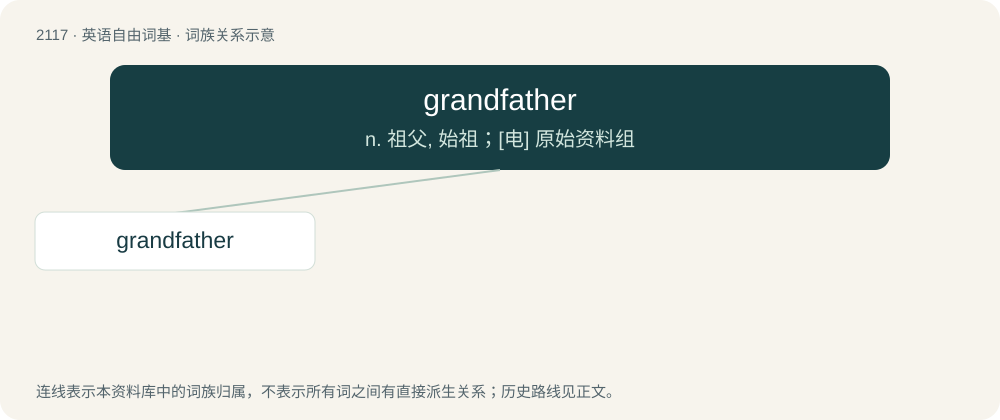

# 2222 · grandfather — n. 祖父, 始祖；\[电\] 原始资料组

[总目录](../00_总目录_按常用程度.md)

**类型**：英语自由词基　｜　**来源语言**：见词源记录

## 核心含义与来源

- 核心含义：n. 祖父, 始祖；\[电\] 原始资料组
- 英文含义：A father of someone's parent.
- 词形：grandfather

**多个词源／构词路径**：同一拼写可能有不同来源；以下按词性和含义分别列出。

**来源记录 1**（名词；A father of someone's parent.）

The noun is derived from Middle English grandfadre, graundfadir, graunfadir, grauntfader, and other forms, from graunt (“big, large; great, important”) + fā̆der (“male parent, father; remoter male ancestor”), probably modelled after Middle French grandpere, grant pere (“male parent; remoter male ancestor”) (whence French grand-père); the English word is analysable as grand- + father. Superseded earlier eldfather, elderfather. The verb is derived from the noun.

**来源记录 2**（动词；To retain discontinued laws or rules for (an object, individual or organization previously affected by them).）

From grandfather clause: see grandfather (etymology 1) and clause.

## 词族图

## 单词速览（常用到不常用）

| 单词 | 音标 | 释义 |
|---|---|---|
| [grandfather](#w-1) | 英 /ˈɡɹæn(d)ˌfɑːðə(r)/；美 /ˈɡɹæn(d)ˌfɑðɚ/ | n. 祖父, 始祖；\[电\] 原始资料组 |

## 逐词详解

### 1. grandfather

**词性**：名词　｜　**音标**：英 /ˈɡɹæn(d)ˌfɑːðə(r)/；美 /ˈɡɹæn(d)ˌfɑðɚ/

**中文释义**：n. 祖父, 始祖；\[电\] 原始资料组

**英文义项**：A father of someone's parent. / A male forefather.

**构词拆分**：grand- + father

**词源与演化**：

The noun is derived from Middle English grandfadre, graundfadir, graunfadir, grauntfader, and other forms, from graunt (“big, large; great, important”) + fā̆der (“male parent, father; remoter male ancestor”), probably modelled after Middle French grandpere, grant pere (“male parent; remoter male ancestor”) (whence French grand-père); the English word is analysable as grand- + father. Superseded earlier eldfather, elderfather. The verb is derived from the noun.

**例句**：

> My grandfather is fond of taking a walk early in the morning.
