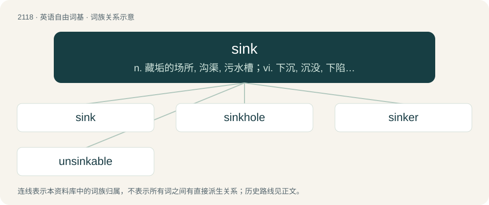

# 2223 · sink — n. 藏垢的场所, 沟渠, 污水槽；vi. 下沉, 沉没, 下陷, 减弱, 衰退, 消沉, 堕落, 渗透；vt. 使低落, 使下沉, 陷于, 投入(资金等), 挖掘

[总目录](../00_总目录_按常用程度.md)

**类型**：英语自由词基　｜　**来源语言**：见词源记录

## 核心含义与来源

- 核心含义：n. 藏垢的场所, 沟渠, 污水槽；vi. 下沉, 沉没, 下陷, 减弱, 衰退, 消沉, 堕落, 渗透；vt. 使低落, 使下沉, 陷于, 投入(资金等), 挖掘
- 英文含义：To descend or submerge (or to cause to do so) into a liquid or similar substance.
- 词形：sink

**来源记录 1**（动词；To descend or submerge (or to cause to do so) into a liquid or similar substance.）

From Middle English synken, from Old English sincan, from Proto-West Germanic \*sinkwan, from Proto-Germanic \*sinkwaną, from Proto-Indo-European \*sengʷ- (“to fall, sink”). Compare West Frisian sinke, Low German sinken, Dutch zinken, German sinken, Danish and Norwegian Bokmål synke, Swedish sjunka. In the causative sense, it replaced Old English senċan (“make sink”) from Proto-Germanic \*sankwijaną.

## 词族图

## 单词速览（常用到不常用）

| 单词 | 音标 | 释义 |
|---|---|---|
| [sink](#w-1) | 英 /ˈsɪŋk/；/ˈsiŋk/ | n. 藏垢的场所, 沟渠, 污水槽；vi. 下沉, 沉没, 下陷, 减弱, 衰退, 消沉, 堕落, 渗透；vt. 使低落, 使下沉, 陷于, 投入(资金等), 挖掘 |
| [sinkhole](#w-2) | 美 /ˈsɪŋkˌhoʊl/ | n. 阴沟口, 污水坑；\[化\] 缩孔 |
| [sinker](#w-3) | /ˈsɪŋkə(ɹ)/ | n. 使下沉的人, 铅锤, 凿井工 |
| [unsinkable](#w-4) | /ˈʌnˈsiŋkəbl/ | a. 不会下沉的, 不会沉底的 |

## 逐词详解

### 1. sink

**词性**：动词　｜　**音标**：英 /ˈsɪŋk/；/ˈsiŋk/

**中文释义**：n. 藏垢的场所, 沟渠, 污水槽；vi. 下沉, 沉没, 下陷, 减弱, 衰退, 消沉, 堕落, 渗透；vt. 使低落, 使下沉, 陷于, 投入(资金等), 挖掘

**英文义项**：To descend or submerge (or to cause to do so) into a liquid or similar substance. / To (directly or indirectly) cause a vessel to sink, generally by making it no longer watertight.

**词源与演化**：

From Middle English synken, from Old English sincan, from Proto-West Germanic \*sinkwan, from Proto-Germanic \*sinkwaną, from Proto-Indo-European \*sengʷ- (“to fall, sink”). Compare West Frisian sinke, Low German sinken, Dutch zinken, German sinken, Danish and Norwegian Bokmål synke, Swedish sjunka. In the causative sense, it replaced Old English senċan (“make sink”) from Proto-Germanic \*sankwijaną.

**例句**：

> A stone sinks in water. The sun gradually sank in the west.

该用例对应义项：To descend or submerge (or to cause to do so) into a liquid or similar substance.

### 2. sinkhole

**词性**：名词　｜　**音标**：美 /ˈsɪŋkˌhoʊl/

**中文释义**：n. 阴沟口, 污水坑；\[化\] 缩孔

**英文义项**：A hole formed in soluble rock by the action of water, serving to conduct surface water to an underground passage. / A depressed area in which waste or drainage collects.

**构词拆分**：sink + hole

**词源与演化**：

From Middle English sinkehole, sinkeholl, equivalent to sink + hole.

**例句**：

> A sinkhole formed under the National Corvette Museum and swallowed eight cars.

### 3. sinker

**词性**：名词　｜　**音标**：/ˈsɪŋkə(ɹ)/

**中文释义**：n. 使下沉的人, 铅锤, 凿井工

**英文义项**：That which sinks or descends. / One who sinks something.

**构词拆分**：sink + -er

**词源与演化**：

From sink + -er.

**例句**：

> His sinkers drew one ground ball after another.

该用例对应义项：Any of several high speed pitches that have a downward motion near the plate; a two-seam fastball, a split-finger fastball, or a forkball.

### 4. unsinkable

**词性**：形容词　｜　**音标**：/ˈʌnˈsiŋkəbl/

**中文释义**：a. 不会下沉的, 不会沉底的

**英文义项**：That cannot be sunk. / That cannot be overcome or defeated.

**构词拆分**：un- + sink + -able

**词源与演化**：

From un- + sink + -able.

**用法示例／搭配（非完整句）**：

> unsinkable optimism

该用例对应义项：That cannot be overcome or defeated.
