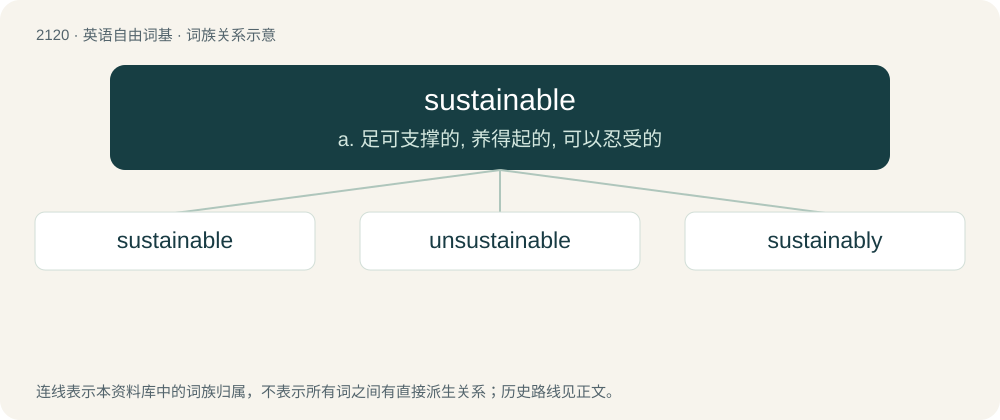

# 2224 · sustainable — a. 足可支撑的, 养得起的, 可以忍受的

[总目录](../00_总目录_按常用程度.md)

**类型**：英语自由词基　｜　**来源语言**：见词源记录

## 核心含义与来源

- 核心含义：a. 足可支撑的, 养得起的, 可以忍受的
- 英文含义：Able to be sustained.
- 词形：sustainable

**来源记录 1**（形容词；Able to be sustained.）

From sustain + -able.

## 词族图

## 单词速览（常用到不常用）

| 单词 | 音标 | 释义 |
|---|---|---|
| [sustainable](#w-1) | /səˈsteɪnəbəl/ | a. 足可支撑的, 养得起的, 可以忍受的 |
| [unsustainable](#w-2) | /,ʌnsəsˈteinəbl/ | a. 无法支撑的, 不能忍受的, 不可证实的；\[法\] 未能证实的, 不能成立的 |
| [sustainably](#w-3) | /səˈsteɪ.nə.bli/ | adv. 支撑得住；能保持住地 |

## 逐词详解

### 1. sustainable

**词性**：形容词　｜　**音标**：/səˈsteɪnəbəl/

**中文释义**：a. 足可支撑的, 养得起的, 可以忍受的

**英文义项**：Able to be sustained. / Able to be produced or sustained for an indefinite period without damaging the environment, or without depleting a resource; renewable.

**构词拆分**：sustain + -able

**词源与演化**：

From sustain + -able.

**用法示例／搭配（非完整句）**：

> sustainable economy

该用例对应义项：Able to be produced or sustained for an indefinite period without damaging the environment, or without depleting a resource; renewable.

### 2. unsustainable

**词性**：形容词　｜　**音标**：/,ʌnsəsˈteinəbl/

**中文释义**：a. 无法支撑的, 不能忍受的, 不可证实的；\[法\] 未能证实的, 不能成立的

**英文义项**：Not sustainable.

**构词拆分**：un- + sustainable

**词源与演化**：

From un- + sustainable.

**例句**：

> This political crisis could lead Algeria to unsustainable situation.

### 3. sustainably

**词性**：副词　｜　**音标**：/səˈsteɪ.nə.bli/

**中文释义**：adv. 支撑得住；能保持住地

**英文义项**：In a sustainable manner.

**构词拆分**：sustainable + -ly

**词源与演化**：

From sustainable + -ly.

**例句**：

> This wood was harvested from a sustainably managed forest.
