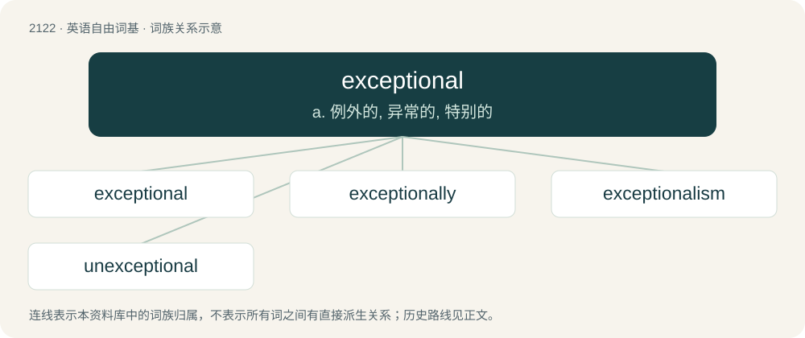

# 2226 · exceptional — a. 例外的, 异常的, 特别的

[总目录](../00_总目录_按常用程度.md)

**类型**：英语自由词基　｜　**来源语言**：见词源记录

## 核心含义与来源

- 核心含义：a. 例外的, 异常的, 特别的
- 英文含义：Forming an exception; not ordinary; uncommon; rare.
- 词形：exceptional

**来源记录 1**（形容词；Forming an exception; not ordinary; uncommon; rare.）

From exception + -al.

## 词族图

## 单词速览（常用到不常用）

| 单词 | 音标 | 释义 |
|---|---|---|
| [exceptional](#w-1) | /ɪkˈsɛpʃənəl/ | a. 例外的, 异常的, 特别的 |
| [exceptionally](#w-2) | /ɪkˈsɛp(t)ʃənəli/ | adv. 特殊地；异常地；例外地 |
| [exceptionalism](#w-3) |  | n. 例外论 |
| [unexceptional](#w-4) | /ˌʌnɪkˈsɛpʃənəl/ | a. 非例外的, 平常的, 不特别的, 不容许有例外的 |

## 逐词详解

### 1. exceptional

**词性**：形容词　｜　**音标**：/ɪkˈsɛpʃənəl/

**中文释义**：a. 例外的, 异常的, 特别的

**英文义项**：Forming an exception; not ordinary; uncommon; rare. / Requiring special schooling for reasons of intellectual giftedness or physical or mental disability.

**构词拆分**：exception + -al

**词源与演化**：

From exception + -al.

**例句**：

> The origins of the conditions and disorders that exceptional learners have are not always well understood.

该用例对应义项：Requiring special schooling for reasons of intellectual giftedness or physical or mental disability.

### 2. exceptionally

**词性**：副词　｜　**音标**：/ɪkˈsɛp(t)ʃənəli/

**中文释义**：adv. 特殊地；异常地；例外地

**英文义项**：To an unusual, remarkable or exceptional degree.

**构词拆分**：exceptional + -ly

**词源与演化**：

From exceptional + -ly.

**例句**：

> In 1957, an exceptionally severe hailstorm struck the village.

该用例对应义项：To an unusual, remarkable or exceptional degree.

### 3. exceptionalism

**词性**：名词

**中文释义**：n. 例外论

**英文义项**：The state of being special, exceptional or unique. / The belief that something (a nation, species etc.) is exceptional, superior, or does not conform to an established norm.

**构词拆分**：exceptional + -ism

**词源与演化**：

From exceptional + -ism.

**例句**：

> Israel will not be able to defend its exceptionalism for ever.

### 4. unexceptional

**词性**：形容词　｜　**音标**：/ˌʌnɪkˈsɛpʃənəl/

**中文释义**：a. 非例外的, 平常的, 不特别的, 不容许有例外的

**英文义项**：Not exceptional.

**构词拆分**：un- + exceptional

**词源与演化**：

From un- + exceptional.

**例句**：

> A unexceptional an incident as can be found in a lawyer's career.

该用例对应义项：not special in any way
