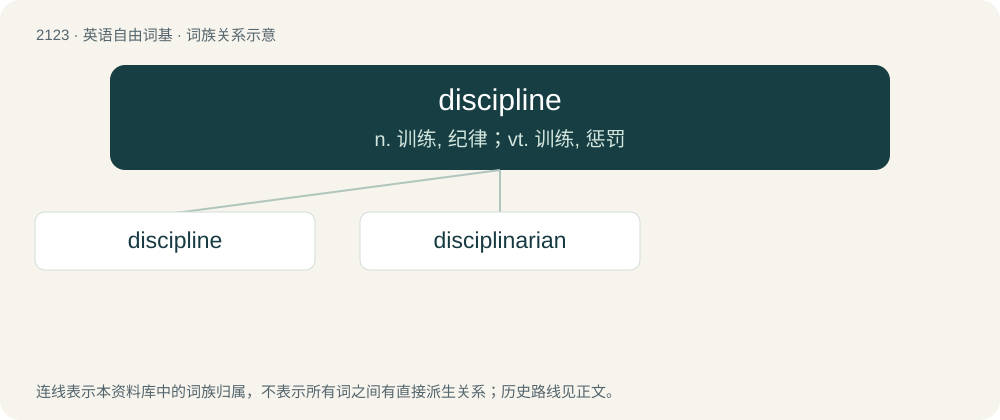

# 2230 · discipline — n. 训练, 纪律；vt. 训练, 惩罚

[总目录](../00_总目录_按常用程度.md)

**类型**：英语自由词基　｜　**来源语言**：见词源记录

## 核心含义与来源

- 核心含义：n. 训练, 纪律；vt. 训练, 惩罚
- 英文含义：A controlled behaviour; self-control.
- 词形：discipline

**来源记录 1**（名词；A controlled behaviour; self-control.）

From Middle English \[Term?\], from Anglo-Norman, from Old French descipline, from Latin disciplina (“instruction”), from discipulus (“pupil”), influenced by disco (“to learn”), from Proto-Indo-European \*dek- (“(cause to) accept”).

## 词族图

## 单词速览（常用到不常用）

| 单词 | 音标 | 释义 |
|---|---|---|
| [discipline](#w-1) | 英 /ˈdɪsɪplɪn/；美 /ˈdɪsəplɪn/ | n. 训练, 纪律；vt. 训练, 惩罚 |
| [disciplinarian](#w-2) | 英 /dɪsɪplɪˈnɛəɹɪən/ | a. 惩戒性的, 纪律的；n. 执行纪律者, 厉行纪律的人 |

## 逐词详解

### 1. discipline

**词性**：名词　｜　**音标**：英 /ˈdɪsɪplɪn/；美 /ˈdɪsəplɪn/

**中文释义**：n. 训练, 纪律；vt. 训练, 惩罚

**英文义项**：A controlled behaviour; self-control. / An enforced compliance or control.

**词源与演化**：

From Middle English \[Term?\], from Anglo-Norman, from Old French descipline, from Latin disciplina (“instruction”), from discipulus (“pupil”), influenced by disco (“to learn”), from Proto-Indo-European \*dek- (“(cause to) accept”).

**用法示例／搭配（非完整句）**：

> academic disciplines

该用例对应义项：A specific branch of knowledge, learning, or practice.

### 2. disciplinarian

**词性**：名词　｜　**音标**：英 /dɪsɪplɪˈnɛəɹɪən/

**中文释义**：a. 惩戒性的, 纪律的；n. 执行纪律者, 厉行纪律的人

**英文义项**：One who exercises discipline. / One who believes in discipline as a tool for regulation or control.

**构词拆分**：discipline + -arian；disciplinary + -an

**词源与演化**：

From discipline + -arian or disciplinary + -an.

**例句**：

> He is the chief disciplinarian in the school.

该用例对应义项：One who exercises discipline.
