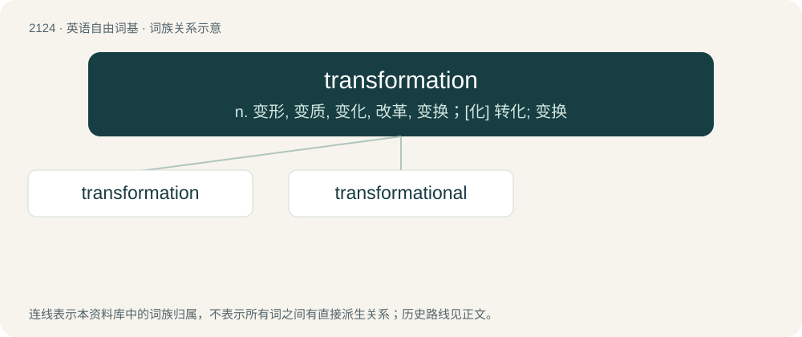

# 2231 · transformation — n. 变形, 变质, 变化, 改革, 变换；\[化\] 转化; 变换

[总目录](../00_总目录_按常用程度.md)

**类型**：英语自由词基　｜　**来源语言**：见词源记录

## 核心含义与来源

- 核心含义：n. 变形, 变质, 变化, 改革, 变换；\[化\] 转化; 变换
- 英文含义：The act of transforming or the state of being transformed.
- 词形：transformation

**来源记录 1**（名词；The act of transforming or the state of being transformed.）

Inherited from Middle English transformacioun, from Middle French, from Ecclesiastical Latin trānsfōrmātiō. Morphologically transform + -ation.

## 词族图

## 单词速览（常用到不常用）

| 单词 | 音标 | 释义 |
|---|---|---|
| [transformation](#w-1) | 英 /ˌtɹæns.fə(ɹ)ˈmeɪ.ʃən/；美 /ˌtɹæns.fɔɹˈmeɪ.ʃən/ | n. 变形, 变质, 变化, 改革, 变换；\[化\] 转化; 变换 |
| [transformational](#w-2) | /,trænsfəˈmeiʃənəl,,trænz-,,trɑːn-/ | \[计\] 变换的 |

## 逐词详解

### 1. transformation

**词性**：名词　｜　**音标**：英 /ˌtɹæns.fə(ɹ)ˈmeɪ.ʃən/；美 /ˌtɹæns.fɔɹˈmeɪ.ʃən/

**中文释义**：n. 变形, 变质, 变化, 改革, 变换；\[化\] 转化; 变换

**英文义项**：The act of transforming or the state of being transformed. / A marked change in appearance or character, especially one for the better.

**构词拆分**：transform + -ation

**词源与演化**：

Inherited from Middle English transformacioun, from Middle French, from Ecclesiastical Latin trānsfōrmātiō. Morphologically transform + -ation.

**用法示例／搭配（非完整句）**：

> undergo a radical transformation

该用例对应义项：The act of transforming or the state of being transformed.

### 2. transformational

**词性**：形容词　｜　**音标**：/,trænsfəˈmeiʃənəl,,trænz-,,trɑːn-/

**中文释义**：\[计\] 变换的

**英文义项**：Of, pertaining to or leading to transformation.

**构词拆分**：From transformation + -al.

**词源与演化**：

From transformation + -al.
