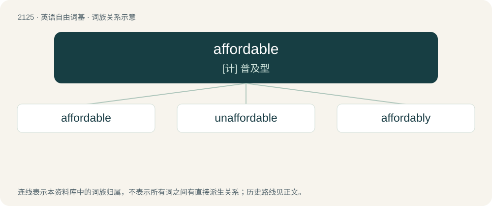

# 2232 · affordable — \[计\] 普及型

[总目录](../00_总目录_按常用程度.md)

**类型**：英语自由词基　｜　**来源语言**：见词源记录

## 核心含义与来源

- 核心含义：\[计\] 普及型
- 英文含义：Able to be afforded; inexpensive or reasonably priced.
- 词形：affordable

**来源记录 1**（形容词；Able to be afforded; inexpensive or reasonably priced.）

From afford + -able.

## 词族图

## 单词速览（常用到不常用）

| 单词 | 音标 | 释义 |
|---|---|---|
| [affordable](#w-1) | 英 /əˈfɔː(ɹ).də.bəl/；美 /əˈfɔɹ.də.bəl/ | \[计\] 普及型 |
| [unaffordable](#w-2) | /ˌʌnəˈfɔːdəbl/ | a. 买不起的, 负担不起的 |
| [affordably](#w-3) | 英 /əˈfɔː(ɹ).də.bli/ | adv. 不太昂贵地 |

## 逐词详解

### 1. affordable

**词性**：形容词　｜　**音标**：英 /əˈfɔː(ɹ).də.bəl/；美 /əˈfɔɹ.də.bəl/

**中文释义**：\[计\] 普及型

**英文义项**：Able to be afforded; inexpensive or reasonably priced.

**构词拆分**：afford + -able

**词源与演化**：

From afford + -able.

**用法示例／搭配（非完整句）**：

> an affordable vacation in the local area

该用例对应义项：Able to be afforded; inexpensive or reasonably priced.

### 2. unaffordable

**词性**：形容词　｜　**音标**：/ˌʌnəˈfɔːdəbl/

**中文释义**：a. 买不起的, 负担不起的

**英文义项**：Too expensive to be afforded.

**构词拆分**：un- + affordable

**词源与演化**：

From un- + affordable.

**例句**：

> Several retailers left the mall due to increasingly unaffordable rent.

### 3. affordably

**词性**：副词　｜　**音标**：英 /əˈfɔː(ɹ).də.bli/

**中文释义**：adv. 不太昂贵地

**英文义项**：In an affordable manner; to an affordable degree

**构词拆分**：affordable + -ly

**词源与演化**：

From affordable + -ly.
